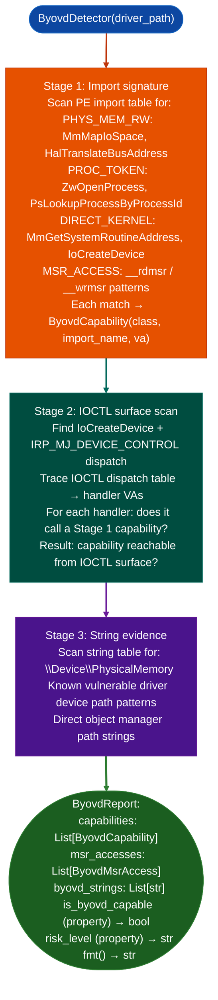

# BYOVD Capability Detection

Detect Bring Your Own Vulnerable Driver (BYOVD) capabilities in Windows kernel drivers: identifying dangerous physical memory R/W, process/token manipulation, and MSR access import patterns that can be used to bypass EDR controls and escalate from userland to kernel-mode execution.

---

## Why this exists

1. **BYOVD attacks load a legitimate, Authenticode-signed driver containing dangerous kernel APIs: `MmMapIoSpace`, `HalTranslateBusAddress`, `ZwOpenProcess`, `IoCreateDevice`, and exploit those APIs through the driver's IOCTL surface to gain kernel-mode capabilities without loading an unsigned driver.** `ByovdDetector` identifies these capability classes statically from imports and string evidence, enabling fast triage of driver files found during firmware or software distribution analysis before PoC effort is invested.

2. **Stage 1 (import signature) catches obvious cases; Stage 2 IOCTL surface scan identifies whether the dangerous capabilities are reachable from the IOCTL dispatch table.** A driver importing `MmMapIoSpace` but never reaching it from a valid IOCTL code is a different risk than one where a specific `IOCTL_CODE` directly calls `MmMapIoSpace` with an attacker-controlled physical address. `ByovdReport.risk_level` accounts for this distinction.

3. **Stage 3 string evidence catches drivers that re-implement dangerous operations via direct Object Manager paths or known vulnerable driver strings.** `\\Device\\PhysicalMemory` in strings indicates direct physical memory access without `MmMapIoSpace`, which imports-only analysis would miss. Known vulnerable driver string patterns (device path signatures from public BYOVD PoCs) are matched in the string table.

---

## How it works



---

## Usage

```python
from ablation.analyzers.byovd_detector import ByovdDetector

detector = ByovdDetector('/path/to/vulnerable_driver.sys')
report = detector.detect()

print(report.fmt())
print(f"BYOVD capable: {report.is_byovd_capable}")
print(f"Risk level: {report.risk_level}")

for cap in report.capabilities:
    print(f"  {cap.fmt()}")

for msr in report.msr_accesses:
    print(f"  MSR access: {msr.fmt()}")
```

---

## Example output

The following illustrates the BYOVD detection output format. Actual addresses and imports are driver-specific.

```
ByovdDetector: vulnerable_driver.sys

Capabilities detected:
  PHYS_MEM_RW   MmMapIoSpace          import at <va>  (IOCTL-reachable: YES)
  PROC_TOKEN    ZwOpenProcess         import at <va>  (IOCTL-reachable: YES)

String evidence:
  "\\Device\\<driver-name>" — known vulnerable device path

is_byovd_capable: True
risk_level: HIGH
```

---

## False positives

**Legitimate kernel drivers may import `MmMapIoSpace` for hardware DMA mapping**: a NIC or storage driver importing `MmMapIoSpace` for DMA is not BYOVD-capable unless the IOCTL surface passes an attacker-controlled physical address. `risk_level` returns `MEDIUM` (not `HIGH`) when Stage 1 detects an import but Stage 2 finds no IOCTL-reachable path, reflecting this distinction.

**Stage 2 IOCTL tracing uses static analysis**: indirect dispatch function pointer tables, virtual dispatch through objects may not be traced to all capability call sites. A `risk_level` of `MEDIUM` from Stage 1 alone warrants manual verification of the IOCTL dispatch table before ruling out BYOVD capability.

---

## Pipeline position

Run `ByovdDetector` as a triage step on any signed Windows kernel driver file found during supply chain, firmware, or endpoint analysis before investing time in IOCTL exploitation research. `is_byovd_capable == True` and `risk_level == 'HIGH'` justifies proceeding to Stage 2 manual IOCTL surface analysis.

---

## Reading output

`ByovdDetector(path).detect()` returns a `ByovdReport`:

| Attribute | Type | Content |
|:---|:---|:---|
| `is_byovd_capable` | property → `bool` | `True` if any BYOVD-relevant capability detected CRITICAL caps, MSR accesses, or known match |
| `risk_level` | property → `str` | `'CRITICAL'` / `'HIGH'` / `'MEDIUM'` / `'NONE'` |
| `capabilities` | `List[ByovdCapability]` | Detected capability list (see `ByovdCapability` fields below) |
| `msr_accesses` | `List[ByovdMsrAccess]` | Detected MSR read/write instructions |
| `byovd_strings` | `List[str]` | Device path or known-vulnerable-driver strings found |
| `known_byovd_match` | `Optional[str]` | Name of matched known-vulnerable driver, or `None` |

`ByovdCapability` fields: `capability_class, api_name, risk, evidence, file_offset`.

---

## See also

- [Windows RPC Server Analysis](rpc-server-analysis.md): unauthenticated RPC interface detection for Windows PE targets
- [Control Flow Guard Review](control-flow-guard-review.md): CFG/XFG bypass detection on Windows PE binaries
- [SEH and SafeSEH Review](seh-and-safeseh-review.md): x86 Structured Exception Handling chain analysis
