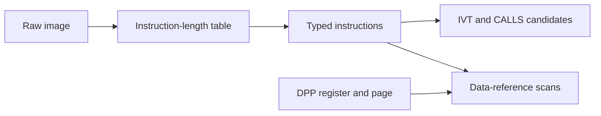

<a id="ecuc166decoder"></a>
# Infineon C166 / C167 ROM Decoding

`EcuC166Decoder` decodes C166-family firmware in pure Python. It recovers variable-width instructions, interrupt vectors, direct call targets, and selected data references without Capstone.

---

## Why this exists

1. Capstone has no C166 decoder. Ablation previously depended on a small opcode subset that could lose alignment or assign the wrong mnemonic to valid instructions.
2. Boot-loaded C166 applications do not always place their vector table at file offset zero. The decoder now accepts arbitrary nonzero image sizes and a caller-selected IVT base.
3. Code segments and DPP data pages have different sizes and address rules. Explicit helpers keep those address domains separate.

---

## How it works

The opcode byte selects a two- or four-byte instruction length. The decoder then handles common moves, arithmetic, comparisons, multiplication, shifts, stack operations, returns, relative branches, absolute calls, and direct or indirect memory forms. Unknown operations remain explicit placeholders.



`function_starts()` scans direct `CALLS` targets. It does not add IVT targets automatically and does not recover indirect calls. Use `parse_ivt()` separately when vector targets are needed.

Power-of-two images retain the original ROM-mirror folding behavior. Other image sizes are accepted without applying a mirror mask. An image may occupy at most the 24-bit C166 physical address space.

---

## EcuC166Decoder

```python
from ablation.analyzers.ecu_c166_decoder import EcuC166Decoder

decoder = EcuC166Decoder.from_path('/path/to/application.bin', base_pa=0)
vectors = decoder.parse_ivt(num_vectors=64, start_pa=0x20000)
insns = decoder.disassemble(0x25EBC, 0x25F00)
```

Important methods:

- `decode_one(byte_off)` and `insn_length(byte_off)` use buffer offsets.
- `disassemble(start_pa, end_pa)` uses physical addresses and returns `C166Insn` objects.
- `parse_ivt()` returns `IVTEntry` objects and defaults to the image base.
- `function_starts()` returns direct `CALLS` target candidates.
- `scan_xram_loads()` and `scan_xram_stores()` find references to a 16-bit data offset.
- `code_pa(seg, addr)` resolves 64 KiB code segments.
- `dpp_pa(offset, dpp)` resolves a 16-bit data offset through a 16 KiB DPP page.
- `dpp_offset(physical_addr, dpp, dpp_index)` recovers a data offset when the DPP register and page value are known.
- `scan_dpp_loads()` applies the same explicit DPP model to a reference scan.

The DPP register index is required because the page value alone cannot recover the top two bits of a 16-bit data pointer.

---

## Usage

Decode a boot-loaded vector table and inspect control flow:

```python
for insn in decoder.disassemble(0x20000, 0x20100):
    if insn.is_call or insn.is_branch:
        print(insn)
```

Find references to physical address `0x1C5E9` through DPP1 with page value 7:

```python
hits = decoder.scan_dpp_loads(0x1C5E9, dpp=7, dpp_index=1)
for hit in hits:
    print(hit)
```

Example output:

```
0x02302A  e6 f9 e9 45  MOV R9, #0x45e9
```

---

## False positives

Linear scanning can interpret data as instructions. Confirm candidate functions against code regions and call evidence. A direct-reference scan can also find an immediate constant that is not a pointer. Validate the surrounding operation before treating it as an address reference.

A power-of-two image size does not prove that ROM mirroring is active. Review the target memory map before relying on folded targets.

---

## Pipeline position

**Before this module:** Use `EcuArchDetector` for an initial ISA hypothesis and identify likely code and data regions.

**After this module:** Review typed instructions, IVT entries, and reference hits during focused C166 analysis. Build a separate CFG or service-path analyzer only after checking decode correctness.

---

## Reading findings

| Field | Content |
|:---|:---|
| `pa` | Physical instruction address |
| `raw` | Original two- or four-byte encoding |
| `mnemonic` | Decoded operation or explicit unknown placeholder |
| `insn_type` | Machine-readable operation class |
| `reg` | Selected register number, when applicable |
| `imm` | Immediate value or direct address, when applicable |
| `target` | Resolved branch or call target, when applicable |
| `is_call` | True for `CALLS` and `CALLA` |
| `is_branch` | True for `JMPS`, `JMPA`, and `JMPR` |

---

## Limitations

- Semantic decoding remains a useful subset, not a complete C166 lifter or decompiler.
- Unknown instructions do not prove invalid code.
- Direct scans do not recover every indirect call or computed data reference.
- Physical addresses, buffer offsets, code segments, and DPP offsets must not be mixed.
- Security-relevant results require byte verification and target-specific memory-map review.

## See also

- [ECU Architecture Detector](ecu-arch-detector.md)
- [Strict Intel HEX Parser](intel-hex.md)
- [TI TMS320C28x Decoding](ecu-c28x-decoder.md)
