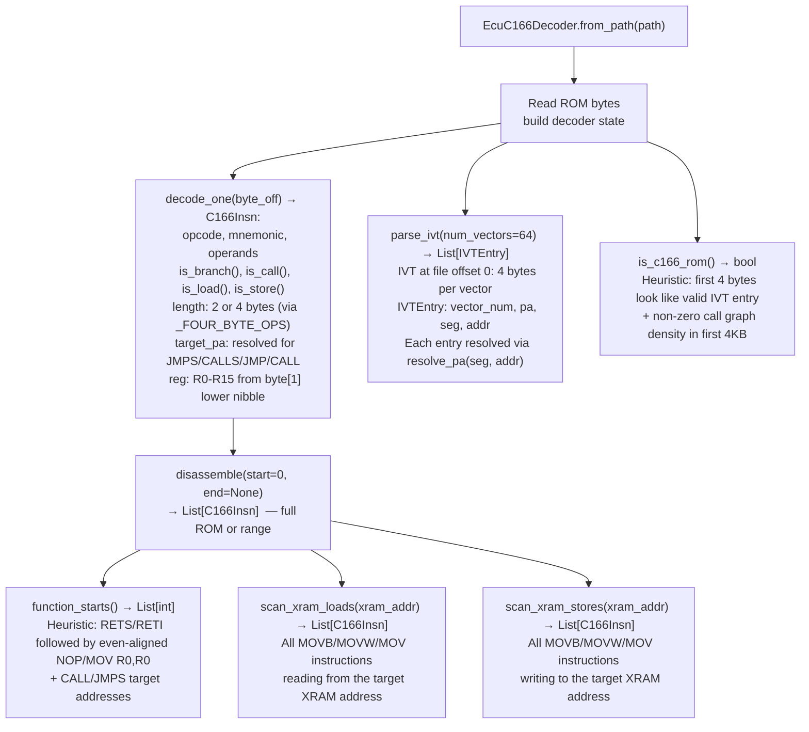

# C166/C167 Decoding

Pure-Python decoder for the Infineon/Siemens C166/C167 16-bit CISC instruction set — covering instruction disassembly, function boundary detection, XRAM access scanning, interrupt vector table parsing, and ROM mirroring resolution for automotive ECU firmware.

---

## Why this exists

1. **The C166/C167 core appears in BMW MS43 (M54 engine), Bosch KW1, Motronic M3.x, and various Daimler/VW ECUs — capstone has no C166 support, so ablation provides its own decoder.** Without a decoder, these ECU ROM images are opaque byte arrays. `EcuC166Decoder` decodes the full C166/C167 instruction set from the Infineon C167CR V1.0 ISA reference, enabling the same semantic analysis pipeline (XRAM access patterns, call graph, IVT parsing) used on other ablation-native ECU targets.

2. **C166/C167 instructions are 2 or 4 bytes — the opcode byte alone determines the length via a lookup table (`_FOUR_BYTE_OPS`), and 9 opcodes are 4-byte while all others are 2-byte.** Correct decode requires precise length determination before advancing the program counter. A wrong length produces a cascade of misaligned instructions. `decode_one()` applies the `_FOUR_BYTE_OPS` set before determining instruction operands, ensuring alignment is never lost.

3. **The C166 24-bit physical address space is split into 8-bit segment and 16-bit offset — `JMPS`/`CALLS` encode both fields, and a 512 KB ROM is typically mirrored across segments 0x00-0x07 and 0x08-0x0F.** `resolve_pa(seg, addr)` computes `(seg * 0x10000 + addr) % rom_size`, which is correct for any power-of-2 ROM size. Without this, cross-segment call targets appear as invalid addresses rather than file offsets.

---

## How it works



---

## Usage

```python
from ablation.analyzers.ecu_c166_decoder import EcuC166Decoder

# Load a C166/C167 ROM image
dec = EcuC166Decoder.from_path('/path/to/ms43.bin')

# Verify it looks like a C166 ROM
if not dec.is_c166_rom():
    print("Warning: ROM fingerprint failed")

# Parse the interrupt vector table
ivt = dec.parse_ivt(num_vectors=64)
for entry in ivt:
    print(f"Vector {entry.vector_num}: PA={entry.pa:#x}  (seg={entry.seg:#04x}, addr={entry.addr:#06x})")

# Find likely function entry points
starts = dec.function_starts()
print(f"Found {len(starts)} function candidates")

# Disassemble a range
insns = dec.disassemble(start=0x1000, end=0x2000)
for insn in insns:
    print(f"  {insn.pa:#08x}  {insn.mnemonic}  {insn.operands}")

# Scan XRAM accesses (find all reads from address 0xF840 — e.g. RPM register)
xram_reads = dec.scan_xram_loads(xram_addr=0xF840)
for insn in xram_reads:
    print(f"  XRAM read at {insn.pa:#08x}: {insn.mnemonic} {insn.operands}")

# Resolve a JMPS/CALLS target
file_offset = dec.resolve_pa(seg=0x00, addr=0x1234)
```

---

## Example output

The following illustrates the disassembly and IVT output format. Actual addresses are ROM-specific.

```
IVT:
  Vector  0: PA=<pa>  (seg=<seg>, addr=<addr>)   ; Reset vector
  Vector  1: PA=<pa>  (seg=<seg>, addr=<addr>)   ; NMI
  ...

Disassembly at <start>:
  <pa>  MOV   R4, #<imm>
  <pa>  CALLS <seg>, <addr>
  <pa>  MOVB  RL0, [R4]
  <pa>  CMPB  RL0, #<imm>
  <pa>  JMP   cc_NE, <addr>
  ...
```

---

## False positives

**`function_starts()` is a heuristic — it finds RETS/RETI epilogues and CALL/JMPS targets, but C166 firmware often uses jump tables and computed branches that `function_starts()` cannot discover.** The result is a lower bound on function count, not a complete call graph. Add known entry points (IVT targets, calibration table access functions) manually when completeness matters.

**`is_c166_rom()` returns True for any ROM with a plausible IVT at offset 0 and reasonable call density in the first 4KB.** Some ROMs with dense data at offset 0 (lookup tables, calibration data) may produce false positives. Cross-check against ECU part numbers or ROM size (typically 256KB–512KB for C166-based ECUs).

---

## Pipeline position

Run `EcuC166Decoder` before any calibration analysis (see [Calibration Parsers](calibration-parsers.md)) — XRAM address scanning identifies which calibration map addresses are actually read/written by the ECU program, providing ground truth for which calibration tables are live. Pair `parse_ivt()` with `scan_xram_loads()` to trace data flow from sensors (XRAM peripheral registers) through computation functions to actuator outputs.

---

## See also

- [Calibration Parsers](calibration-parsers.md) — A2L and open_damos table definitions; inject label_map() into BinaryContext
- [Calibration Table Interpretation](calibration-table-interpretation.md) — CalibrationTable dataclass: axis, map, physical values
- [MIPS](mips.md) — MIPS-32 taint tracker for network-facing ECU targets that use MIPS cores
- [V850/RH850](v850-rh850.md) — Renesas V850/RH850 decoder for Renesas-based ECU firmware
