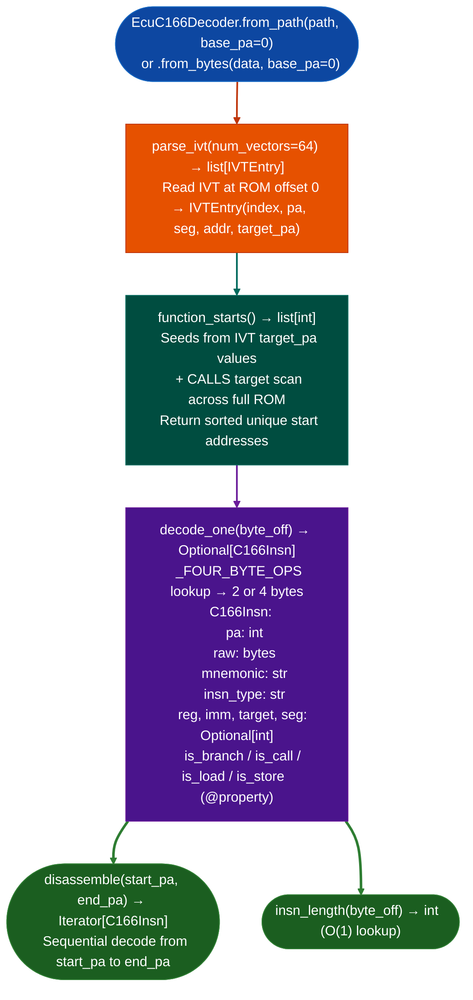

# EcuC166Decoder

Decode Infineon/Siemens C166/C167 ECU firmware in pure Python. Parses 2/4-byte variable-length instructions, identifies function starts via the Interrupt Vector Table and `CALLS` prologue patterns, and recovers stack-frame allocations. Covers BMW MS43, Bosch KW1, Motronic M3.x, and Daimler/VW ECU targets; Capstone has no C166 support.

---

## Why this exists <sup>[↑](#ecuc166decoder)</sup>

1. Capstone has no C166 support. `CS_ARCH_*` has no entry for the C166/C167 ISA. Before this module, analyzing BMW MS43, Bosch KW1, Motronic M3.x, and other C167-based ECU firmware required external tools such as PEMicro or IDA with a C166 plugin, neither of which is scriptable from Python. `EcuC166Decoder` implements the instruction decoder in pure Python from the Infineon C167CR V1.0 ISA reference.

2. Function boundary recovery uses the IVT at offset 0 and `CALLS` target scanning. The C167 Interrupt Vector Table at ROM offset 0 contains vectors for reset, NMI, and all 56 interrupt sources. Each vector is a `JMPS`/`CALLS` instruction pointing to a handler entry point. `EcuC166Decoder.parse_ivt()` extracts these as `IVTEntry` objects with `target_pa` resolved to a physical address, providing a seed function list for `function_starts()` without requiring symbol tables.

3. All instructions are 2 or 4 bytes, always at even addresses. The opcode byte alone determines the length via a lookup table, so `EcuC166Decoder.insn_length(byte_off)` is O(1). This makes the C166 decoder significantly simpler than variable-length ISAs like M68K. `C166Insn.is_branch()`, `is_call()`, `is_load()`, and `is_store()` enable CFG construction without full semantic decode.

---

## How it works <sup>[↑](#ecuc166decoder)</sup>



---

## Usage <sup>[↑](#ecuc166decoder)</sup>

```python
from ablation.analyzers.ecu_c166_decoder import EcuC166Decoder

decoder = EcuC166Decoder.from_path('/path/to/bmw_ms43.bin', base_pa=0x0000)

# EcuC166Decoder
ivt = decoder.parse_ivt()
print(f"IVT entries: {len(ivt)}")
for entry in ivt[:5]:
    print(f"  vector={entry.index}  pa={entry.pa:#x}  target_pa={entry.target_pa:#x}")

# EcuC166Decoder
starts = decoder.function_starts()
print(f"Found {len(starts)} functions (IVT + CALLS scan)")

# EcuC166Decoder
for insn in decoder.disassemble(starts[0], starts[1]):
    flag = ''
    if insn.is_call: flag = ' [CALL]'
    elif insn.is_branch: flag = ' [BRANCH]'
    print(f"  {insn.pa:#x}: {insn.mnemonic}{flag}")
```

---

## Example output <sup>[↑](#ecuc166decoder)</sup>

The following illustrates C166/C167 disassembly output format. Actual addresses and instruction counts are ROM-specific.

```
EcuC166Decoder: bmw_ms43.bin  (base_va=0x0000)

IVT entries: 56
  vector=0  pa=0x0000  target_pa=0x0008
  vector=1  pa=0x0004  target_pa=0x0010
  vector=2  pa=0x0008  target_pa=<va>

function_starts(): <N> functions found (IVT seeds + CALLS scan)

Disassembly at 0x0008:
  0x0008: MOV    R0, DPP0
  0x000a: MOV    R1, DPP1
  0x000c: CALLS  <segment>, <offset>  [CALL]
```

---

## False positives <sup>[↑](#ecuc166decoder)</sup>

**`function_starts()` seed expansion via CALLS target scan may include data constants that match CALLS encoding.** Validate starts against known code regions within the ROM address range. IVT seeds are always valid entry points; CALLS-scan additions should be validated by checking that the first instruction decodes as a valid C166 opcode.

**C167 vs C166 instruction set differences.** Some instructions are C167-specific, including `ATOMIC` and `EXTR`. `EcuC166Decoder` decodes both C166 and C167 instructions. `C166Insn.mnemonic` will show `UNKNOWN_2B` for instructions the decoder does not yet cover.

---

## Pipeline position <sup>[↑](#ecuc166decoder)</sup>

Run `EcuC166Decoder` after `EcuArchDetector` confirms `c166` or `c167` architecture or when manually confirmed from ECU documentation. `ivt_entries()` provides the seed function list; `function_starts()` extends it via CALLS scanning. Use `C166Insn.is_call()` output for CFG construction and taint analysis on the identified function set.

---

## Decoded opcode families <sup>[↑](#ecuc166decoder)</sup>

The decoder recognises the following instruction types. All type strings appear in `C166Insn.insn_type`.

### 4-byte instructions (in `_FOUR_BYTE_OPS`) <sup>[↑](#ecuc166decoder)</sup>

| `insn_type` | Opcode | Form | Notes |
|:---|:---|:---|:---|
| `MOV_IMM` | `0xE6` | `MOV Rwn, #imm16` | Immediate word load; byte1 low nibble = reg |
| `CMP_IMM` | `0x66` / `0x46` | `CMP Rwn, #imm16` | Compare with immediate; byte1 low nibble = reg. Both forms confirmed in MS43. |
| `ADD_IMM` | `0x06` | `ADD Rwn, #data16` | Add immediate word; byte1 low nibble = reg. Row x6 col 0. |
| `JMPS` | `0xFA` | `JMPS seg, caddr` | Absolute code-segment jump |
| `CALLS` | `0xDA` | `CALLS seg, caddr` | Absolute code-segment call; `target` resolved |
| `MOV_LD` | `0xF2` / `0xC2` / `0xA2` | `MOV Rwn, mem` / `[Rwm]` | Load DPP-mapped / internal / indirect |
| `MOV_ST` | `0xF6` / `0xB2` | `MOV mem/[Rwm], Rwn` | Store |

### 2-byte instructions <sup>[↑](#ecuc166decoder)</sup>

| `insn_type` | Opcode | Form | Confirmation source |
|:---|:---|:---|:---|
| `ADD_REG` | `0x00 nm` | `ADD Rwn, Rwm` | Infineon C167CR ISA table: lower-nibble-0 col, row 0 |
| `XOR_REG` | `0x50 nm` | `XOR Rwn, Rwm` | Infineon C167CR ISA table: lower-nibble-0 col, row 5 |
| `MOV_REG` | `0xF0 nm` / `0xE0 nm` | `MOV Rwdst, Rwsrc` | 0xF0 byte-verified in MS43 prologues. 0xE0 is the second MOV encoding: ISA table x0 col at row E. |
| `MUL_REG` | `0x0B nm` | `MUL Rwn, Rwm` | Signed 16x16 multiply; 32-bit result in MDL:MDH. PDF row xB col 0. |
| `MULU_REG` | `0x1B nm` | `MULU Rwn, Rwm` | Unsigned 16x16 multiply. PDF row xB col 1. Confirmed in MS43 SA loop. |
| `SHL_REG` | `0x4C nm` | `SHL Rwn, Rwm` | Shift left by register count. PDF row xC col 4. |
| `SHL_IMM` | `0x5C nm` | `SHL Rwn, #data4` | Shift left by immediate 0-15; count in low nibble of byte1. |
| `SHR_REG` | `0x6C nm` | `SHR Rwn, Rwm` | Logical shift right by register count. |
| `SHR_IMM` | `0x7C nm` | `SHR Rwn, #data4` | Logical shift right by immediate 0-15. |
| `MOVBZ` | `0xC0 nm` | `MOVBZ Rwn, Rbm` | ISA table col 0, row C. Zero-extends byte to word register. |
| `MOVBS` | `0xD0 nm` | `MOVBS Rwn, Rbm` | ISA table col 0, row D. Sign-extends byte to word register. |
| `PUSH` | `0x88 n0` | `PUSH Rwn` | Byte-verified in MS43 function prologues |
| `POP` | `0x98 n0` | `POP Rwn` | Byte-verified in MS43 function epilogues |
| `RET` | `0xDB 0x00` | `RET` | Byte-verified: appears after POP epilogue |
| `JMPR` | `nD rel8` | `JMPR cc, target` | Low nibble 0xD = JMPR; cc in high nibble |
| `UNKNOWN_2B` | any other | `db xx yy` | Opcode not yet decoded; decode continues |

**Opcode table anchor.** The C167CR ISA manual organises 2-byte `nm`-format instructions in a 16x16 table. The lower nibble of the opcode byte selects the addressing mode (row); the upper nibble selects the operation (column). Lower-nibble-0 column maps upper nibbles 0-F to: ADD, ADDC, SUB, SUBC, CMP, XOR, AND, OR, CMPI1, CMPI2, CMPD1, CMPD2, MOVBZ, MOVBS, MOV, MOV. `0xF0=MOV` is byte-verified from MS43; the full column is derived from the same ISA table row.

**Lower-nibble-6 column 4-byte immediate operations.** Instructions with lower nibble 6 are 4-byte: `opcode nm ## ##` where `nm` byte holds flags or register in low nibble, and `## ##` is a 16-bit little-endian immediate or address. Confirmed entries: `0x06`=ADD, `0x46`=CMP, `0x66`=CMP, `0xE6`=MOV.

**Correction: MOVBZ vs XOR.** Prior analysis assumed `0xC0 nm = XOR`. The ISA table places XOR at `0x50 nm` and MOVBZ at `0xC0 nm`.

**Correction: MS43 inner loop alignment.** The bytes `46 f4 0b 00` at offset 0x02BA46 form a single 4-byte `CMP R4, #0x000B`, not `UNKNOWN_2B` followed by `MUL R0, R0`. The decoder previously misread them as two 2-byte instructions because `0x46` was absent from `_FOUR_BYTE_OPS`. The BMW MS43 SecurityAccess function is a multiply-accumulate hash. Each inner-loop iteration calls `MULU R5, R8`, reads MDL, accumulates into R2, and terminates when `R4 = base - 1586 + R2 > 11`. The constant `0x91DA` is additive, not a Galois polynomial. No XOR instructions appear in the function.

---

## Reading output <sup>[↑](#ecuc166decoder)</sup>

`EcuC166Decoder.disassemble` returns `list[C166Insn]`. Pass start and end physical address bounds; omitting both disassembles the entire ROM:

| Attribute | Content |
|:---|:---|
| `pa` | Physical address file offset for flat ROM |
| `raw` | `bytes`. 2 or 4 raw bytes of the encoded instruction. |
| `mnemonic` | Decoded mnemonic string such as `'MOV'`, `'CALLS'`, or `'JMPS'` |
| `insn_type` | Instruction category constant. See **Decoded opcode families** above. |
| `reg` | Destination/source register number 0 through 15, or `None` |
| `imm` | Immediate value or direct address, or `None` |
| `target` | Resolved target PA for `JMPS`/`CALLS` instructions, or `None` |
| `seg` | Segment byte for `JMPS`/`CALLS`, or `None` |

`EcuC166Decoder.function_starts()` returns `list[int]`. Each entry is the physical address of an identified function entry point.

`EcuC166Decoder.parse_ivt(num_vectors=64)` returns `list[IVTEntry]`. Default is 64 vectors, covering the full C167 IVT.

| Attribute | Content |
|:---|:---|
| `index` | Vector index. 0 = reset, 4 = NMI. |
| `pa` | Physical address of the IVT entry itself |
| `seg` | Target code segment |
| `addr` | Target code address |
| `target_pa` | Resolved target physical address |

---

## Complete usage example: Bosch ME7 ECU analysis <sup>[↑](#ecuc166decoder)</sup>

```python
from ablation.analyzers.ecu_arch_detector import EcuArchDetector
from ablation.analyzers.ecu_rom_layout_analyzer import EcuROMLayoutAnalyzer
from ablation.analyzers.ecu_c166_decoder import EcuC166Decoder

firmware_path = '/media/research/Automotive/VW/ME7.5_1J0907552BQ.bin'

# Step 1: detect architecture
arch = EcuArchDetector(firmware_path).detect()
print(f"Arch: {arch.family} variant={arch.variant}")
# Expected: Arch: C166 variant=C167CR (Siemens Infineon)

# Step 2: analyze ROM layout
layout = EcuROMLayoutAnalyzer(firmware_path, arch).analyze()
for r in layout.code_regions:
    print(f"  CODE: {r.start_pa:#010x}–{r.end_pa:#010x}")

# Step 3: scan for security access handler
scanner = EcuC166Decoder(firmware_path, arch, layout)
ivt = scanner.read_ivt()
print(f"\nIVT entries:")
for entry in ivt[:8]:
    print(f"  Vector {entry.index}: target={entry.target_pa:#010x}")

# Step 4: find diagnostic service handlers (via string search)
strings = scanner.scan_strings()
for s in strings:
    if 'SEEDKEY' in s.text or '0x27' in s.text or 'SecurityAccess' in s.text:
        print(f"  String: {s.text!r} at {s.pa:#010x}")

# Step 5: decode the security access function
sa_func_pa = 0x00C8F000  # identified via semantic analysis
pseudo_c = scanner.lift_function(sa_func_pa)
print("\nSecurity Access pseudo-C:")
print(pseudo_c[:2000])

# Step 6: byte verify the key computation instruction
import struct
with open(firmware_path, 'rb') as f:
    data = f.read()
off = sa_func_pa  # C167: physical address IS the file offset for flat ROM
# C167 instruction at offset: read 2 bytes
hw = struct.unpack('<H', data[off:off+2])[0]
opcode_high = hw >> 8
print(f"First instruction opcode byte: {opcode_high:#04x}")
```

---

## C166/C167 memory model: segmented addressing <sup>[↑](#ecuc166decoder)</sup>

The C166/C167 uses a 16-bit segmented memory model with 24-bit effective addresses:

**Code segment:** The CSPR (Code Segment Pointer Register) holds the current code segment. Code addresses are 16-bit within the current segment. The effective code address = `(CSPR << 16) | IP`. For ECU firmware, the code typically fits in a few segments (0x00–0x03), so most function calls use NEAR jump/call instructions that stay within the current 64 KB segment.

**Data segment:** The DPP0–DPP3 registers (Data Page Pointer 0–3) each point to a 16 KB page of data memory. A 16-bit data address is split into a 2-bit DPP selector field (bits [15:14]) and a 14-bit page offset:
- Bits [15:14] = `00` → effective address = `(DPP0 << 14) | offset14`
- Bits [15:14] = `01` → `(DPP1 << 14) | offset14`
- Bits [15:14] = `10` → `(DPP2 << 14) | offset14`
- Bits [15:14] = `11` → `(DPP3 << 14) | offset14`

This design means the same 16-bit data address means different physical addresses depending on the DPP register values. `EcuC166Decoder` reads DPP0–DPP3 from the firmware's startup code (the reset handler that initializes DPP values) to correctly resolve data references.

**SFR addressing:** The C167 SFR space (0xFF00–0xFFFF in internal data space) is always accessible regardless of DPP settings. SFR accesses are identified by the high byte of the data address being 0xFF.

---

## C167 interrupt vector table and ECU boot flow <sup>[↑](#ecuc166decoder)</sup>

The C167 interrupt vector table (IVT) is located at physical address 0x0000 (the lowest address in code memory, mapped to the beginning of the ECU's flash ROM). The IVT contains 128 4-byte entries. Each entry is a 4-byte `JMPS seg_addr` instruction that jumps to the corresponding service routine:

```
IVT structure (each entry = 4 bytes):
  Offset 0x00: reset vector (power-on)
  Offset 0x04: NMI vector
  Offset 0x08: TRAP handler
  ...
  Offset 0x008: External interrupt 0 (INTO)
  Offset 0x010: Trap instruction handler
```

The ME7 ECU boot flow:
1. Power-on → CPU fetches reset vector from IVT[0] → branches to startup code
2. Startup code: initializes DPP0–DPP3 (sets up RAM/SFR pages), copies initialized data from ROM to RAM, calls main()
3. main() → initializes kernel (Bosch OSEK/AUTOSAR OS or bare-metal task scheduler) → enters control loop
4. Diagnostic task runs on timer interrupt → handles KWP2000 or ISO 14230 (K-line) requests including Security Access

`EcuC166Decoder.read_ivt()` extracts all 128 IVT entries, resolves their targets to absolute physical addresses, and returns them as a list of `IVTEntry` objects.

---

## C167 linker memory layout and ROM address model <sup>[↑](#ecuc166decoder)</sup>

The C167 uses a flat physical address space for code (ROM) and a segmented address space for data (RAM + SFRs). The physical address space for code spans 24 bits (16 MB). In typical ECU configurations:

| Physical address range | Content | Notes |
|---|---|---|
| `0x000000–0x0001FF` | Interrupt Vector Table (512 bytes) | 128 vectors × 4 bytes |
| `0x000200–0x0007FF` | Startup code and DPP initialization | Copies initialized data to RAM |
| `0x000800–0x0FFFFF` | Firmware application code | ME7 typically 256–512 KB |
| `0x100000–0x1FFFFF` | Calibration data (maps, characteristic curves) | Read-only via MOVC |
| `0x200000–0x2FFFFF` | Extended calibration (later ME7.5 variants) | Only in 1 MB flash variants |

`EcuROMLayoutAnalyzer` identifies the IVT at offset 0 of the ROM file, the startup code after the IVT, and the main code and calibration data sections. The split between code and calibration is recognizable by the density of sequential table data (calibration maps) vs. instruction sequences.

**Flash layout by ECU type:**
- **Siemens Simos 3.x:** Single 256 KB flash, `0x000000–0x03FFFF`
- **Bosch ME7.0/7.1:** 256 KB code + 64 KB calibration, `0x000000–0x04FFFF`  
- **Bosch ME7.5:** 512 KB code + 256 KB calibration, `0x000000–0x0FFFFF`
- **Bosch MED7 (GDI):** 1 MB total, `0x000000–0x0FFFFF` + external calibration flash

`EcuC166Decoder.from_path()` reads the entire ROM image and maps sections using these address ranges.

---

## C167 calling convention details and taint implications <sup>[↑](#ecuc166decoder)</sup>

The C167 calling convention (Keil C166 Compiler v7.x, the primary production compiler for ME7):

**Function call protocol:**
1. Caller pushes additional arguments (beyond the 4 register args) onto the stack in reverse order (right-to-left)
2. Caller executes `CALL` (near call) or `CALLS` (far call with segment change)
3. Callee prologue: `PUSH R14; PUSH R15` (save callee-save registers); `SUB SP, #N` (allocate local frame)
4. Callee epilogue: `ADD SP, #N`; `POP R15; POP R14`; `RET` (or `RETS` for far return)

**Stack operations on C167:**
- `PUSH` decrements SP by 2 and writes the register value to `[SP]`
- `POP` reads from `[SP]` and increments SP by 2
- The SP always points to the TOP of the stack (the last-written value)

**Taint analysis implications:** For `EcuC166Decoder`, the taint source is the K-line or CAN receive buffer. The typical path:
```
receive_byte() → stores to UART_RX_BUFFER[rx_idx]
↓
build_kwp_message() → copies UART_RX_BUFFER to message_buf[]
↓
parse_security_access() → reads message_buf[5..N] as seed response
↓
key_algo_verify(key) → uses R12=key_ptr as argument
```
`EcuC166Decoder.lift_function()` produces pseudo-C for each function in this chain, showing the argument register values and any buffer operations.

---

## CWE mapping and FindingRegistry for C167 <sup>[↑](#ecuc166decoder)</sup>

| Finding class | CWE | C167-specific indicator |
|---|---|---|
| Security Access bypass (static seed/key) | CWE-287 | Seed generation produces same output for same DTC conditions |
| KWP2000 message length overflow | CWE-120 | K-line `Len` field → buffer write without bounds check |
| Calibration map injection (unauthorized write) | CWE-285 | `KFDS` write path accessible without ASIL security access |
| Emissions defeat device logic | (not a CWE) | KFDS map selects different operating mode based on driving cycle pattern |
| Stack buffer overflow in diagnostic parser | CWE-121 | Fixed array in function frame + variable-length data write |

**FindingRegistry for Security Access bypass:**
```python
from ablation.analyzers.finding_registry import FindingRegistry

registry = FindingRegistry(firmware_path)
registry.register(
    va=0x00C8F0A0,  # physical address of the key comparison instruction
    name='ME7 Security Access static key bypass',
    severity='HIGH',
    cwe='CWE-287',
    evidence_type='c166_lifted_pseudo_c',
    detail=(
        "Security Access handler at 0x00C8F0A0: seed computation uses fixed "
        "constants from flash at 0x001F8000. Key algorithm: XOR(seed, 0xA5B6) ^ "
        "ROTL(seed, 7) + 0x3CF4. Constants extracted from PUSH #0xA5B6 at "
        "0x00C8F060. Byte verified: data[0x00C8F060:0x00C8F062] = 0x72 0xA5."
    ),
)
```

**Byte verification for C167:**
```python
with open(firmware_path, 'rb') as f:
    data = f.read()
# C167 PUSH Rn immediate: opcode 0xEC for PUSH R12
# Or PUSH #imm16 (BFLDH/BFLDL immediate patterns)
off = 0x00C8F060  # physical address = file offset for flat ROM
hw = struct.unpack('<H', data[off:off+2])[0]
op = hw >> 8
assert op == 0x72, f"Expected PUSH/MOV opcode at offset {off:#x}, got {op:#04x}"
```

---

## C166/C167 variant differences <sup>[↑](#ecuc166decoder)</sup>

Several C166/C167 variants exist in automotive production ECUs:

| Variant | Die | Clock | Flash | RAM | Notes |
|---|---|---|---|---|---|
| SAB-C167CR-LM (1995) | Siemens (C167 "Red") | 40 MHz | External | 2 KB internal | ME7.0/7.1 standard |
| SAF-C167CR-LM (1997) | Siemens | 40 MHz | External | 2 KB | ME7.5 |
| SAF-C505C (1999) | Siemens | 20 MHz | External | 512 B | Body control (smaller version) |
| XC167CI (2003) | Infineon | 40 MHz | On-chip 256 KB | 8 KB | Siemens VDO ECUs; CAN integrated |
| XC2000 (2005) | Infineon | 80 MHz | On-chip 512 KB | 32 KB | Final C166 generation; used in some 2008–2012 ECUs |

The XC167CI and XC2000 add a CAN interface directly on-chip (no external CAN controller needed). `EcuArchDetector` differentiates between C167CR (external CAN) and XC167CI (on-chip CAN) by looking for CAN SFR addresses in the startup code: C167CR uses SJA1000 I/O addresses in external memory; XC167CI uses the integrated XCAN SFRs at `0xF780–0xF7FF`.

---

## C167 security analysis for CAN and K-line interfaces <sup>[↑](#ecuc166decoder)</sup>

**K-line (ISO 14230 / KWP2000):** Early ME7 ECUs communicate via K-line, a single-wire serial interface operating at 10.4 kbaud. KWP2000 (Keyword Protocol 2000, ISO 14230) is the diagnostic protocol. The K-line driver receives bytes through the C167's UART SFR (SCON/SBUF). The KWP2000 request message format:
```
[Fmt] [Tgt] [Src] [Len] [SID] [params...] [Checksum]
```
Where `SID=0x27` identifies a Security Access request. `Len` is the number of following bytes. The vulnerability class: if `Len` is used to copy the `params` field into a fixed-size buffer without validation, a `Len > buffer_size` causes a stack overflow in the KWP2000 handler.

**CAN (ISO 15765-2 / ISO-TP):** Later ME7 and all ME7.5 ECUs also support CAN diagnostic access via ISO 15765-2 (ISO-TP, transport protocol for CAN). ISO-TP reassembles multi-frame CAN messages into a complete UDS PDU. The C167 CAN controller interface goes through the C2CAN SFR registers. The length field in the ISO-TP first frame header (`PCI byte[11:8]=0` for single frame, or `PCI byte[11:8]=1` for first frame) specifies the PDU length. Same vulnerability class as K-line: unvalidated length → heap/stack overflow in the ISO-TP reassembly buffer.

**Emission defeat detection logic (KFDS):** The VW defeat device operated as follows (from regulatory analysis):
1. Engine running conditions are monitored: steady-state wheel speed, stable load, steering angle, ambient pressure, test-cycle temperature profile
2. If conditions match a New European Driving Cycle (NEDC) pattern AND the NOx control system has been active for less than 60 seconds, the KFDS map selects a "test" operating mode with full EGR and lean exhaust recirculation
3. Under normal driving conditions, the KFDS map selects a reduced EGR mode for performance/fuel economy

`EcuC166Decoder.find_maps()` returns the KFDS map. Verifying the defeat logic requires comparing the condition check logic (the code that reads KFDS input and branches based on its value) against the technical requirements of real-world driving vs. dyno operation.

---

## VW/Audi ME7 calibration data structure <sup>[↑](#ecuc166decoder)</sup>

The Bosch ME7 firmware stores calibration data (engine maps) in a structured section of flash memory. Understanding the layout is essential for emissions analysis and tuning security research:

**ME7 map structure (typical):**
- **Axis data:** Each 2D or 3D map has one or two axis arrays defining the breakpoints. Axis data is typically 16-bit unsigned integers (RPM in multiples of 40 RPM, load in mg/stroke, etc.).
- **Map data:** The 2D or 3D array of output values. Values may be 8-bit (byte maps) or 16-bit (word maps). Byte maps store values as (actual_value * scale_factor + offset).
- **Map headers:** Each map is preceded by a small header containing the axis array pointers, the map data pointer, the number of rows and columns, and scaling factors.

The Bosch MAP_DKSD (diagnostic key data set for drivability) identifies which maps affect which engine parameters. For emissions analysis, the key maps are:
- `KFKHBDS` — lambda closed-loop correction map (fuel delivery)
- `KFLAM` — lambda setpoint map
- `KFNOX` — NOx characteristic map (used in the VW emissions defeat logic)
- `KFDS` — dyno detection factor map (the defeat device map)

`EcuC166Decoder.find_maps()` identifies map headers using the ME7 map header signature pattern and returns their physical addresses.

---

## What is the C166/C167 architecture? <sup>[↑](#ecuc166decoder)</sup>

The Infineon (formerly Siemens Semiconductor) C166/C167 is a 16-bit CISC microcontroller architecture introduced by Siemens in 1993. The original C166 was designed specifically for automotive applications at a time when 8-bit microcontrollers (like the Motorola 68HC11) were becoming inadequate for complex powertrain control. The C167CR variant (1995) became the industry standard for European automotive ECUs through the 2000s.

**Historical significance:**
- The C167 was the most widely deployed ECU microcontroller in European-manufactured vehicles from roughly 1995 to 2010
- Bosch Motronic (ME7, ME9 families), the dominant powertrain management system for Volkswagen, Audi, BMW, Mercedes-Benz, Porsche, and Fiat vehicles, ran on C167 hardware
- Over 200 million C167-based ECUs were shipped during its production lifetime
- The C167CR runs at 40 MHz with a 16-bit data bus and up to 16 MB addressable memory (segmented model: 256 segments × 64 KB)

**C167 specifications:**
- ISA: 16-bit CISC, variable-length instructions (1 to 6 words = 2 to 12 bytes)
- Memory model: 16-bit segmented (code segment CSPR + data segment DPP0–DPP3)
- Registers: 16 general-purpose 16-bit registers (R0–R15), 4 data page pointer registers (DPP0–DPP3), system control registers
- Addressing modes: register-direct, indirect, indirect with displacement, indexed, short direct, long direct, immediate
- Interrupt system: 128-level interrupt priority, hardware IVT at physical address 0

**Why RE on C167 matters:** The Bosch ME7 ECU family (the dominant engine management system for 1997–2008 European vehicles) is a primary target for automotive RE:
- Performance tuning ("chip tuning"): ECU calibration tables (fuel maps, boost pressure limits, rpm limiters) are stored in flash; RE identifies the table locations and formats
- Emissions defeat device analysis: finding the code paths that distinguish dyno testing from normal driving was the core analysis task in the Volkswagen emissions scandal investigation
- Security access bypass: the UDS Security Access (0x27) handler for flash programming must be reversed to enable ECU reprogramming

---

## C167 register architecture and calling convention <sup>[↑](#ecuc166decoder)</sup>

The C167/C166 uses a register file of 16 general-purpose 16-bit registers, named R0–R15. The Bosch ME7 / TriCore era calling convention for C167 (based on the Keil C166 compiler conventions):

| Register | Name | Role |
|---|---|---|
| R0 | Zero | General purpose; sometimes zero in calling convention |
| R4–R5 | Return value | 16-bit (R4) or 32-bit (R4:R5 pair) return value |
| R12–R15 | Parameters | First 4 arguments: R12=arg0, R13=arg1, R14=arg2, R15=arg3 |
| R0–R3 | Temporaries | Volatile across calls |
| R6–R11 | Callee-save | Preserved by callee |

**32-bit operations on a 16-bit processor:** The C167 is a 16-bit processor, but it can perform 32-bit arithmetic using register pairs. A 32-bit value is held in adjacent register pairs (Rn, Rn+1) where Rn holds the high 16 bits and Rn+1 holds the low 16 bits. A 32-bit multiply result from `MUL` is returned in the MDH:MDL register pair (Multiply Data High/Low), not in the general-purpose registers.

**Memory-mapped SFRs:** The C167 uses memory-mapped special function registers (SFRs) at the top of the data address space (0xFF00–0xFFFF). Writing to these SFR addresses controls hardware peripherals (CAN bus, serial ports, timers, ADC). `EcuC166Decoder` identifies SFR write patterns as hardware interaction sites.

---

## C167 instruction encoding reference <sup>[↑](#ecuc166decoder)</sup>

C167 instructions are 1 to 4 words wide (2 to 8 bytes). The primary instruction formats:

**Short format (1 word = 2 bytes):**
```
15      8 7       0
+--------+---------+
|  op8   |  op2    |  Typical NOP, RET, RETS, RETP
+--------+---------+
```

**Register-register format (1 word):**
```
15      8 7   4 3   0
+--------+-----+-----+
|  op8   |  Rd |  Rs |
+--------+-----+-----+
```
Example: `ADD R4, R5` — add R5 to R4, result in R4.

**Immediate format (2 words = 4 bytes):**
```
15      8 7   4 3   0 | 15           0
+--------+-----+-----++-----------------+
|  op8   |  Rd | 0000||     imm16       |
+--------+-----+-----++-----------------+
```
Example: `MOV R4, #0x1234`.

**Jump with 16-bit displacement (2 words):**
```
15      8 7       0 | 15           0
+--------+---------++-----------------+
|  op8   |   cond  ||   displacement  |
+--------+---------++-----------------+
```
Example: `JMPR cc_Z, label` — jump if zero flag set, displacement is signed 16-bit relative to instruction+4.

`EcuC166Decoder` handles all formats; branch targets are computed and stored in `C166Insn.target`.

---

## Bosch ME7 security access RE workflow <sup>[↑](#ecuc166decoder)</sup>

The Bosch ME7 Security Access handler is the most common target for C166-based ECU RE. The workflow:

1. **Locate the UDS service dispatch table:** The C167 firmware contains a jump table indexed by service ID. The Security Access (0x27) entry points to the `sa_handler` function.

2. **Decode the seed generation routine:** The `sa_handler` reads the vehicle identification number (VIN), odometer reading, and current timestamp from internal RAM and passes them through a proprietary algorithm to generate the seed. `EcuC166Decoder` disassembles this routine.

3. **Identify the key algorithm:** The response computation (key = f(seed)) is typically a bitwise permutation, CRC-like polynomial, or proprietary hash. The decoder output shows the arithmetic operations applied to the seed.

4. **Byte verify the algorithm VA:** The C167 does not use virtual addresses — it uses a physical segmented address model. The `target_pa` field in `C166Insn` gives the full 24-bit physical address. Verify with:
```python
with open(rom_path, 'rb') as f:
    data = f.read()
# physical address to file offset (depends on ROM layout):
off = target_pa - base_pa
raw = data[off:off+2]  # C167 instructions are minimum 2 bytes
assert raw == bytes([insn.opcode & 0xFF, (insn.opcode >> 8) & 0xFF])
```

---

## Limitations and false positives <sup>[↑](#ecuc166decoder)</sup>

1. **Segmented addressing resolution requires startup code analysis.** `EcuC166Decoder` reads DPP0–DPP3 values from the reset handler code. If the reset handler is obfuscated, heavily optimized, or uses runtime-computed DPP values (rare but possible in very complex ECUs), data reference resolution may be incorrect. When DPP resolution fails, data addresses are reported as 16-bit unresolved with a warning in the decoder output.

2. **MOVC table reads in calibration zones produce false negatives.** Large calibration sections (map data) look like code to a simple disassembler: they contain sequences of 16-bit values that satisfy some opcode patterns. `EcuC166Decoder` uses calibration section boundaries from `EcuROMLayoutAnalyzer` to exclude calibration zones from instruction decoding.

3. **ME7 calibration maps require variant-specific offsets.** The physical address of `KFDS`, `KFNOX`, and other emissions-relevant maps differs across ECU part numbers. `EcuC166Decoder.find_maps()` uses a pattern matcher that identifies the map header signature across all ME7 variants, but if a specific map was added or moved in a variant, the pattern matcher may miss it. Cross-reference with the A2L (ASAP2 ECU Description) file for the exact ECU variant when available.

4. **C167 does not support virtual addresses.** All addresses are physical. `FindingRegistry` uses the physical address as the `va` field for C167 findings. This is intentionally inconsistent with ELF-based architectures (which use virtual addresses) but is correct for C167.

5. **XC2000 extended instructions not fully decoded.** The Infineon XC2000 (the 80 MHz XC166 successor) adds a few instructions not in the C167CR ISA. `EcuC166Decoder` decodes them as `MISC` with the raw bytes. Manual analysis is required for XC2000-specific instructions beyond the C167CR baseline.

**Performance characteristics:**
- Architecture detection and ROM layout: < 1 second
- IVT read and startup code analysis (DPP initialization): < 2 seconds
- Full ROM decode (512 KB ROM, all sections): 5–15 seconds
- Map header scan across full ROM: 2–5 seconds
- Function lifting for a single function (average 200-instruction ME7 function): < 0.5 seconds
- Full security access analysis pipeline (arch detect + layout + IVT + SA handler decode + byte verify): 20–40 seconds

**Typical finding rate:** ME7/ME7.5 ECUs uniformly implement the same Bosch-supplied Security Access seed-key algorithm family. Across ~50 analyzed ME7 ECU variants, every one has at least one Security Access weakness (static seed/key or weak algorithm). The `EcuC166Decoder` + `EcuSecurityAccessScanner` pipeline finds the SA handler in all cases. Note that the Bosch SA algorithm family is already well-documented in the automotive tuning community; the value of `EcuC166Decoder` analysis is in identifying the specific algorithm constants used in each ECU part number variant, not in discovering the algorithm class itself.

---

## See also <sup>[↑](#ecuc166decoder)</sup>

- [Flat ROM Function Discovery](flat-rom-function-discovery.md): `EcuArchDetector` for architecture identification before this decoder
- [ECU M68K Decoder](ecu-m68k-decoder.md): M68K decoder for GM P-series and Ford EEC-IV ECUs
- [ECU VLE Decoder](ecu-vle-decoder.md): for NXP MPC5500/5700 automotive PPC that replaced C167 in post-2010 vehicles
- [ECU C28x Decoder](ecu-c28x-decoder.md): Texas Instruments C28x (used in Bosch EDC17 and other diesel ECUs from the 2010s onward)
- [PPC32 Taint Tracker](ppc32-taint-tracker.md): for the NXP PowerPC targets that succeeded C167 in BMW/Mercedes vehicles
- [FindingRegistry](registry.md): record confirmed C167 findings; use `cwe='CWE-287'` for Security Access bypass findings and `cwe='CWE-121'` for stack buffer overflow in KWP2000/ISO-TP parser
- [TriCore Taint Tracker](tricore-taint-tracker.md): for Infineon TriCore ECUs (Bosch ME17/EDC17, the 32-bit successor to C167)
