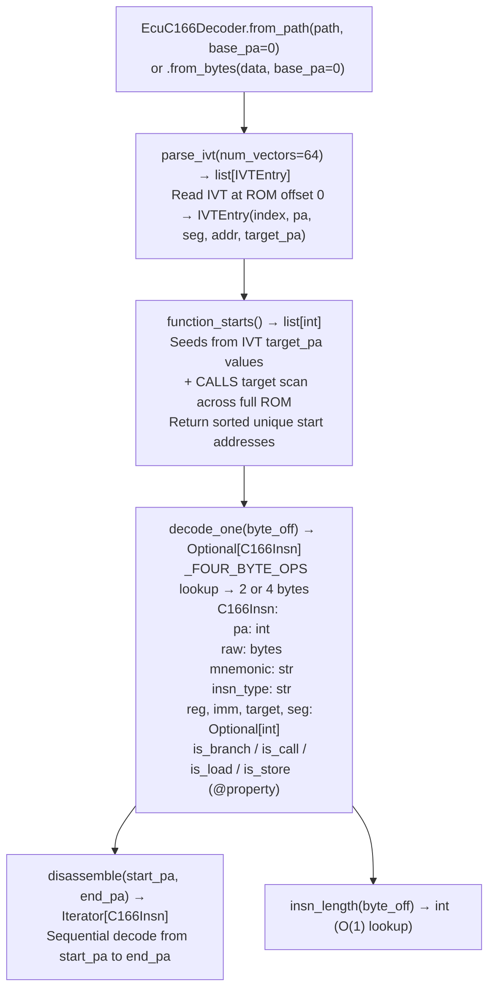

# C166/C167 ECU Decoding

Decode Infineon/Siemens C166/C167 ECU firmware in pure Python. Parses 2/4-byte variable-length instructions, identifies function starts via the Interrupt Vector Table and `CALLS` prologue patterns, and recovers stack-frame allocations. Covers BMW MS43, Bosch KW1, Motronic M3.x, and Daimler/VW ECU targets; Capstone has no C166 support.

---

## Why this exists

1. **Capstone has no C166 support.** `CS_ARCH_*` has no entry for the C166/C167 ISA. Before this module, analyzing BMW MS43, Bosch KW1, Motronic M3.x, and other C167-based ECU firmware required external tools such as PEMicro or IDA with a C166 plugin, neither of which is scriptable from Python. `EcuC166Decoder` implements the instruction decoder in pure Python from the Infineon C167CR V1.0 ISA reference.

2. **Function boundary recovery uses the IVT at offset 0 and `CALLS` target scanning.** The C167 Interrupt Vector Table at ROM offset 0 contains vectors for reset, NMI, and all 56 interrupt sources. Each vector is a `JMPS`/`CALLS` instruction pointing to a handler entry point. `EcuC166Decoder.parse_ivt()` extracts these as `IVTEntry` objects with `target_pa` resolved to a physical address, providing a seed function list for `function_starts()` without requiring symbol tables.

3. **All instructions are 2 or 4 bytes, always at even addresses.** The opcode byte alone determines the length via a lookup table. This makes the C166 decoder significantly simpler than variable-length ISAs like M68K, and `EcuC166Decoder.insn_length(byte_off)` is O(1). `C166Insn.is_branch()`, `is_call()`, `is_load()`, and `is_store()` enable CFG construction without full semantic decode.

---

## How it works



---

## Usage

```python
from ablation.analyzers.ecu_c166_decoder import EcuC166Decoder

decoder = EcuC166Decoder.from_path('/path/to/bmw_ms43.bin', base_pa=0x0000)

# IVT function seeds
ivt = decoder.parse_ivt()
print(f"IVT entries: {len(ivt)}")
for entry in ivt[:5]:
    print(f"  vector={entry.index}  pa={entry.pa:#x}  target_pa={entry.target_pa:#x}")

# All function starts
starts = decoder.function_starts()
print(f"Found {len(starts)} functions (IVT + CALLS scan)")

# Disassemble a function
for insn in decoder.disassemble(starts[0], starts[1]):
    flag = ''
    if insn.is_call: flag = ' [CALL]'
    elif insn.is_branch: flag = ' [BRANCH]'
    print(f"  {insn.pa:#x}: {insn.mnemonic}{flag}")
```

---

## Example output

The following illustrates C166/C167 disassembly output format. Actual addresses and instruction counts are ROM-specific.

```
EcuC166Decoder: bmw_ms43.bin  (base_va=0x0000)

IVT entries: 56
  vector=0  pa=0x0000  target_pa=0x0008
  vector=1  pa=0x0004  target_pa=0x0010
  vector=2  pa=0x0008  target_pa=<va>

function_starts(): <N> functions found (IVT seeds + CALLS scan)

Disassembly at 0x0008:
  0x0008: MOV    R0, DPP0
  0x000a: MOV    R1, DPP1
  0x000c: CALLS  <segment>, <offset>  [CALL]
```

---

## False positives

**`function_starts()` seed expansion via CALLS target scan may include data constants that match CALLS encoding.** Validate starts against known code regions within the ROM address range. IVT seeds are always valid entry points; CALLS-scan additions should be validated by checking that the first instruction decodes as a valid C166 opcode.

**C167 vs C166 instruction set differences.** Some instructions are C167-specific, including `ATOMIC` and `EXTR`. `EcuC166Decoder` decodes both C166 and C167 instructions. `C166Insn.mnemonic` will show `UNKNOWN_2B` for instructions the decoder does not yet cover.

---

## Pipeline position

Run `EcuC166Decoder` after `EcuArchDetector` confirms `c166` or `c167` architecture (or when manually confirmed from ECU documentation). `ivt_entries()` provides the seed function list; `function_starts()` extends it via CALLS scanning. Use `C166Insn.is_call()` output for CFG construction and taint analysis on the identified function set.

---

## Decoded opcode families

The decoder recognises the following instruction types. All type strings appear in `C166Insn.insn_type`.

### 4-byte instructions (in `_FOUR_BYTE_OPS`)

| `insn_type` | Opcode | Form | Notes |
|:---|:---|:---|:---|
| `MOV_IMM` | `0xE6` | `MOV Rwn, #imm16` | Immediate word load; byte1 low nibble = reg |
| `CMP_IMM` | `0x66` | `CMP Rwn, #imm16` | Compare with immediate |
| `JMPS` | `0xFA` | `JMPS seg, caddr` | Absolute code-segment jump |
| `CALLS` | `0xDA` | `CALLS seg, caddr` | Absolute code-segment call; `target` resolved |
| `MOV_LD` | `0xF2` / `0xC2` / `0xA2` | `MOV Rwn, mem` / `[Rwm]` | Load (DPP-mapped / internal / indirect) |
| `MOV_ST` | `0xF6` / `0xB2` | `MOV mem/[Rwm], Rwn` | Store |

### 2-byte instructions

| `insn_type` | Opcode | Form | Confirmation source |
|:---|:---|:---|:---|
| `ADD_REG` | `0x00 nm` | `ADD Rwn, Rwm` | Infineon C167CR ISA table: lower-nibble-0 col, row 0 |
| `XOR_REG` | `0x50 nm` | `XOR Rwn, Rwm` | Infineon C167CR ISA table: lower-nibble-0 col, row 5 |
| `MOV_REG` | `0xF0 nm` | `MOV Rwdst, Rwsrc` | Byte-verified in MS43 ROM prologue/epilogue |
| `MOVBZ` | `0xC0 nm` | `MOVBZ Rwn, Rbm` | ISA table col 0, row C. Zero-extends byte to word register. |
| `MOVBS` | `0xD0 nm` | `MOVBS Rwn, Rbm` | ISA table col 0, row D. Sign-extends byte to word register. |
| `PUSH` | `0x88 n0` | `PUSH Rwn` | Byte-verified in MS43 function prologues |
| `POP` | `0x98 n0` | `POP Rwn` | Byte-verified in MS43 function epilogues |
| `RET` | `0xDB 0x00` | `RET` | Byte-verified: appears after POP epilogue |
| `JMPR` | `nD rel8` | `JMPR cc, target` | Low nibble 0xD = JMPR; cc in high nibble |
| `UNKNOWN_2B` | any other | `db xx yy` | Opcode not yet decoded; decode continues |

**Opcode table anchor:** The C167CR ISA manual organises 2-byte `nm`-format instructions in a 16×16 table where the column selects the lower nibble and the row selects the upper nibble. Lower-nibble column 0 (the `x0` column) maps rows 0–F to: ADD(0), ADDC(1), SUB(2), SUBC(3), CMP(4), XOR(5), AND(6), OR(7), CMPI1(8), CMPI2(9), CMPD1(A), CMPD2(B), MOVBZ(C), MOVBS(D), MOV(E), MOV(F). `0xF0=MOV` is byte-verified from MS43; all other entries in this column are derived from the same table row.

**Important correction (2026-10-21).** Prior analysis assumed `0xC0 nm = XOR`. The ISA table confirms `0xC0 nm = MOVBZ` and `0x50 nm = XOR`. MOVBZ moves a byte register to a word register with zero extension. Bytes previously labelled as XOR in the BMW MS43 LFSR step function were MOVBZ operations extracting the low byte of a register. The seed-key algorithm uses MOVBZ + ADD + multiply rather than XOR + shift, and `0x91DA` is an additive constant rather than a Galois feedback polynomial.

---

## Reading output

`EcuC166Decoder.disassemble` returns `list[C166Insn]`. Pass start and end physical address bounds; omitting both disassembles the entire ROM:

| Attribute | Content |
|:---|:---|
| `pa` | Physical address (file offset for flat ROM) |
| `raw` | `bytes`. 2 or 4 raw bytes of the encoded instruction. |
| `mnemonic` | Decoded mnemonic string such as `'MOV'`, `'CALLS'`, or `'JMPS'` |
| `insn_type` | Instruction category constant. See **Decoded opcode families** above. |
| `reg` | Destination/source register number 0 through 15, or `None` |
| `imm` | Immediate value or direct address, or `None` |
| `target` | Resolved target PA for `JMPS`/`CALLS` instructions, or `None` |
| `seg` | Segment byte for `JMPS`/`CALLS`, or `None` |

`EcuC166Decoder.function_starts()` returns `list[int]`. Each entry is the physical address of an identified function entry point.

`EcuC166Decoder.parse_ivt(num_vectors=64)` returns `list[IVTEntry]`. Default is 64 vectors, covering the full C167 IVT.

| Attribute | Content |
|:---|:---|
| `index` | Vector index. 0 = reset, 4 = NMI. |
| `pa` | Physical address of the IVT entry itself |
| `seg` | Target code segment |
| `addr` | Target code address |
| `target_pa` | Resolved target physical address |

---

## See also

- [Flat ROM Function Discovery](flat-rom-function-discovery.md): `EcuArchDetector` for architecture identification before this decoder
- [M68K/CPU32 Decoding](m68k-cpu32-decoding.md): M68K decoder for other ECU targets including GM P-series
- [Calibration Parsers](calibration-parsers.md): A2L and open_damos for Bosch/Siemens calibration data
