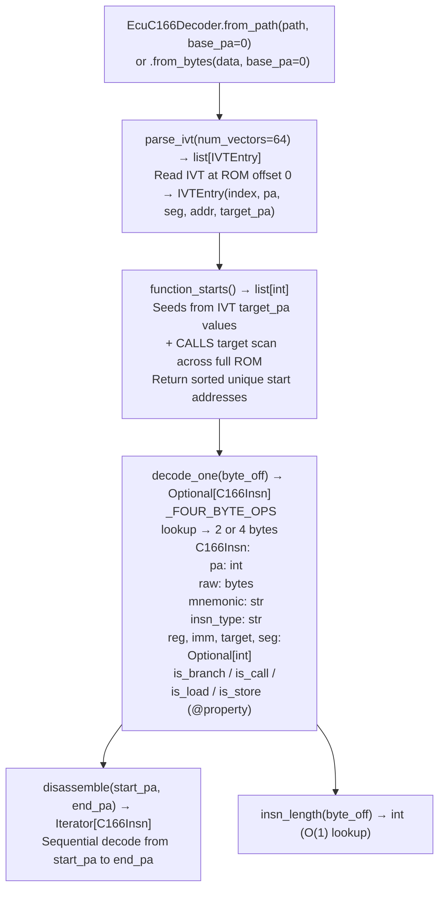

# C166/C167 ECU Decoding

Decode Infineon/Siemens C166/C167 ECU firmware in pure Python — parsing 2/4-byte variable-length instructions, identifying function starts via IVT (Interrupt Vector Table) and `CALLS`/`CALL` prologue patterns, and recovering stack-frame allocations — for BMW MS43, Bosch KW1, Motronic M3.x, and Daimler/VW ECU targets that Capstone cannot decode (no C166 support).

---

## Why this exists

1. **Capstone has no C166 support** — `CS_ARCH_*` has no entry for the C166/C167 ISA. Before this module, analyzing BMW MS43, Bosch KW1, Motronic M3.x, and other C167-based ECU firmware required external tools (PEMicro or IDA with a C166 plugin), neither of which is scriptable from Python. `EcuC166Decoder` implements the instruction decoder in pure Python from the Infineon C167CR V1.0 ISA reference.

2. **Function boundary recovery uses the IVT (Interrupt Vector Table) at offset 0 and `CALLS`/`CALL` target scanning.** The C167 IVT at ROM offset 0 contains vectors for reset, NMI, and all 56 interrupt sources — each vector is a `JMPS`/`CALLS` instruction pointing to a handler entry point. `EcuC166Decoder.parse_ivt()` extracts these as `IVTEntry` objects with `target_pa` resolved to a physical address, providing a seed function list for `function_starts()` without requiring symbol tables.

3. **All instructions are 2 or 4 bytes, always at even addresses** — the opcode byte alone determines the length via a lookup table (`_FOUR_BYTE_OPS`). This makes the C166 decoder significantly simpler than variable-length ISAs like M68K, and `EcuC166Decoder.insn_length(byte_off)` is therefore O(1). `C166Insn.is_branch()`, `is_call()`, `is_load()`, `is_store()` enable CFG construction without full semantic decode.

---

## How it works



---

## Usage

```python
from ablation.analyzers.ecu_c166_decoder import EcuC166Decoder

decoder = EcuC166Decoder.from_path('/path/to/bmw_ms43.bin', base_pa=0x0000)

# IVT function seeds
ivt = decoder.parse_ivt()
print(f"IVT entries: {len(ivt)}")
for entry in ivt[:5]:
    print(f"  vector={entry.index}  pa={entry.pa:#x}  target_pa={entry.target_pa:#x}")

# All function starts
starts = decoder.function_starts()
print(f"Found {len(starts)} functions (IVT + CALLS scan)")

# Disassemble a function
for insn in decoder.disassemble(starts[0], starts[1]):
    flag = ''
    if insn.is_call: flag = ' [CALL]'
    elif insn.is_branch: flag = ' [BRANCH]'
    print(f"  {insn.pa:#x}: {insn.mnemonic}{flag}")
```

---

## Example output

The following illustrates C166/C167 disassembly output format. Actual addresses and instruction counts are ROM-specific.

```
EcuC166Decoder: bmw_ms43.bin  (base_va=0x0000)

IVT entries: 56
  vector=0  pa=0x0000  target_pa=0x0008
  vector=1  pa=0x0004  target_pa=0x0010
  vector=2  pa=0x0008  target_pa=<va>

function_starts(): <N> functions found (IVT seeds + CALLS scan)

Disassembly at 0x0008:
  0x0008: MOV    R0, DPP0
  0x000a: MOV    R1, DPP1
  0x000c: CALLS  <segment>, <offset>  [CALL]
```

---

## False positives

**`function_starts()` seed expansion via CALLS target scan may include data constants that match CALLS encoding** — validate starts against known code regions (within ROM address range). IVT seeds are always valid entry points; CALLS-scan additions should be validated by checking that the first instruction decodes as a valid C166 opcode.

**C167 vs C166 instruction set differences** — some instructions are C167-specific (e.g., `ATOMIC`, `EXTR`). `EcuC166Decoder` decodes both C166 and C167 instructions; `C166Insn.mnemonic` will show `UNKNOWN_OP` for C167-specific instructions if the decoder does not cover the full C167 opcode extension.

---

## Pipeline position

Run `EcuC166Decoder` after `EcuArchDetector` confirms `c166` or `c167` architecture (or when manually confirmed from ECU documentation). `ivt_entries()` provides the seed function list; `function_starts()` extends it via CALLS scanning. Use `C166Insn.is_call()` output for CFG construction and taint analysis on the identified function set.

---

## Reading output

`EcuC166Decoder.disassemble(start_pa=None, end_pa=None)` returns `list[C166Insn]`. Omitting both bounds disassembles the entire ROM:

| Attribute | Content |
|:---|:---|
| `pa` | Physical address (file offset for flat ROM) |
| `raw` | `bytes` — 2 or 4 raw bytes of the encoded instruction |
| `mnemonic` | Decoded mnemonic string (e.g., `'MOV'`, `'CALLS'`, `'JMPS'`) |
| `insn_type` | Instruction category constant (`CALLS`, `JMPS`, `JMPR`, `MOV_IMM`, etc.) |
| `reg` | Destination/source register number (0–15), or `None` |
| `imm` | Immediate value or direct address, or `None` |
| `target` | Resolved target PA for `JMPS`/`CALLS` instructions, or `None` |
| `seg` | Segment byte for `JMPS`/`CALLS`, or `None` |

`EcuC166Decoder.function_starts()` returns `list[int]` — physical addresses of identified function entry points.

`EcuC166Decoder.parse_ivt(num_vectors=64)` returns `list[IVTEntry]` — one entry per interrupt vector (default 64 vectors, covering the full C167 IVT):

| Attribute | Content |
|:---|:---|
| `index` | Vector index (0 = reset, 4 = NMI, …) |
| `pa` | Physical address of the IVT entry itself |
| `seg` | Target code segment |
| `addr` | Target code address |
| `target_pa` | Resolved target physical address |

---

## See also

- [Flat ROM Function Discovery](flat-rom-function-discovery.md) — `EcuArchDetector` for architecture identification before this decoder
- [M68K/CPU32 Decoding](m68k-cpu32-decoding.md) — M68K decoder for other ECU targets (GM P-series)
- [Calibration Parsers](calibration-parsers.md) — A2L/open_damos for Bosch/Siemens calibration data
