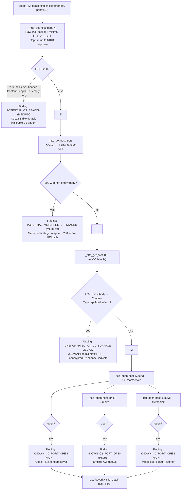
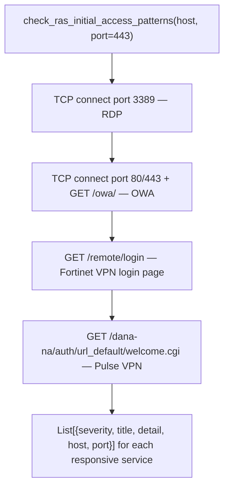

# C2 / Exfiltration Indicators

Probe a live host for active command-and-control channel signatures: Cobalt Strike default beacon responses, Meterpreter HTTP stager behavior, Empire and Metasploit default listener ports, and ransomware initial-access precursors exposed RDP, OWA, Fortinet VPN, Pulse VPN: using raw socket connections with no external tool dependencies.

---

## Why this exists

1. **Known C2 framework default configurations produce distinctive network fingerprints.** Cobalt Strike with an unmodified Malleable C2 profile responds to `GET /` with HTTP 200, no `Server` header, and `Content-Length: 0` or zero body bytes. Meterpreter HTTP stager responds HTTP 200 to any path, including random 4-character URIs that no legitimate service would handle. These patterns are not guaranteed: operators change them, but they appear frequently enough in engagements that probing them before manual analysis saves time.

2. **Well-known C2 framework default ports confirm compromise without service identification.** Port 50050 is the Cobalt Strike teamserver default. Port 8443 is the PowerShell Empire default. Port 55553 is the Metasploit default reverse handler. When any of these ports responds to a TCP connect on an internal host that has no business running these services, that response alone constitutes an indicator of compromise. The function probes all three in sequence.

3. **Ransomware operators use specific exposed services as initial access vectors.** RDP (`3389`), Outlook Web Access, Fortinet VPN (`/remote/login`), and Pulse VPN (`/dana-na/auth/url_default/welcome.cgi`) are the four most common initial access broker pivot points. Identifying these services: especially unpatched VPN appliances with publicly known vulnerabilities: maps the external attack surface before an active exploitation attempt is made.

---

## How it works





---

## Usage

```python
from modules.lateral_movement import (
    detect_c2_beaconing_indicators,
    check_ras_initial_access_patterns,
)

host = "10.10.10.5"

# C2 beacon check
c2_findings = detect_c2_beaconing_indicators(host, port=443, timeout=5.0)
for f in c2_findings:
    print(f"[{f['severity']:6}]  {f['title']}")
    print(f"         {f['detail']}")

# Also check HTTP (port 80)
c2_findings += detect_c2_beaconing_indicators(host, port=80)

# RaaS initial access precursors
ras_findings = check_ras_initial_access_patterns(host, timeout=5.0)
for f in ras_findings:
    print(f"[{f['severity']:6}]  {f['title']}  host={f['host']} port={f['port']}")

# Combine and sort by severity
all_findings = c2_findings + ras_findings
all_findings.sort(key=lambda f: {'HIGH': 0, 'MEDIUM': 1, 'INFO': 2}.get(f['severity'], 9))
for f in all_findings:
    print(f"  {f['severity']:6}  {f['title']}")
```

---

## Example output

```
[HIGH  ]  KNOWN_C2_PORT_OPEN
          host=10.10.10.5 port=50050 service=Cobalt_Strike_teamserver
          note=well_known_C2_framework_default_port_responding

[MEDIUM]  POTENTIAL_CS_BEACON
          host=10.10.10.5 port=443 status=200 server_header=absent
          content_length=0 note=Cobalt_Strike_default_beacon_response_pattern

[MEDIUM]  POTENTIAL_METERPRETER_STAGER
          host=10.10.10.5 port=443 uri=/aBcD status=200 body_len=204800
          note=Meterpreter_HTTP_stager_responds_200_to_random_URIs

[HIGH  ]  FORTINET_VPN_EXPOSED
          host=10.10.10.5 port=443 path=/remote/login
          note=Fortinet_SSL-VPN_login_page_responsive
```

---

## False positives

**`POTENTIAL_CS_BEACON` on misconfigured servers.** A legitimate web server with `ServerTokens Off` and no content on `/` produces the same `Server`-absent, zero-body 200 response as an unmodified Cobalt Strike profile. This finding is an indicator, not a confirmation. Follow up with SSL certificate inspection (`openssl s_client -connect host:port`): Cobalt Strike default certificates use self-signed RSA with a known subject string.

**`POTENTIAL_METERPRETER_STAGER` on wildcard handlers.** Any server with a catch-all route that returns 200 for unknown paths common in single-page apps and load balancers triggers this finding. The distinguishing factor for Meterpreter is binary body content containing PE headers or shellcode. The function does not inspect body content: treat this as low-confidence until the response body is analyzed.

**`KNOWN_C2_PORT_OPEN` on legitimate services.** Port 8443 runs TLS services on many production hosts Elasticsearch, Kubernetes API, Jenkins. `_tcp_open()` only checks whether the port accepts a TCP connection, it does not send any protocol-specific probe. Verify with `openssl s_client -connect host:8443 </dev/null` and check the certificate subject.

---

## Pipeline position

**Before this module:** This module targets live hosts. Obtain target IPs from `NetworkDiscovery.enumerate_all()`, the VDT `tiptoe` scan, or the engagement scope.

**After this module:** For `KNOWN_C2_PORT_OPEN` and `POTENTIAL_CS_BEACON` findings: extract any SSL certificate from the port for inspection, check for default Cobalt Strike watermark license hash embedded in profile or stage. For `FORTINET_VPN_EXPOSED` / RaaS precursors: check the firmware version against known CVEs and run the appropriate binary RE analysis with `BinaryContext.load_or_build()`.

---

## Reading findings

| Field | Content |
|:---|:---|
| `severity` | `HIGH` default C2 ports, VPN with CVE exposure / `MEDIUM` behavioral indicators / `INFO` informational surface |
| `title` | Short classification: `POTENTIAL_CS_BEACON`, `KNOWN_C2_PORT_OPEN`, `FORTINET_VPN_EXPOSED`, etc. |
| `detail` | Full probe result: host, port, path, status code, headers observed, explanatory note |
| `host` | Target IP |
| `port` | Port at which the indicator was detected |

---

## See also

- [System-Call Tracing](system-call-tracing.md): dynamic trace to confirm active beaconing from a compromised host
- [Binary Format and Platform Identification](binary-format-and-platform-identification.md): identify firmware on exposed VPN appliances
- [API Authentication and Token Checks](api-authentication-and-token-checks.md): binary RE for VPN authentication bypass
