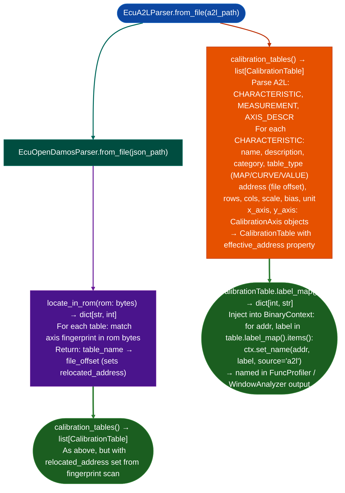

<a id="calibration-parsers"></a>
# Calibration & CAN Analysis

Parse ECU calibration definition files: ASAM/ASAP2 A2L industry standard for Bosch EDC16/EDC17, Continental, Delphi and `open_damos.json` fingerprint-relocated format for PSA/Bosch ECU variant families: producing `CalibrationTable` objects and label maps for injection into `BinaryContext`, enabling calibration variable names to appear in disassembly alongside security-relevant code.

---

## Why this exists

1. A2L files ASAM MCD-2 MC standard, ASAP2 v1.31+ contain the ground-truth mapping from ROM addresses to calibration variable names: a single EDC16 A2L covers 3,999 `CHARACTERISTIC` definitions; a large EDC17 covers 25,000+. `EcuA2LParser.calibration_tables()` parses these and returns typed `CalibrationTable` objects with axis and value ROM addresses, enabling `BinaryContext.set_name()` annotation of fuel maps, injection timing tables, and safety limits that are directly adjacent to security-relevant code.

2. `EcuOpenDamosParser` handles `open_damos.json` format with fingerprint relocation: rather than using fixed ROM addresses which differ between firmware variants, the parser scans for axis breakpoint value fingerprints in the ROM bytes and adjusts table addresses accordingly. The same `open_damos.json` file works for every PSA/Bosch EDC16C34 firmware variant regardless of minor address differences between software generations.

3. Calibration context is essential for security analysis: a buffer write to a ROM address that appears to be a vulnerability may be a legitimate calibration update path, or a calibration variable read may be an attacker-controllable input. Annotating calibration addresses in `BinaryContext` allows `FuncProfiler` and `TaintTracker` to correctly label these as calibration reads/writes rather than unknown data accesses.

---

## How it works



---

## Usage

```python
from ablation.analyzers.ecu_a2l_parser import EcuA2LParser
from ablation.analyzers.ecu_open_damos_parser import EcuOpenDamosParser
from ablation.analyzers.binary_context import BinaryContext

ctx = BinaryContext.load_or_build('/path/to/edc16_rom.bin')

# A2L-based annotation
parser = EcuA2LParser.from_file('/path/to/ecu.a2l')
tables = parser.calibration_tables()
print(f"A2L calibration tables: {len(tables)}")

for table in tables:
    ctx.set_name(table.effective_address, table.name, source='a2l')

print(f"Annotated {len(tables)} calibration entries")

# Open DAMOS fingerprint-relocated annotation
with open('/path/to/edc16_rom.bin', 'rb') as f:
    rom = f.read()

od_parser = EcuOpenDamosParser.from_file('/path/to/open_damos.json')
locations = od_parser.locate_in_rom(rom)
for table in od_parser.calibration_tables():
    if table.name in locations:
        ctx.set_name(locations[table.name], table.name, source='open_damos')
```

---

## CAN DBC decoding

`CanDbcParser` reads Vector/PEAK DBC files and extracts standard and extended CAN messages, signal bit layouts, scaling, units, comments, and value tables.

```python
from modules.can_dbc_parser import CanDbcParser

dbc = CanDbcParser.from_file('/path/to/vehicle.dbc')
print(dbc.summary())

for message in dbc.messages():
    print(message.name, hex(message.msg_id), message.dlc)
    for signal in message.signals:
        print(f'  {signal.name}: raw * {signal.factor} + {signal.offset} {signal.unit}')

speed = dbc.message(0x100)
if speed is not None:
    signal = speed.signal('VehicleSpeed')
    if signal is not None:
        physical_value = signal.decode(raw_int=1234)
```

`message(can_id)` uses the canonical ID with the extended-frame marker stripped. `find_signals(text)` performs a case-insensitive substring search. DBC parsing supplies decoding metadata only; captured-frame extraction and bus timestamping must come from the CAN capture source.

---

## Example output

The following illustrates the calibration parser output format. Actual table counts and names are ECU-specific.

```
EcuA2LParser: edc17.a2l

Calibration tables: 25,341
  CHARGE_TEMP_FACTOR_MAP    va=0x0012340   MAP  (16x16 axis)
  INJ_TIMING_BASE_CURVE     va=0x0018000   CURVE  (8-point X-axis)
  LAMBDA_TARGET_VALUE       va=0x00200a0   VALUE

Annotated 25,341 BinaryContext entries (source='a2l')

EcuOpenDamosParser: open_damos.json  (EDC16C34)
  Fingerprint located: 47 / 50 tables  (94% match rate)
```

---

## False positives

**`locate_in_rom()` fingerprint matching may return wrong addresses when multiple ROM regions contain the same axis breakpoint values**: fuel map axis values for example RPM breakpoints 800, 1200, 1600, ... may appear in multiple places. The parser selects the first match; validate located tables by comparing axis value counts against the A2L definition.

**A2L ROM addresses are absolute**: if the ECU ROM is loaded at a non-zero base address in `BinaryContext`, `CalibrationTable.va` must be adjusted by the base offset before injection. A2L addresses are typically the actual Flash memory physical addresses for example `0x80000000` for ARM Cortex-M Flash base.

---

## Pipeline position

Run `EcuA2LParser` or `EcuOpenDamosParser` after `BinaryContext.load_or_build()` to inject calibration variable names before `FuncProfiler` or `WindowAnalyzer` analysis. Calibration context prevents false-positive vulnerability findings on deliberate calibration update paths.

---

## Reading output

`EcuA2LParser.calibration_tables()` returns `list[CalibrationTable]`:

| Attribute | Content |
|:---|:---|
| `name` | Table name from the A2L/DAMOS definition |
| `description` | Long description string from the calibration file |
| `category` | Category string from the source file |
| `table_type` | `'VALUE'`, `'CURVE'`, or `'MAP'` |
| `address` | File offset of the data block raw, before relocation |
| `relocated_address` | Fingerprint-relocated address, or `None` if not relocated |
| `effective_address` | Property: `relocated_address` if set, else `address` |
| `rows` | Row count y-axis length |
| `cols` | Column count x-axis length |
| `scale` / `bias` | Physical-unit conversion factors |
| `unit` | Physical unit string |
| `x_axis` / `y_axis` | `CalibrationAxis` objects for CURVE and MAP, or `None` |
| `label_map()` | Returns `{file_offset: label}`: inject into `BinaryContext` via `set_name()` |

`EcuOpenDamosParser.locate_in_rom(rom)` accepts raw ROM bytes and returns `Dict[str, int]`: `{characteristic_name: file_offset}` for every characteristic table found in this ROM variant.

---

## See also

- [Flat ROM Function Discovery](flat-rom-function-discovery.md): ISA detection and function start discovery before calibration annotation
- [M68K/CPU32 Decoding](m68k-cpu32-decoding.md): M68K ECU decoder for calibration-adjacent code analysis
- [C166/C167 ECU Decoding](c166-c167-decoding.md): C166/C167 decoder for Bosch/Siemens targets using A2L
