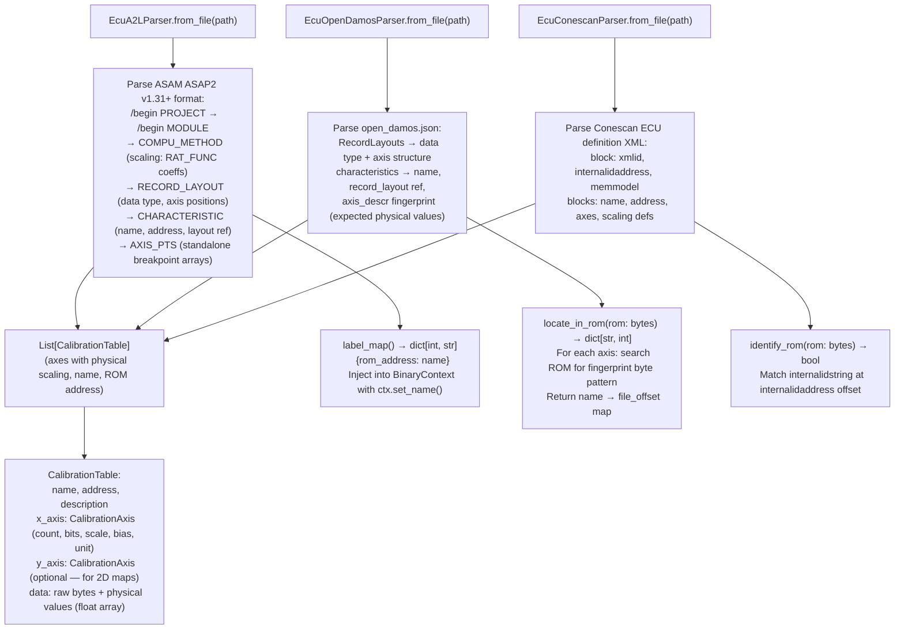

# Calibration Parsers

Parse ECU calibration definition formats (ASAM A2L, open_damos.json, Conescan XML) and emit `CalibrationTable` objects and address label maps for injection into `BinaryContext` — enabling named calibration table access in stripped ECU firmware.

---

## Why this exists

1. **ECU ROM analysis without calibration definitions is symbol-less analysis on a data-heavy binary — a single EDC17 ROM may contain 25,000+ calibration tables (fuel maps, torque limiters, boost targets, knock thresholds) stored as raw byte arrays with no embedded names.** Calibration definition files (A2L, open_damos.json, Conescan XML) provide the names, addresses, axis types, and scaling formulas for every table. `EcuA2LParser.label_map()` and `EcuOpenDamosParser.label_map()` inject these as named symbols into `BinaryContext`, so `ctx.name(va)` returns `"KF_LOAD_EFF"` instead of `0xB2140`.

2. **Three calibration definition formats are in widespread use across different ECU families — ASAM A2L (Bosch EDC16, EDC17, MED17, Continental, Delphi), open_damos.json (PSA/Bosch EDC16C34 and EDC16+ variants from the open-car-reprog project), and Conescan XML (Mazda SH705x/SH7055-based ECUs).** Each has a different address model: A2L uses absolute addresses for a specific ROM variant; open_damos.json uses fingerprint-based relocation to find tables in any ROM variant of the family; Conescan XML uses ROM ID matching plus internal-address-relative offsets.

3. **open_damos.json fingerprint relocation makes the same definition file work across all firmware variants of a target ECU family — the parser locates each axis by searching the ROM for the expected physical breakpoint values rather than using a fixed address.** `EcuOpenDamosParser.locate_in_rom(rom)` performs this search and returns a name→offset map. Without fingerprint relocation, each firmware update requires a new definition file.

---

## How it works



### Parser selection guide

| Format | Parser | Target ECUs | Address model |
|:---|:---|:---|:---|
| ASAM A2L (`.a2l`) | `EcuA2LParser` | Bosch EDC16, EDC17, MED17; Continental; Delphi | Absolute — one file per ROM variant |
| open_damos JSON | `EcuOpenDamosParser` | PSA/Bosch EDC16C34, EDC16+ variants | Fingerprint relocation — works across all variants |
| Conescan XML | `EcuConescanParser` | Mazda SH705x/SH7055 (MX5, RX8) | ROM ID match + relative address |

---

## Usage

```python
from ablation.analyzers.ecu_a2l_parser import EcuA2LParser
from ablation.analyzers.ecu_open_damos_parser import EcuOpenDamosParser
from ablation.analyzers.ecu_conescan_parser import EcuConescanParser
from ablation.analyzers.binary_context import BinaryContext

# ── A2L parser (Bosch EDC17/MED17) ─────────────────────────────────────────
parser = EcuA2LParser.from_file('/path/to/definition.a2l')
tables = parser.calibration_tables()
labels = parser.label_map()
print(parser.summary())   # "EcuA2LParser: <N> tables, <M> axes"

# Inject into BinaryContext
ctx = BinaryContext.load_or_build('/path/to/rom.bin')
for addr, name in labels.items():
    ctx.set_name(addr, name, source='a2l')

# ── open_damos (PSA/Bosch EDC16C34) ────────────────────────────────────────
odp = EcuOpenDamosParser.from_file('/path/to/definition.json')
rom_data = open('/path/to/rom.bin', 'rb').read()
located = odp.locate_in_rom(rom_data)   # fingerprint-based relocation
labels_od = odp.label_map(rom_data)
print(odp.summary())

# ── Conescan (Mazda SH705x) ─────────────────────────────────────────────────
csp = EcuConescanParser.from_file('/path/to/definition.xml')
if csp.identify_rom(rom_data):
    tables_cs = csp.calibration_tables()
    labels_cs = csp.label_map()
```

---

## Example output

The following illustrates parser summary format. Actual table counts and names are definition-file-specific.

```
EcuA2LParser: <N> tables, <M> axes, <K> compu_methods
  Sample tables: KF_LOAD_EFF, KF_TORQUE_MAX, KF_KFZW, KF_LAMFA, KF_TIEFF
  ROM address range: <start_addr> – <end_addr>

EcuOpenDamosParser: <N> tables
  Fingerprint relocation: <located>/<N> tables located in ROM
  Unlocated (fingerprint mismatch): <table_names>
```

---

## False positives

**A2L files are ROM-variant-specific — using an A2L file from firmware 1.x on firmware 2.x will produce incorrect ROM addresses if tables moved between variants.** Always confirm the A2L file matches the exact ROM build using the ROM ID or checksum. `EcuOpenDamosParser` avoids this entirely by design (fingerprint relocation), but A2L files require manual version matching.

**`EcuOpenDamosParser.locate_in_rom()` searches for fingerprint byte patterns (physical breakpoint values) — a fingerprint collision can assign one table's address to a different table with similar breakpoint values.** This is most likely for simple linear axes (0, 500, 1000, 2000...) that appear in multiple tables. Verify relocated addresses for tables with generic-looking axis values.

---

## Pipeline position

Run calibration parsers before any C166/SH/other ECU decoder analysis on the same ROM. Inject the `label_map()` result into `BinaryContext` first — all subsequent `ctx.name(va)` calls will return calibration table names, which appear in `scan_xram_loads()` and `scan_xram_stores()` output as named symbols rather than raw addresses.

---

## See also

- [Calibration Table Interpretation](calibration-table-interpretation.md) — `CalibrationTable` and `CalibrationAxis` dataclasses; physical value decoding
- [C166/C167 Decoding](c166-c167-decoding.md) — ECU decoder that produces XRAM access lists that reference calibration addresses
- [Calibration Variant Relocation Support](calibration-variant-relocation-support.md) — fingerprint relocation detail for cross-variant ROM analysis
- [V850/RH850](v850-rh850.md) — Renesas ECU decoder often paired with A2L or Conescan definitions
