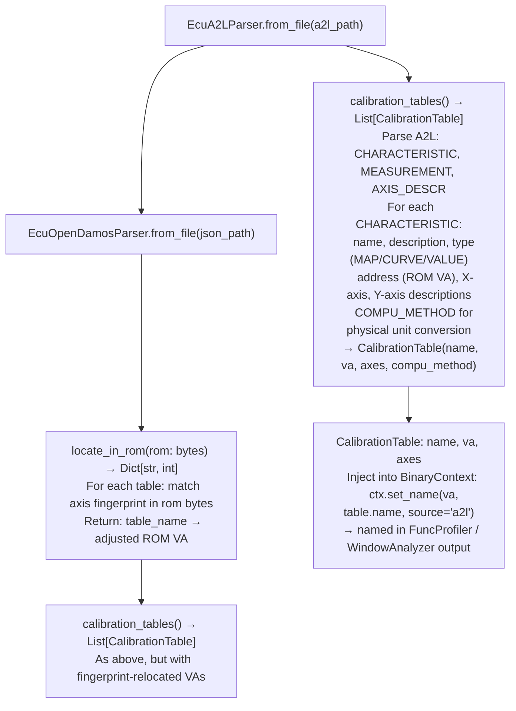

# Calibration Parsers

Parse ECU calibration definition files — ASAM/ASAP2 A2L (industry standard for Bosch EDC16/EDC17, Continental, Delphi) and `open_damos.json` (fingerprint-relocated format for PSA/Bosch ECU variant families) — producing `CalibrationTable` objects and label maps for injection into `BinaryContext`, enabling calibration variable names to appear in disassembly alongside security-relevant code.

---

## Why this exists

1. **A2L files (ASAM MCD-2 MC standard, ASAP2 v1.31+) contain the ground-truth mapping from ROM addresses to calibration variable names** — a single EDC16 A2L covers 3,999 `CHARACTERISTIC` definitions; a large EDC17 covers 25,000+. `EcuA2LParser.calibration_tables()` parses these and returns typed `CalibrationTable` objects with axis and value ROM addresses, enabling `BinaryContext.set_name()` annotation of fuel maps, injection timing tables, and safety limits that are directly adjacent to security-relevant code.

2. **`EcuOpenDamosParser` handles `open_damos.json` format with fingerprint relocation** — rather than using fixed ROM addresses (which differ between firmware variants), the parser scans for axis breakpoint value fingerprints in the ROM bytes and adjusts table addresses accordingly. The same `open_damos.json` file works for every PSA/Bosch EDC16C34 firmware variant regardless of minor address differences between software generations.

3. **Calibration context is essential for security analysis** — a buffer write to a ROM address that appears to be a vulnerability may be a legitimate calibration update path, or a calibration variable read may be an attacker-controllable input. Annotating calibration addresses in `BinaryContext` allows `FuncProfiler` and `TaintTracker` to correctly label these as calibration reads/writes rather than unknown data accesses.

---

## How it works



---

## Usage

```python
from ablation.analyzers.ecu_a2l_parser import EcuA2LParser
from ablation.analyzers.ecu_open_damos_parser import EcuOpenDamosParser
from ablation.analyzers.binary_context import BinaryContext

ctx = BinaryContext.load_or_build('/path/to/edc16_rom.bin')

# A2L-based annotation
parser = EcuA2LParser.from_file('/path/to/ecu.a2l')
tables = parser.calibration_tables()
print(f"A2L calibration tables: {len(tables)}")

for table in tables:
    ctx.set_name(table.va, table.name, source='a2l')

print(f"Annotated {len(tables)} calibration entries")

# Open DAMOS fingerprint-relocated annotation
with open('/path/to/edc16_rom.bin', 'rb') as f:
    rom = f.read()

od_parser = EcuOpenDamosParser.from_file('/path/to/open_damos.json')
locations = od_parser.locate_in_rom(rom)
for table in od_parser.calibration_tables():
    if table.name in locations:
        ctx.set_name(locations[table.name], table.name, source='open_damos')
```

---

## Example output

The following illustrates the calibration parser output format. Actual table counts and names are ECU-specific.

```
EcuA2LParser: edc17.a2l

Calibration tables: 25,341
  CHARGE_TEMP_FACTOR_MAP    va=0x0012340   MAP  (16x16 axis)
  INJ_TIMING_BASE_CURVE     va=0x0018000   CURVE  (8-point X-axis)
  LAMBDA_TARGET_VALUE       va=0x00200a0   VALUE

Annotated 25,341 BinaryContext entries (source='a2l')

EcuOpenDamosParser: open_damos.json  (EDC16C34)
  Fingerprint located: 47 / 50 tables  (94% match rate)
```

---

## False positives

**`locate_in_rom()` fingerprint matching may return wrong addresses when multiple ROM regions contain the same axis breakpoint values** — fuel map axis values (e.g., RPM breakpoints 800, 1200, 1600, ...) may appear in multiple places. The parser selects the first match; validate located tables by comparing axis value counts against the A2L definition.

**A2L ROM addresses are absolute** — if the ECU ROM is loaded at a non-zero base address in `BinaryContext`, `CalibrationTable.va` must be adjusted by the base offset before injection. A2L addresses are typically the actual Flash memory physical addresses (e.g., `0x80000000` for ARM Cortex-M Flash base).

---

## Pipeline position

Run `EcuA2LParser` or `EcuOpenDamosParser` after `BinaryContext.load_or_build()` to inject calibration variable names before `FuncProfiler` or `WindowAnalyzer` analysis. Calibration context prevents false-positive vulnerability findings on deliberate calibration update paths.

---

## Reading output

`EcuA2LParser.parse()` returns `List[CalibrationTable]`:

| Attribute | Content |
|:---|:---|
| `name` | Table name from the A2L definition |
| `va` | Virtual address (applied to BinaryContext entries) |
| `table_type` | `MAP`, `CURVE`, or `VALUE` |
| `data` | Numpy array of physical-unit values |
| `x_axis` | X breakpoint array (for CURVE and MAP) |
| `y_axis` | Y breakpoint array (for MAP only) |

`EcuOpenDamosParser.locate_in_rom(rom)` accepts raw ROM bytes and returns `Dict[str, int]` — `{characteristic_name: file_offset}` for every characteristic table found in this ROM variant.

---

## See also

- [Flat ROM Function Discovery](flat-rom-function-discovery.md) — ISA detection and function start discovery before calibration annotation
- [M68K/CPU32 Decoding](m68k-cpu32-decoding.md) — M68K ECU decoder for calibration-adjacent code analysis
- [C166/C167 ECU Decoding](c166-c167-decoding.md) — C166/C167 decoder for Bosch/Siemens targets using A2L
