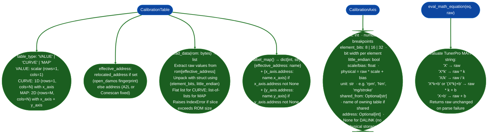

# Calibration Table Interpretation

`CalibrationTable` and `CalibrationAxis` dataclasses: the shared data model for ECU calibration objects, providing raw→physical value decoding, label-map generation for `BinaryContext` injection, and ROM data extraction for map visualization.

---

## Why this exists

1. **Calibration tables in ECU ROM are raw integer or float arrays with no embedded unit, scale, or axis information: a raw value of `0x7FFF` in a torque limit map might mean 204.0 Nm or 800.0 RPM depending on the scale and bias defined in the calibration definition file.** `CalibrationTable` stores the scale and bias from the definition file alongside the ROM address, so `read_data(rom)` returns pre-scaling integer/float values and callers can apply `physical = raw * scale + bias` without re-parsing the definition.

2. **A single `CalibrationTable` may have a shared x-axis breakpoint array referenced by many tables: `CalibrationAxis.shared_from` names the owning table.** This is the ASAM A2L `AXIS_PTS` pattern: a standalone axis object referenced by multiple `CHARACTERISTIC` entries. Knowing whether an axis is shared vs. private matters for address labeling: `label_map()` only emits axis labels for axes with non-None addresses; `DALINK` axes no physical storage emit only the table label.

3. **`eval_math_equation()` evaluates TunerPro-style MATH string equations `X*0.1`, `X/4+20`, etc. for definition files that use equation-form scaling instead of linear A/B coefficients.** This covers the XDF/TunerPro calibration format subset used by some Bosch and Siemens aftermarket definition files. Without it, physical values from MATH-equation axes would require parsing in the caller.

---

## How it works



---

## Usage

```python
from ablation.analyzers.ecu_a2l_parser import EcuA2LParser
from ablation.analyzers.ecu_cal_def import CalibrationTable, eval_math_equation

# Parse and get tables
parser = EcuA2LParser.from_file('/path/to/definition.a2l')
tables = parser.calibration_tables()

# Get a specific table
for t in tables:
    if t.name == 'KF_LOAD_EFF':
        rom = open('/path/to/rom.bin', 'rb').read()

        # Extract raw data
        raw = t.read_data(rom)           # list or list-of-lists

        # Decode physical values
        if t.table_type == 'CURVE':
            physical = [v * t.scale + t.bias for v in raw]
            print(f"{t.name}: {physical} {t.unit}")
        elif t.table_type == 'MAP':
            for row in raw:
                print([v * t.scale + t.bias for v in row])

        # Get axis breakpoints
        if t.x_axis and t.x_axis.address is not None:
            x_raw = ...  # read t.x_axis.address from rom
            x_phys = [v * t.x_axis.scale + t.x_axis.bias for v in x_raw]
            print(f"X axis ({t.x_axis.unit}): {x_phys}")

        # Generate BinaryContext labels
        labels = t.label_map()
        for addr, name in labels.items():
            ctx.set_name(addr, name, source='a2l')
        break

# eval_math_equation for TunerPro-format scalings
physical_val = eval_math_equation('X*0.023437+0', raw_val=0x1200)
```

---

## Example output

The following illustrates calibration table print output. Actual names, values, and units are definition-specific.

```
KF_LOAD_EFF [MAP 16x16]
  Address: <file_offset>
  Data (physical, mg/stroke):
    <row_0_values>
    <row_1_values>
    ...
  X axis (rpm):  [<x_breakpoints>]
  Y axis (mg):   [<y_breakpoints>]
  Scale: <scale>, Bias: <bias>, Unit: mg/stroke
```

---

## False positives

**`read_data()` returns raw pre-scaling integers, not physical values.** Callers must apply `physical = raw * scale + bias` separately. This is intentional: calibration analysis tools need both the raw value for diff/comparison and the physical value for human-readable output. Failing to apply the scaling produces incorrect physical interpretation.

**`effective_address` returns `relocated_address` when set: for open_damos tables where fingerprint relocation succeeded.** If `locate_in_rom()` failed for a table, `relocated_address` is `None` and `effective_address` falls back to the original possibly wrong address. Always check `EcuOpenDamosParser.locate_in_rom()` results before calling `read_data()` on open_damos tables.

---

## Pipeline position

`CalibrationTable.label_map()` feeds directly into `BinaryContext.set_name()` after calibration parsers extract table definitions. Once labels are injected, all ECU decoder analysis C166 XRAM scans, V850 disassembly, SH-2A lifting will reference calibration tables by name in its output. See [Calibration Parsers](calibration-parsers.md) for parser-level documentation.

---

## Reading output

`CalibrationTable` object attributes (returned by `EcuA2LParser.from_file(path)` and the other ECU definition parsers):

| Attribute | Content |
|:---|:---|
| `name` | Table name from the `.a2l`/`.damos` definition |
| `description` | Human-readable description from the definition file |
| `category` | Source-file category label |
| `table_type` | `'VALUE'` (scalar), `'CURVE'` 1D with x_axis, `'MAP'` 2D with x_axis + y_axis |
| `address` | File offset of the table data |
| `rows` | Row count Y-axis length for MAP type |
| `cols` | Column count X-axis length for MAP type |
| `element_bits` | Bit width of each element 8, 16, or 32 |
| `little_endian` | `True` for little-endian byte order |
| `scale` | Scale factor applied to raw integer data |
| `bias` | Bias added after scaling |
| `unit` | Physical unit string for example `mg/stroke`, `°C` |
| `x_axis` | `Optional[CalibrationAxis]`: X-axis breakpoints |
| `y_axis` | `Optional[CalibrationAxis]`: Y-axis breakpoints MAP type only |
| `source_file` | Path to the definition file this table was parsed from |
| `is_float` | `True` when storage type is float/float32 |

---

## See also

- [Calibration Parsers](calibration-parsers.md): A2L, open_damos, Conescan: produce `List[CalibrationTable]`
- [C166/C167 Decoding](c166-c167-decoding.md): produces `scan_xram_loads()` results that reference calibration addresses
- [Binary Lifter](binary-lifter.md): `arch='sh2a'` for lifting the SH-2A functions that access calibration tables
- [Calibration Variant Relocation Support](calibration-variant-relocation-support.md): fingerprint relocation internals
