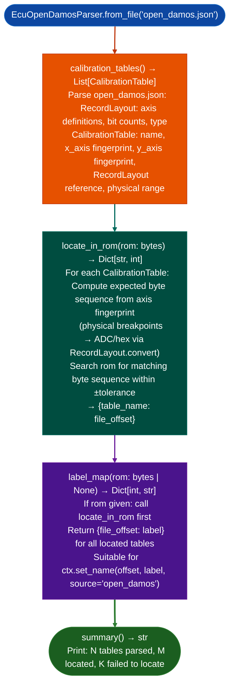

# Calibration Variant Relocation Support

Locate open_damos.json calibration tables in any firmware variant of a Bosch ECU family: using fingerprint relocation matching expected physical breakpoint axis values to find tables even when their absolute addresses differ across software generations: via `ablation/analyzers/ecu_open_damos_parser.py`.

---

## Why this exists

1. **Fixed-address calibration table lookups break across firmware variants.** Bosch EDC-family ECUs EDC16C34, EDC17, MED17 have dozens of software generations; a calibration table found at `0x3E8000` in one build may appear at `0x3E9200` in the next. `EcuOpenDamosParser` uses the numeric axis fingerprints embedded in the open_damos.json to find each table in any variant without maintaining per-version address maps.

2. open_damos.json is the output format of the open-car-reprog project Poisson48: a community-maintained calibration definition file for PSA/Bosch ECU families. Each axis entry carries expected physical breakpoint values for example RPM axis = `[800, 1200, 1600, 2000, ...]`. `locate_in_rom()` XORs a search window against these fingerprints to find the table's location in any ROM variant, not just the baseline image used to build the JSON.

3. `label_map(rom)` returns `{file_offset: label}` directly usable with `ctx.set_name()`: after calling `locate_in_rom()`, `label_map()` generates human-readable table names for example `inj_duration_vs_rpm_load`, `boost_target_map` keyed by file offset. This populates the `BinaryContext` name registry with calibration-domain labels in one call, enabling SemanticSearcher to find code that accesses specific tables by name.

---

## How it works



---

## Usage

```python
from ablation.analyzers.ecu_open_damos_parser import EcuOpenDamosParser

parser = EcuOpenDamosParser.from_file('open_damos.json')
rom = open('9663944680.bin', 'rb').read()

# Locate all tables in this specific ROM variant
located = parser.locate_in_rom(rom)
print(f"Located {len(located)} calibration tables")

# Build label map and populate context
labels = parser.label_map(rom)
for offset, name in labels.items():
    ctx.set_name(offset, name, source='open_damos')

print(parser.summary())
```

---

## Example output

The following illustrates calibration relocation output format.

```
EcuOpenDamosParser: open_damos.json
  Tables defined: <N>

locate_in_rom: 9663944680.bin
  Located: <M>  |  Failed: <K>

label_map():
  0x3e8040 → inj_duration_vs_rpm_load
  0x3e9200 → boost_target_map
  0x3e94a0 → egr_correction_table
  ...
```

---

## False positives

**Fingerprint search within ±tolerance may produce offset collisions**: if two tables have similar axis fingerprints and appear near each other in ROM, `locate_in_rom()` may return the wrong table offset for one of them. Verify located offsets by inspecting the data at the returned offset against the expected axis values from the JSON.

**open_damos.json files are calibration-family-specific**: a PSA/Bosch EDC16C34 JSON will not locate tables in a BMW/Bosch MED17 ROM. Use the JSON file that matches the ECU family under analysis.

---

## Pipeline position

Run `EcuOpenDamosParser` as the first step on any Bosch ECU ROM that has an available open_damos.json definition. Apply `label_map()` to `BinaryContext` before `SemanticSearcher` runs: calibration table names improve semantic hit quality for code that accesses injection/ignition/boost tables by referencing their human-readable names.

---

## Reading output

`EcuOpenDamosParser.locate_in_rom(rom)` accepts raw ROM bytes and returns `Dict[str, int]`: `{characteristic_name: file_offset}` for every table found in this ROM variant. Tables that were not found are omitted from the result.

`EcuOpenDamosParser.label_map(rom=None)` returns `Dict[int, str]`: file offset → calibration table name. When `rom` is supplied, fingerprint relocation is performed first so the offsets reflect this ROM variant; when `None`, the default A2L addresses are used as-is.

---

## See also

- [TI C28x Decoding](ti-c28x-decoding.md): `EcuC28xDecoder` for TI-based ECU firmware different architecture but similar calibration analysis pattern
- [Flat ROM Function Discovery](flat-rom-function-discovery.md): `EcuArchDetector` for initial architecture identification before calibration analysis
