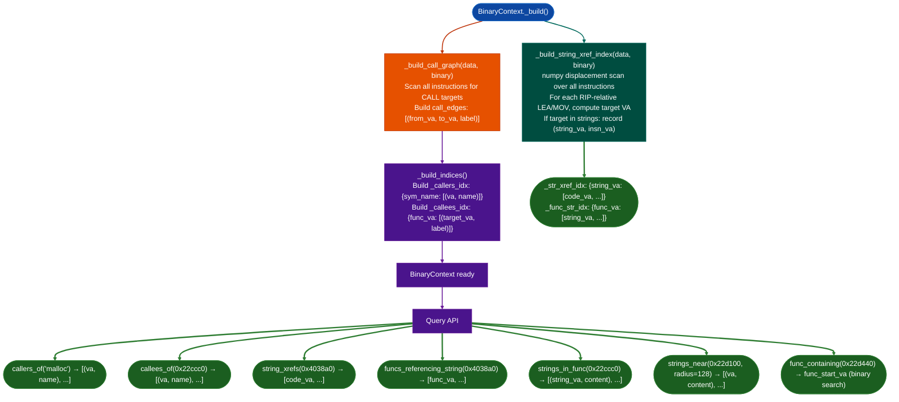

# Call and String Cross-References

Navigate the binary's call graph and string reference index: find every caller of a function, every callee of a function, every string referenced by a function, and every function that references a particular string: all in sub-millisecond query time from a pre-built index.

---

## Why this exists

1. **Understanding what calls what is the primary navigation tool in stripped firmware.** When `HeapVulnScanner` identifies a suspicious allocation at `0x40a200`, the first question is: "what calls this function, and where does the caller come from?" Without a pre-built caller index, answering this requires a full re-scan of the disassembly. `BinaryContext`'s `callers_of()` answers it instantly from an in-memory dict.

2. **String cross-references map human-readable evidence to code locations.** Firmware binaries contain error messages, log strings, and protocol strings in `.rodata`. A string like `"SSL_read error: %d"` instantly narrows the relevant code to 1–3 functions. The `funcs_referencing_string()` and `strings_in_func()` methods provide that navigation without disassembly or grep.

3. **RIP-relative string references must be indexed at build time.** On x86-64, string references use RIP-relative addressing `lea rsi, [rip+offset]`. Computing which instruction references which string requires scanning every instruction in the code section and resolving each RIP-relative displacement against the known string VA set: an O(N×M) operation that is too expensive to run on every query. `BinaryContext` runs this scan once during `_build()` and caches the result as `_str_xref_idx`.

---

## How it works



### Call graph queries

**`callers_ofsymbol_or_va`**: accepts either a PLT symbol name (string) or a VA (int). When given a string, it looks up the PLT map to find all functions that call that imported symbol. When given a VA, it looks up all functions that contain a `CALL` to that VA. Returns a list of `caller_va, caller_name` tuples, with the best available name from the overlay.

**`callees_of(func_va)`**: returns all `target_va, target_name` pairs for calls made from the function starting at `func_va`. Useful for rapidly building a call tree from a specific function of interest.

### String cross-reference queries

**`string_xrefsstring_va`**: returns a list of instruction-level code VAs that RIP-relatively reference the given string VA. Multiple instructions in the same function can reference the same string.

**`funcs_referencing_stringstring_va`**: maps each instruction VA from `string_xrefs()` to its containing function start using `func_containing()`, then deduplicates. Returns a sorted list of function start VAs. This is the primary way to go from "I know the log message" to "I know which function to analyze".

**`strings_in_func(func_va)`**: returns all `string_va, content` pairs for strings that have a RIP-relative reference inside the function at `func_va`. Useful for characterizing what a function does by its string constants.

**`strings_nearva, radius=128`**: returns all strings in the `strings` dict within `±radius` bytes of `va`. Useful for checking what constant data surrounds a specific address.

---

## Usage

```python
from ablation.analyzers.binary_context import BinaryContext

ctx = BinaryContext.load_or_build('/fw/fortigate/httpsd')

# Who calls malloc?
for caller_va, caller_name in ctx.callers_of('malloc'):
    print(f"  0x{caller_va:x}  {caller_name}")

# What does a function call?
for target_va, target_name in ctx.callees_of(0x22ccc0):
    print(f"  → 0x{target_va:x}  {target_name}")

# Find functions by log message
for va, content in ctx.strings.items():
    if 'SSL_read error' in content:
        print(f"String at 0x{va:x}: {content!r}")
        for func_va in ctx.funcs_referencing_string(va):
            print(f"  referenced by: 0x{func_va:x}  {ctx.name(func_va)}")
        break

# Characterize a function by its strings
for sva, s in ctx.strings_in_func(0x22ccc0):
    print(f"  0x{sva:x}  {s!r}")

# Find what's near a suspicious address
for sva, s in ctx.strings_near(0x40a200, radius=256):
    print(f"  0x{sva:x}  {s!r}")

# Find the function containing a VA from a taint finding
va = 0x22d440
func_va = ctx.func_containing(va)
print(f"0x{va:x} is in function starting at 0x{func_va:x} ({ctx.name(func_va)})")
```

---

## Example output

```python
ctx.callers_of('malloc')
# [(0x40a200, 'recv_handler'), (0x40b100, 'parse_request'), (0x40c800, '0x40c800')]

ctx.callees_of(0x40a200)
# [(0x401030, 'malloc'), (0x401040, 'memcpy'), (0x401050, 'free')]

ctx.funcs_referencing_string(0x4038a0)
# [0x40a200, 0x40b100]

ctx.strings_in_func(0x40a200)
# [(0x4038a0, 'recv_handler: buffer overflow'), (0x4038c0, 'SSL_read error: %d')]

ctx.func_containing(0x40a240)
# 0x40a200
```

---

## False positives

**Tail calls and indirect calls.** The call graph is built from direct `CALL` instructions with immediate targets. Indirect calls `CALL rax`, `CALL [rbp+8]` are tracked with label `"indirect"` but cannot be resolved to a target VA at this stage. `callers_of()` results for functions that are primarily called indirectly will be incomplete.

**RIP-relative references in non-string contexts.** Not every RIP-relative reference is a string reference. References to other code sections for example `lea rcx, [rip+_init_proc]` or to function pointers in `.data` will not match any string VA and are silently excluded from the index. The index only records references whose target VA maps to a known entry in `ctx.strings`.

**`strings_near()` radius granularity.** The proximity radius is a byte-distance heuristic, it does not respect function boundaries. A string from a completely unrelated nearby function can appear within the radius. Use `strings_in_func()` for function-scoped string discovery.

---

## Pipeline position

**Before this module:** `BinaryContext.load_or_build()`: the cross-reference index is built as part of the context construction. No separate build step is needed.

**After this module:** Use `funcs_referencing_string()` to find candidate functions for detailed analysis. Use `callers_of()` to trace call chains back to network input sources. Feed results to `TaintTracker.trace_function()` or `FuncProfiler.profile()`.

---

## Reading findings

| Method | Returns |
|:---|:---|
| `callers_of(sym)` | `List[Tuple[int, str]]`: `caller_va, name` |
| `callees_of(func_va)` | `List[Tuple[int, str]]`: `target_va, name` |
| `string_xrefsstring_va` | `List[int]`: instruction VAs |
| `funcs_referencing_stringstring_va` | `List[int]`: function start VAs |
| `strings_in_func(func_va)` | `List[Tuple[int, str]]`: `string_va, content` |
| `strings_nearva, radius` | `List[Tuple[int, str]]`: `string_va, content` |
| `func_containing(va)` | `int`: nearest function start VA ≤ va binary search |

---

## See also

- [Binary Context](binary-context.md): parent module; context fields and construction
- [Taint Analysis](taint-analysis.md): trace tainted data through functions identified here
- [Semantic Code Search](semantic-code-search.md): find functions by behavioral description rather than string/call navigation
- [Function Profiler](function-profiler.md): deep behavioral analysis of candidates found via cross-reference
