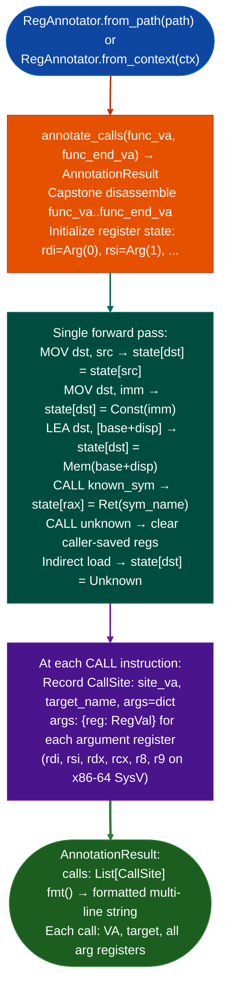

# Call Argument Annotation

Lightweight forward symbolic register pass for call-site annotation: single forward pass through a function window tracking register assignments without Z3 or lattice fixpoint, recovering ~85% of argument values for typical firmware dispatch functions with near-zero overhead.

---

## Why this exists

1. **TaintTracker and SinkArgClassifier report sink call sites with tainted register arguments, but not the concrete values those registers hold at call time: knowing that `rdi` is tainted is useful, but knowing that `rdi = recv_buffer + 0x10` is more useful.** `RegAnnotator.annotate_calls()` performs a single forward pass through a function, tracking concrete register values via linear propagation, and annotates each call site with the argument register values at the time of the call. No Z3, no lattice: just instruction-level tracking.

2. **Approximately 85% of argument values in typical firmware dispatch functions are recoverable via single-pass forward propagation.** The remaining 15% are values loaded from heap or stack slots with non-constant offsets. `RegAnnotator` uses `RegVal` types to represent what is known: `Const(v)` for constant-propagated values, `Arg(n)` for function arguments, `String(s)` for string constant loads, `Ret(name)` for return values of named callees, and `Unknown` when the value cannot be determined. The `Unknown` result is explicit rather than silent: callers can distinguish between "value is zero" and "value is unknown".

3. **`RegAnnotator` is the template for all new scanners in Ablation**: its `from_context()` classmethod, `scan()` method returning a findings list, and `report()` method are the canonical interface pattern documented in `CLAUDE.md`. New analysis modules that need register annotation at call sites should call `RegAnnotator.annotate_calls()` rather than re-implementing the propagation.

---

## How it works



---

## Usage

```python
from ablation.analyzers.reg_annotator import RegAnnotator
from ablation.analyzers.binary_context import BinaryContext

ctx = BinaryContext.load_or_build('/path/to/target.elf')
ra = RegAnnotator.from_context(ctx)

# Annotate all calls in a function
result = ra.annotate_calls(func_va=0x1000, func_end_va=0x1200)
print(result.fmt())

# Inspect individual call sites
for call in result.calls:
    print(f"{call.site_va:#x}: {call.target_name}")
    for reg, val in call.args.items():
        print(f"  {reg} = {val.display()}")

# From path (no BinaryContext required)
ra2 = RegAnnotator.from_path('/path/to/target.elf')
result2 = ra2.annotate_calls(func_va=0x401200, func_end_va=0x401400)
```

---

## Example output

The following illustrates the annotation output format. Actual addresses and values are function-specific.

```
<va>: call recv
  rdi = Arg(0)          ; socket fd passed through from caller
  rsi = [rbp-0x100]     ; buffer at stack offset -256
  rdx = Const(0x400)    ; length 1024

<va>: call process_request
  rdi = Ret(recv)       ; return value of prior recv() call
  rsi = Const(0x0)      ; NULL pointer
  rdx = Arg(1)          ; original second argument passed through
```

---

## False positives

**`RegAnnotator` clears caller-saved registers at unknown CALL targets**: a `Const` value that was set before an unresolved call will appear as `Unknown` afterward, even if the callee doesn't actually clobber it. To track values through specific callees, pre-populate the callee's PLT entry with `RegAnnotator.register_callee_preservessym, regs=[...]`.

**Single-pass forward propagation does not handle loops**: a register modified in a loop body will appear with its first-assignment value, not the loop-updated value. For loop-body analysis, use `ConstPropAnalysis` from [CFG Fixpoint Dataflow](cfg-fixpoint-dataflow.md) instead.

---

## Pipeline position

Run `RegAnnotator.annotate_calls()` immediately after `TaintTracker` identifies a finding: the annotation adds context to the sink call site what concrete values are passed without requiring a second full analysis pass. The annotation output goes into the finding record and CVE documentation.

---

## Reading output

`RegAnnotator.annotate_callsfunc_va, func_end_va` returns `AnnotationResult`:

| Field | Content |
|:---|:---|
| `func_va` | Start VA of the annotated function |
| `func_end_va` | End VA of the annotated function |
| `calls` | `List[CallSite]`: all call sites in the function |
| `reg_trace` | `List[Tuple[int, str, RegVal]]`: per-instruction register state log |

Each `CallSite`:

| Field | Content |
|:---|:---|
| `site_va` | VA of the call instruction |
| `target_va` | Resolved VA of the callee |
| `target_name` | Callee symbol name |
| `args` | `Dict[str, RegVal]`: argument register → `RegVal` at call time |

`RegVal` is a dataclass with a `kind` string attribute:

| `kind` | `display()` output | Meaning |
|:---|:---|:---|
| `'arg'` | `arg0_entry rdi@entry` | Entry-time argument register passed through unmodified |
| `'const'` | `0x<hex>` | Immediate constant propagated to call site |
| `'string'` | `'<preview>'` | `.rodata` string pointer resolved via LEA |
| `'copy'` | `<src_val> via <reg>` | Copied from another register; chain shows origin |
| `'ret'` | `ret<callee>` | Return value of a prior named call |
| `'zero'` | `0` | Explicitly zeroed for example `xor reg, reg` |
| `'mem'` | `[<desc>]` | Loaded from memory; not statically resolvable |
| `'unknown'` | `?` | Clobbered or untracked |

Use `val.display()` to produce a human-readable string. Use `val.kind == 'arg'` to identify passed-through argument registers when assessing taint paths.

---

## See also

- [CFG Fixpoint Dataflow](cfg-fixpoint-dataflow.md): `ConstPropAnalysis` for loop-body and fixpoint-accurate propagation
- [Taint Analysis](taint-analysis.md): identifies sink call sites; RegAnnotator annotates their arguments
- [Single Function Profiling](single-function-profiling.md): combines RegAnnotator with CFG stats and string refs for a complete function profile
