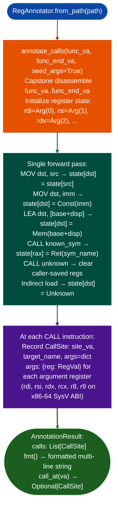

<a id="regannotator"></a>
# Register & Argument Tracking

  - [What is symbolic register analysis?](#what-is-symbolic-register-analysis)
  - [Why this exists](#why-this-exists)
  - [How it works](#how-it-works)
  - [Module relationships](#module-relationships)
  - [API reference](#api-reference)
    - [RegAnnotator](#regannotator)
    - [ARM32RegAnnotator](#arm32regannotator)
    - [AnnotationResult](#annotationresult)
    - [CallSite](#callsite)
    - [RegVal](#regval)
  - [Usage](#usage)
  - [Limitations](#limitations)
  - [Pipeline position](#pipeline-position)
  - [See also](#see-also)

---

## What is symbolic register analysis? <sup>[↑](#regannotator)</sup>

Symbolic register analysis replaces each concrete register value with a symbolic label that describes where the value came from: a function argument passed at entry, a string constant loaded from `.rodata`, the return value of a previous call, or a constant propagated from an immediate operand. Instead of tracking the number `0x400`, the analysis tracks the fact that `rdx` holds the constant `0x400`. Instead of tracking an opaque 64-bit value in `rdi`, it tracks the label `arg0` meaning the value was the first argument to the enclosing function at entry.

The technique is a restricted form of abstract interpretation. Full abstract interpretation over a lattice of symbolic values, as implemented by tools like Frama-C or the Clang Static Analyzer, computes a fixpoint across the control flow graph: it iterates until the symbolic state at every basic block entry stabilizes. This handles loops correctly and models all possible paths through conditional branches. The cost is proportional to the number of fixpoint iterations times the function size.

`RegAnnotator` trades precision for speed. It performs a single forward pass through the function's instruction stream without constructing a control flow graph, without a fixpoint, and without Z3. Register values are tracked as a flat dictionary from canonical register name to `RegVal`. A `MOV rdi, rax` copies the tracked value of `rax` into `rdi`. A `CALL unknown_func` clears all caller-saved registers because the callee may overwrite them. The pass ends when the instruction stream ends.

This design choice reflects a pragmatic observation about stripped firmware. Dispatch functions in network-facing firmware tend to be straight-line code or simple if/else trees that call one or two sinks. The argument registers at those call sites usually hold values assigned in the function prologue: an argument from the network handler, a string constant for a command, or a size from a header field. A forward pass recovers all of these in one scan. The 15% of cases it misses are values loaded from heap or stack with non-constant offsets: cases where the value genuinely cannot be resolved without dynamic execution.

The provenance labels that `RegAnnotator` assigns directly feed taint decisions. When `rdi` at a sink call site is labeled `Ret(recv)`, the analyst knows the sink received the return value of `recv()` and can mark that argument as attacker-controlled without re-running the taint tracker. When `rdx` is labeled `Const(0x400)`, the size argument is a constant and cannot overflow regardless of network input.

## Why this exists <sup>[↑](#regannotator)</sup>

1. `TaintTracker` and `SinkArgClassifier` report sink call sites with tainted register arguments, but not the concrete values those registers hold at call time. Knowing that `rdi` is tainted is useful, but knowing that `rdi = recv_buffer + 0x10` is more useful. `RegAnnotator.annotate_calls()` performs a single forward pass through a function, tracks concrete register values via linear propagation, and annotates each call site with the argument register values at the time of the call. No Z3, no lattice: just instruction-level tracking.

2. Approximately 85% of argument values in typical firmware dispatch functions are recoverable via single-pass forward propagation. The remaining 15% are values loaded from heap or stack slots with non-constant offsets. `RegAnnotator` uses `RegVal` types to represent what is known: `Const(v)` for constant-propagated values, `Arg(n)` for function arguments, `String(s)` for string constant loads, `Ret(name)` for return values of named callees, and `Unknown` when the value cannot be determined. The `Unknown` result is explicit rather than silent: callers can distinguish between "value is zero" and "value is unknown".

3. `RegAnnotator` is the template for all new scanners in Ablation: its `from_path()` classmethod, `scan()` method returning a findings list, and `report()` method are the canonical interface pattern documented in `CLAUDE.md`. New analysis modules that need register annotation at call sites should call `RegAnnotator.annotate_calls()` rather than re-implementing the propagation.

---

## How it works <sup>[↑](#regannotator)</sup>



Register values flow forward through the instruction stream. An instruction can copy or propagate a constant, load a string from `.rodata`, preserve a named callee's return value, clear a caller-saved register at an unknown call, or produce `Unknown`. The tracked state is a flat dict; there is no branching, no join, and no fixpoint iteration. At each `CALL` instruction, the current argument register state is snapshotted into a `CallSite` record.

---

## Module relationships <sup>[↑](#regannotator)</sup>

`RegAnnotator` operates on x86-64 and PPC64LE binaries. `ARM32RegAnnotator` covers ARM32/Thumb binaries with the same interface plus a `thumb_funcs` parameter for mode switching. Both share the `RegVal`, `CallSite`, and `AnnotationResult` types defined in `reg_annotator.py`.

`FuncProfiler` calls `RegAnnotator.annotate_calls()` internally when producing function profiles. Callers that need call-site annotations outside a full profile can call `RegAnnotator` directly.

`TaintTracker` identifies which call sites are reachable from tainted input. `RegAnnotator` then annotates those specific call sites to show what concrete values the tainted and non-tainted registers hold. The two tools are complementary: taint says "this argument is attacker-controlled"; provenance says "and this is its origin and this is the constant beside it".

---

## API reference <sup>[↑](#regannotator)</sup>

### RegAnnotator <sup>[↑](#regannotator)</sup>

```python
from ablation.analyzers.reg_annotator import RegAnnotator
```

**Constructor**

```text
RegAnnotator.from_path(binary_path: str) -> RegAnnotator
```

Loads the binary at `binary_path` for x86-64 (default) or PPC64LE analysis. Resolves PLT entries from the ELF `.dynamic` section so that `CALL printf@plt` produces `Ret(printf)` rather than `Ret(unknown_plt)`.

**Methods**

```text
annotator.annotate_calls(
    func_va: int,
    func_end_va: int = 0,
    window: int = 2048,
    seed_args: bool = True,
) -> AnnotationResult
```

Performs a forward symbolic pass from `func_va` to `func_end_va`. When `func_end_va` is `0`, the analysis runs for `window` bytes. When `seed_args` is `True`, the argument registers are pre-seeded with `Arg(0)` through `Arg(5)` at function entry.

---

### ARM32RegAnnotator <sup>[↑](#regannotator)</sup>

```python
from ablation.analyzers.arm32_reg_annotator import ARM32RegAnnotator
```

**Constructors**

```text
ARM32RegAnnotator.from_path(
    path: str,
    thumb_funcs: Optional[Set[int]] = None,
) -> ARM32RegAnnotator
```

```text
ARM32RegAnnotator.from_context(ctx) -> ARM32RegAnnotator
```

`from_context(ctx)` reads Thumb function addresses from `BinaryContext` automatically. `from_path()` accepts an optional `thumb_funcs` set for binaries without a `BinaryContext` cache.

**Methods**

```text
annotator.annotate_calls(
    va: int,
    end_va: int,
    window: int = 2048,
    seed_args: bool = True,
) -> AnnotationResult
```

Same interface as `RegAnnotator.annotate_calls()`. Uses AAPCS32 argument registers (`r0` through `r3`) instead of the x86-64 SysV ABI.

---

### AnnotationResult <sup>[↑](#regannotator)</sup>

| Field | Type | Description |
|:------|:-----|:------------|
| `func_va` | `int` | Start VA of the annotated function |
| `func_end_va` | `int` | End VA of the annotated function |
| `calls` | `List[CallSite]` | All call sites found in the function, in order |
| `reg_trace` | `List[Tuple[int, str, RegVal]]` | Per-instruction register state log: `(va, reg_name, new_val)` |

**Methods**

```text
result.fmt(arg_regs=None) -> str
```

Returns a formatted multi-line string showing each call site with its argument register values.

```text
result.call_at(va: int) -> Optional[CallSite]
```

Returns the `CallSite` at instruction address `va`, or `None` if no call was found there.

---

### CallSite <sup>[↑](#regannotator)</sup>

| Field | Type | Description |
|:------|:-----|:------------|
| `site_va` | `int` | VA of the `CALL` instruction |
| `target_va` | `int` | Resolved VA of the callee (may be the PLT entry VA) |
| `target_name` | `str` | Symbol name of the callee, or empty string if unresolved |
| `args` | `Dict[str, RegVal]` | Argument register names mapped to their symbolic values at call time |

---

### RegVal <sup>[↑](#regannotator)</sup>

| Field | Type | Description |
|:------|:-----|:------------|
| `kind` | `str` | One of the kind strings below |
| `int_val` | `int` | Numeric payload: argument index for `arg`, constant value for `const`, `0` otherwise |
| `str_val` | `str` | String payload: register name for `copy`, callee name for `ret`, memory description for `mem`, string content for `string` |
| `chain` | `Optional[RegVal]` | For `kind == 'copy'`: the `RegVal` of the source register, enabling origin tracing |

**`kind` values**

| `kind` | `display()` example | Meaning |
|:-------|:--------------------|:--------|
| `'arg'` | `arg0_entry (rdi@entry)` | Entry-time argument register, unmodified since function entry |
| `'const'` | `0x400` | Immediate constant propagated to this register |
| `'string'` | `'/bin/sh'` | `.rodata` string pointer resolved from a `LEA` instruction |
| `'copy'` | `arg0_entry (rdi@entry) (via rax)` | Copied from another register; `chain` holds the source's `RegVal` |
| `'ret'` | `ret(recv)` | Return value of a previously named call |
| `'zero'` | `0` | Explicitly zeroed via `XOR reg, reg` |
| `'mem'` | `[rbp-0x100]` | Loaded from a memory address not resolvable at analysis time |
| `'unknown'` | `?` | Clobbered by an unknown call or otherwise not tracked |

Use `val.display()` to produce a human-readable string. Use `val.kind == 'arg'` to identify passed-through argument registers when tracing taint provenance.

---

## Usage <sup>[↑](#regannotator)</sup>

### Annotate call sites in a function (x86-64)

```python
from ablation.analyzers.reg_annotator import RegAnnotator

ra = RegAnnotator.from_path('/path/to/target.elf')

result = ra.annotate_calls(func_va=0x1000, func_end_va=0x1200)
print(result.fmt())

# Inspect individual call sites
for call in result.calls:
    print(f"{call.site_va:#x}: {call.target_name}")
    for reg, val in call.args.items():
        print(f"  {reg} = {val.display()}")
```

### Annotate call sites in a function (ARM32)

```python
from ablation.analyzers.arm32_reg_annotator import ARM32RegAnnotator
from ablation.analyzers.binary_context import BinaryContext

ctx = BinaryContext.load_or_build('/path/to/target.elf')
ra = ARM32RegAnnotator.from_context(ctx)

result = ra.annotate_calls(func_va=0x8200, func_end_va=0x8400)
print(result.fmt())
```

### Determine whether a sink argument is attacker-controlled

```python
from ablation.analyzers.reg_annotator import RegAnnotator

ra = RegAnnotator.from_path('/path/to/target.elf')
result = ra.annotate_calls(func_va=0x1000, func_end_va=0x1200)

sink_call = result.call_at(0x1180)  # VA of the system() call
if sink_call:
    format_arg = sink_call.args.get('rdi')
    if format_arg and format_arg.kind in ('arg', 'ret', 'mem'):
        print(f'rdi at system() = {format_arg.display()} — potentially attacker-controlled')
    elif format_arg and format_arg.kind == 'string':
        print(f'rdi at system() = {format_arg.display()} — rodata constant, not exploitable')
```

### Example output

```
RegAnnotator: 0x1000..0x1200  (3 calls)
  0x1040: call recv
    rdi = arg0_entry (rdi@entry)   ; socket fd
    rsi = 0x402010  '[rbp-0x100]'  ; stack buffer
    rdx = 0x400                    ; size 1024

  0x1100: call process_request
    rdi = ret(recv)                ; return value of recv
    rsi = 0x0                      ; NULL
    rdx = arg1_entry (rsi@entry)   ; original second arg

  0x1180: call system
    rdi = ret(process_request)     ; return of process_request — tainted
```

---

## Limitations <sup>[↑](#regannotator)</sup>

1. Single-pass forward propagation does not handle loops. A register modified in a loop body appears with its first-assignment value, not the loop-updated value. For loop-body analysis, use `ConstPropAnalysis` from `dataflow_engine.py` instead: it runs a fixpoint and models all possible values at each instruction.

2. `RegAnnotator` clears all caller-saved registers at unknown `CALL` targets. A constant value that was set before an unresolved call appears as `Unknown` afterward, even if the callee does not actually clobber that register. This is conservative: it produces `Unknown` where the value might be recoverable, but never produces a wrong constant.

3. The analysis operates on a flat address range, not a control flow graph. Code after an unconditional jump is still analyzed as if it were reached. Branches that set a register one way on the true path and another way on the false path produce whichever value the forward scan sees last.

4. `RegAnnotator` covers x86-64 and PPC64LE. `ARM32RegAnnotator` covers ARM32 and Thumb. No other ISAs are currently supported. For LoongArch64, PPC32, MIPS, or RISC-V, use the arch-specific taint tracker's register state instead.

5. String resolution relies on Capstone's `.rodata` address computation from `LEA` instructions. Strings loaded via GOT entries or through indirect pointers return `mem` rather than `string`.

---

## Pipeline position <sup>[↑](#regannotator)</sup>

Run `RegAnnotator.annotate_calls()` immediately after `TaintTracker` identifies a finding. The annotation adds context to the sink call site showing what concrete values are passed without requiring a second full analysis pass. The annotation output goes into the finding record and CVE documentation.

---

## See also <sup>[↑](#regannotator)</sup>

- [`TaintTracker`](taint-analysis.md): identifies which call sites are reachable from tainted input; `RegAnnotator` annotates the argument values at those sites
- [`FuncProfiler`](single-function-profiling.md): combines `RegAnnotator` with CFG stats and string refs for a complete function profile
- [`dataflow_engine.py`](control-flow-graph-construction.md): `ConstPropAnalysis` for fixpoint-accurate propagation when single-pass is insufficient
