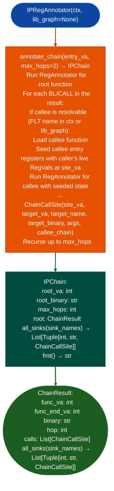

# Interprocedural Register Annotation

Extend `RegAnnotator`'s single-function forward symbolic pass to follow call chains across function boundaries: seeding each callee's entry registers with the actual `RegVal` objects from the caller's register state at the call site, enabling argument provenance to trace back to the root function's entry arguments across N hops.

---

## Why this exists

1. **`RegAnnotator` stops at function boundaries.** When a tainted register is passed as an argument to a callee, `RegAnnotator` tracks it inside that callee separately from the caller: losing the chain of provenance back to the original source. `IPRegAnnotator` re-seeds the callee's entry registers with the caller's live values, maintaining the full provenance chain across the call.

2. `ChainCallSite` records the call VA, callee name, and live argument registers at each hop: enabling `ChainResult.all_sinks()` to find every sink call site reachable from the root function's tainted arguments, regardless of how many intermediate functions the tainted value passes through. This is the mechanism that confirms a multi-hop injection chain: `user_input → handler → validator → exec_wrapper → system()`.

3. `IPRegAnnotator` is the required tool for cross-library call chains: when a tainted value crosses a PLT boundary into another library, `RegAnnotator` alone cannot continue the trace. `IPRegAnnotator` uses `LibGraph` to resolve the callee's binary and continues the forward symbolic pass into the external library's function, producing a complete cross-binary argument provenance chain.

---

## How it works



---

## Usage

```python
from ablation.analyzers.ipreg_annotator import IPRegAnnotator
from ablation.analyzers.binary_context import BinaryContext
from ablation.analyzers.lib_graph import LibGraph

ctx = BinaryContext.load_or_build('/path/to/httpd')
lib_graph = LibGraph.from_dir('/path/to/firmware/lib/')

annotator = IPRegAnnotator(ctx, lib_graph=lib_graph)

chain = annotator.annotate_chain(handler_va, max_hops=3)
print(chain.fmt())

# Find all sink calls reachable from this handler
for func_va, binary, call_site in chain.all_sinks({'system', 'execv', 'popen'}):
    print(f"  Sink: {call_site.target_name} at {call_site.site_va:#x}  in {binary}")
    print(f"  args: {call_site.args}")
```

---

## Example output

The following illustrates interprocedural register annotation output format. Actual VAs are binary-specific.

```
CHAIN 0x<va>  httpd  [max_hops=3]

[0x<root_va>..0x<root_end>]  httpd  hop 0
  0x<call1>  validate_input(r0=arg0, r1=0x20)
    [0x<validate_va>..0x<validate_end>]  httpd  hop 1
      0x<call2>  exec_wrapper(r0=arg0)
        [0x<exec_va>..0x<exec_end>]  httpd  hop 2
          0x<call3>  system(r0=arg0)  [PLT/external]

SINK CALLS in chain from 0x<root_va>:
  httpd:0x<exec_va> -> system(0x<call3>)  [r0=arg0]
```

---

## False positives

**`max_hops` limits the chain depth**: a taint path deeper than `max_hops` is not traced. If no sink is found at `max_hops=3`, increase to 5 before concluding no path exists.

**Register state at cross-library calls is based on the caller's symbolic values at the call site**: if the caller modifies a register between the last symbolic write and the call, the modification may not be captured. Always verify the annotated argument provenance against the disassembly.

---

## Pipeline position

Run `IPRegAnnotator.annotate()` on confirmed pre-auth handler VAs or CMDB sink-co-location callers. It produces the multi-hop argument provenance chain needed for `byte_proof` in confirmed findings that span multiple function boundaries.

---

## Reading output

`IPRegAnnotator.annotate_chainentry_va, max_hops=2` returns an `IPChain` object:

| Attribute | Content |
|:---|:---|
| `root_va` | VA of the root entry function |
| `root_binary` | Path of the binary containing the root function |
| `max_hops` | Maximum call depth configured for this trace |
| `root` | `ChainResult`: root function result, with nested callee chains via `.calls` |

Each `ChainResult` in the chain:

| Attribute | Content |
|:---|:---|
| `func_va` | VA of this function |
| `func_end_va` | End VA of this function |
| `binary` | Path of the binary containing this function |
| `hop` | Hop depth 0 = root, 1 = callee, 2 = callee's callee, … |
| `calls` | `List[ChainCallSite]`: each call site with its argument register annotations |

Each `ChainCallSite`:

| Attribute | Content |
|:---|:---|
| `site_va` | VA of the `CALL`/`BL` instruction |
| `target_va` | VA of the called function |
| `target_name` | Name of the called function from PLT or names registry |
| `target_binary` | Path of the binary containing the target function |
| `args` | `Dict[str, RegVal]`: argument registers with their symbolic values at the call |
| `callee_chain` | `Optional[ChainResult]`: recursive chain for this callee if followed |
| `is_plt_leaf` | `True` if the callee is an external PLT call not followed further |

Call `chain.all_sinkssink_names` to get all `func_va, binary, ChainCallSite` tuples for any named sink within the full chain.

---

## See also

- [Register Annotation Single Function](register-annotation.md): `RegAnnotator` base for single-function symbolic forward pass
- [Cross-Binary Taint Analysis](configurable-taint-reporting.md): `CrossBinaryTaintTracker` for labeled taint across library boundaries
- [CMDB Attack Surface Mapping](finding-corpus-mining.md): `CMDBSurfaceMapper` that identifies callers for IPRegAnnotator analysis
