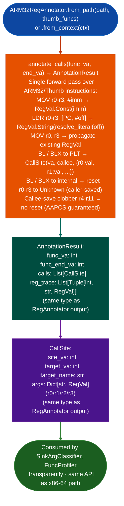

# ARM32 Register Annotation

Annotate ARM32/Thumb function call sites with AAPCS argument register values: tracking `r0`–`r3` through `LDR [PC, #off]` literal pool loads, immediate constants, and register copies: producing the same `CallSite`/`AnnotationResult` types as `RegAnnotator` so `FuncProfiler` can use ARM32 and x86-64 binaries transparently.

---

## Why this exists

1. **`RegAnnotator` (x86-64) and `ARM32RegAnnotator` share the same output types `CallSite`, `AnnotationResult`: `FuncProfiler` dispatches to the correct annotator based on architecture and calls the same downstream analysis regardless of ISA.** This design means every scanner and classifier written against `RegAnnotator` output works automatically on ARM32/Thumb targets. `ARM32RegAnnotator` closes the gap that previously required manual disassembly for ARM32 call site annotation.

2. **ARM32/Thumb literal pool loads `LDR r0, [PC, #N]` are the primary mechanism for passing string arguments to function calls**: in Thumb2 code, string pointers are almost never formed from `MOV`/`MOVT` immediates. `ARM32RegAnnotator` correctly resolves `LDR [PC, #off]` to the actual string value from the `.rodata` section, enabling `SinkArgClassifier.from_context()` to classify ARM32 call sites with the same accuracy as x86-64.

3. **AAPCS register roles `r0`–`r3` caller-saved argument/return, `r4`–`r11` callee-saved differ from System V AMD64 ABI (`rdi`/`rsi`/`rdx`/`rcx`/`r8`/`r9`)**: ARM32 functions use only 4 argument registers where x86-64 uses 6. `ARM32RegAnnotator.annotate_calls()` applies the AAPCS convention, correctly identifying `r0` as the destination argument for `strcpy` and `r0`/`r1` as dest/src for `memcpy`.

---

## How it works



---

## Usage

```python
from ablation.analyzers.arm32_reg_annotator import ARM32RegAnnotator
from ablation.analyzers.binary_context import BinaryContext

ctx = BinaryContext.load_or_build('/path/to/arm32_firmware.elf')
annotator = ARM32RegAnnotator.from_context(ctx)

# Annotate a specific function
result = annotator.annotate_calls(func_va=0x12340, end_va=0x12500)
for site in result.calls:
    print(f"  {site.site_va:#x}: {site.target_name}")
    for reg, val in site.args.items():
        print(f"    {reg} = {val}")

# FuncProfiler uses ARM32RegAnnotator automatically on ARM32 targets
from ablation.analyzers.func_profiler import FuncProfiler
fp = FuncProfiler.from_context(ctx)
profile = fp.profile(va=0x12340, end_va=0x12500)
print(profile.fmt())  # ARM32 register annotations in output
```

---

## Example output

The following illustrates ARM32 call site annotation output format. Actual addresses and values are binary-specific.

```
ARM32RegAnnotator: arm32_firmware.elf  (Thumb2)

annotate_calls(0x12340, 0x12500):
  <va>: strcpy
    r0 = Arg(0)     (dest from caller r0)
    r1 = String("admin_config")  (src from LDR [PC,#N])

  <va>: snprintf
    r0 = Arg(0)     (buf from caller)
    r1 = Const(256) (size from MOV r1, #0x100)
    r2 = String("GET %s HTTP/1.1")  (format from LDR [PC,#N])
```

---

## False positives

**Thumb mode detection depends on `thumb_funcs` set**: `from_path()` auto-detects Thumb functions from ELF symbol table `STT_FUNC` + odd address convention; `from_context()` uses `ctx.thumb_funcs` if available. If the binary has no symbol table and `thumb_funcs` is not provided, the annotator may misidentify ARM mode vs Thumb mode and produce incorrect instruction decoding.

**Register state resets at call boundaries**: `r0`–`r3` are reset to `Unknown` at every internal `BL`/`BLX` call AAPCS caller-saved. If a string argument is loaded into `r0` before an intermediate function call, the state will be `Unknown` at the subsequent sink call site, potentially under-classifying what `SinkArgClassifier` would rate as `ARG_PROPAGATED`.

---

## Pipeline position

`ARM32RegAnnotator` is used automatically by `FuncProfiler` and `SinkArgClassifier` on ARM32 targets, no explicit calls are needed. Use `from_context()` directly only when building custom analysis tools that need per-call-site register state for ARM32 binaries.

---

## Reading output

`ARM32RegAnnotator.annotate_callsfunc_va, end_va` returns `AnnotationResult` (same type as `RegAnnotator`):

`AnnotationResult` fields:

| Field | Content |
|:---|:---|
| `func_va` | VA of the annotated function entry |
| `func_end_va` | VA of the function end |
| `calls` | `List[CallSite]`: all call sites found |
| `reg_trace` | `List[Tuple[int, str, RegVal]]`: per-instruction register state trace |

Each `CallSite`:

| Field | Content |
|:---|:---|
| `site_va` | VA of the `BL`/`BLX` call instruction |
| `target_va` | VA of the callee resolved |
| `target_name` | Callee symbol name from PLT or names registry |
| `args` | `Dict[str, RegVal]`: `r0`–`r3` → one of `Const(v)`, `String(s)`, `Arg(n)`, `Unknown` |

State resets: `r0`–`r3` are reset to `Unknown` at every `BL`/`BLX` call site AAPCS caller-saved.

---

## See also

- [Call Argument Annotation](call-argument-annotation.md): `RegAnnotator` x86-64 equivalent, full design reference
- [Single-Function Profiling](single-function-profiling.md): `FuncProfiler` that dispatches to `ARM32RegAnnotator` on ARM32 targets
- [ARM32 Allocation Arithmetic Overflow](arm32-allocation-arithmetic-overflow.md): ARM32 taint analysis using ARM32RegAnnotator output
