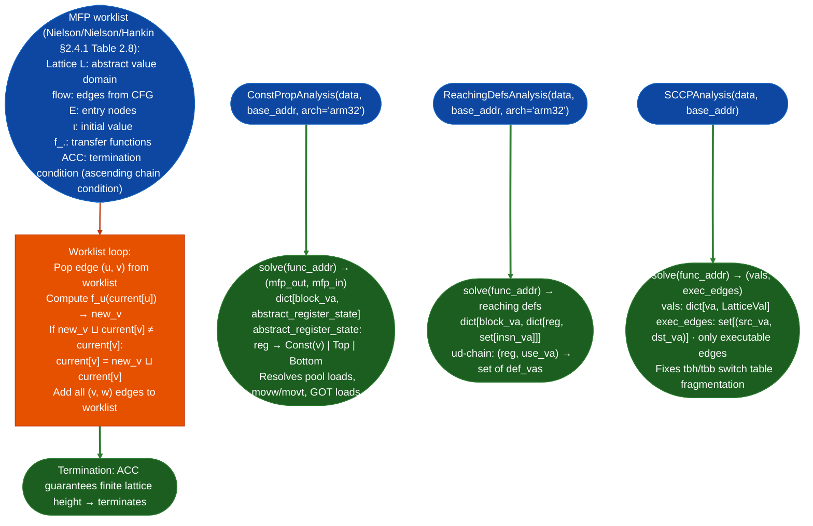

# CFG Fixpoint Dataflow

Generic Monotone Framework worklist algorithm (`DataflowEngine`) plus pre-built analysis instances: constant propagation, reaching definitions, and sparse conditional constant propagation (SCCP): for ARM32/ARM64 RE and switch-table recovery in stripped firmware.

---

## Why this exists

1. **ARM32 pool loads `ldr r0, [pc, #N]` and `movw`/`movt` immediate chains cannot be resolved by a single-instruction analysis: the constant value is split across two instructions or loaded from a literal pool.** `ConstPropAnalysis` implements a dataflow constant propagation over the CFG, resolving pool loads, immediate chains, and GOT-seeded values. Without it, `SinkArgClassifier` and `TaintTracker` see `rdi = unknown` where they could see `rdi = 0x12345678`.

2. **Thumb `tbh`/`tbb` switch tables (ARM32 `switch` lowering) fragment the CFG: capstone decodes the `tbh` as an indirect branch with no known targets, breaking any analysis that depends on complete successor sets.** `SCCPAnalysis` sparse conditional constant propagation, Wegman-Zadeck algorithm propagates conditions through executable edges only. An edge that cannot be reached under SCCP is marked non-executable, which avoids adding its target to the work queue and prevents spurious constant merges. This fixes the switch-table fragmentation: `tbh` targets that are provably unreachable are correctly excluded.

3. **`ReachingDefsAnalysis` builds ud-chains use-definition chains for any `register, call_site` pair: answering "where was this register last written before this call?"** Use-definition chains are the foundation for backward slicing tracing argument values back to their sources, cross-function constant propagation, and inter-procedural taint seeding.

---

## How it works



---

## Usage

```python
from ablation.analyzers.dataflow_engine import ConstPropAnalysis, ReachingDefsAnalysis, SCCPAnalysis

data = open('/path/to/target.elf', 'rb').read()
base_addr = 0   # or actual load address

# ── Constant propagation (ARM32) ─────────────────────────────────────────────
cp = ConstPropAnalysis(data, base_addr=base_addr, arch='arm32')
mfp_out, mfp_in = cp.solve(func_addr=0x1e6ae)

# Query constant value of r0 at entry to a block
for block_va, state in mfp_out.items():
    r0 = state.get('r0')
    if r0 and r0.is_const:
        print(f"  Block {block_va:#x}: r0 = {r0.value:#x}")

# ── Reaching definitions (ARM32) ─────────────────────────────────────────────
rda = ReachingDefsAnalysis(data, base_addr=base_addr, arch='arm32')
rd_out, rd_in = rda.solve(func_addr=0x1e6ae)

# Find where r1 was last defined before a call at <call_va>
# (lookup in rd_in at the call's block)

# ── SCCP (ARM32 switch table recovery) ───────────────────────────────────────
sccp = SCCPAnalysis(data, base_addr=base_addr)
vals, exec_edges = sccp.solve(func_addr=0x1e6ae)
# exec_edges: only CFG edges reachable under SCCP
# Use to reconstruct tbh/tbb switch targets
```

---

## Example output

The following illustrates the constant propagation output format. Actual addresses and values are binary-specific.

```
ConstPropAnalysis results for <func-va>:
  Block <va>:
    r0 = Const(<value>)   ; resolved movw/movt chain
    r1 = Const(<value>)   ; resolved pool load ldr r1, [pc, #<N>]
    r2 = Top              ; value not constant-propagated
  
SCCPAnalysis: exec_edges = {(<src>, <dst>), ...}
  Non-executable edges (unreachable switch cases): {(<src>, <unreachable-dst>)}
```

---

## False positives

**`ConstPropAnalysis` with `arch='arm32'` does not handle Thumb IT (If-Then) block conditional execution**: instructions inside an IT block are treated as unconditional, which can cause incorrect constant assignments on paths that are conditionally dead. Use `SCCPAnalysis` when IT block condition tracking is required.

**`ReachingDefsAnalysis` produces use-definition chains at the basic-block level: the reaching defs at block entry is the join of all predecessor exit sets.** This means the "last definition" for a register at a join point for example after an `if`/`else` shows both the then-path and else-path definitions. Backward slicing must handle the case where a register has multiple reaching defs.

---

## Pipeline position

Run `ConstPropAnalysis` or `ReachingDefsAnalysis` when TaintTracker or SinkArgClassifier reports `source=unknown` for a register argument: the dataflow engine often resolves the unknown to a concrete constant. Run `SCCPAnalysis` when `CFGBuilder.stats()` reports `has_indirect_branch=True` for a function with ARM32 Thumb switch tables: SCCP recovers the executable edges that capstone cannot.

---

## Reading output

`ConstPropAnalysis.solvefunc_addr` returns a `Tuple[Dict[int, Dict[str, LatValue]], Dict[int, Dict[str, LatValue]]]`: `mfp_out, mfp_in` keyed by block VA:

| Type | Meaning |
|:---|:---|
| `Const(v)` | Register holds the constant value `v` at this block entry |
| `Top` | Value not determinable set by a non-constant write |
| `Bottom` | Block unreachable |

`SCCPAnalysis.solvefunc_addr` returns `Tuple[Dict[int, Any], Set[Tuple[int, int]]]`:

- **First element** (`cp_vals`): `Dict[block_label, Dict[register, LatValue]]`: per-block register constant state; `None` for unreachable blocks.
- **Second element** (`exec_edges`): `Set[Tuple[int, int]]`: `src_va, dst_va` edges proven reachable given the constant conditions.

---

## See also

- [Control-Flow Graph Construction](control-flow-graph-construction.md): CFG that dataflow analysis operates over
- [Taint Analysis](taint-analysis.md): taint tracker that benefits from constant-propagation-resolved sources
- [Structured Control-Flow Recovery](structured-control-flow-recovery.md): uses dominator tree and loop info from `dataflow_engine.py`
- [ARM32 Allocation Arithmetic Overflow](arm32-allocation-arithmetic-overflow.md): uses reaching definitions to trace allocation size sources
