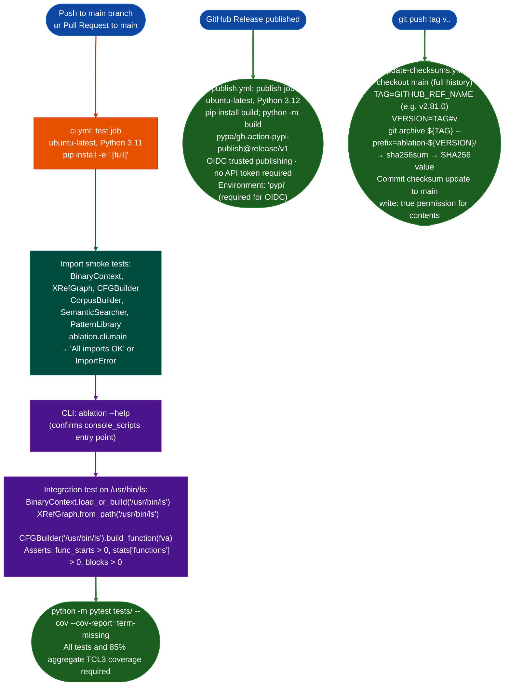

# CI and Release Automation

Three GitHub Actions workflows that enforce import smoke tests, run the pytest suite, publish release builds to PyPI via OIDC trusted publishing, and automatically update Homebrew-formula checksums on every version tag.

---

## Why this exists

1. **Ablation's analyzer tree has 60+ modules across 4 package namespaces `ablation`, `ablation.analyzers`, `ablation.core`, and `sweeps`: a broken import in any one of them produces a silent failure during RE sessions that manifests as an `ImportError` at the worst possible moment.** The CI workflow runs import smoke tests for the six highest-impact modules `BinaryContext`, `XRefGraph`, `CFGBuilder`, `CorpusBuilder`, `SemanticSearcher`, and `PatternLibrary` on every push and pull request to `main`. These tests run before `pytest` so that a missing dependency or circular import is caught before the test suite even starts.

2. **PyPI publication requires signing provenance: an incorrect manual `twine upload` can publish a build without provenance attestation, which breaks downstream package integrity verification.** The publish workflow uses `pypa/gh-action-pypi-publish@release/v1` with OIDC trusted publishing no API token stored in secrets and is triggered only on GitHub Release publication events, not on arbitrary pushes. This means every PyPI upload is traceable to a specific signed GitHub Release event.

3. **Homebrew formula SHA-256 checksums must be updated atomically with the release tag: a formula that references an outdated checksum blocks all `brew install` users until the formula is manually fixed.** The `update-checksums.yml` workflow fires on any `v*.*.*` tag push, computes `git archive` SHA-256 for that tag, and commits the updated checksum to `main` automatically. The full pipeline (tag → CI green → Release published → PyPI published → Homebrew checksum updated) is automated end-to-end.

---

## How it works



### Workflow reference

| Workflow | File | Trigger | Purpose |
|:---|:---|:---|:---|
| CI | `ci.yml` | Push/PR to `main` | Import smoke tests, CLI test, `/usr/bin/ls` integration test, pytest, and coverage |
| Publish | `publish.yml` | GitHub Release published | Test and coverage gate, build sdist/wheel, OIDC-publish to PyPI |
| Supply Chain Audit | `supply-chain.yml` | Weekly and manual | Audit pinned dependencies and upload the JSON report |
| Update checksums | `update-checksums.yml` | Tag push `v*.*.*` | Compute `git archive` SHA-256, commit to Homebrew formula |

### CI test stages

| Stage | Command | Blocks on failure |
|:---|:---|:---|
| Import smoke test | `python -c "from ablation... import ..."` | Yes: any ImportError fails the job |
| CLI help | `ablation --help` | Yes: confirms entry-point registration |
| Integration test | Python inline script on `/usr/bin/ls` | Yes: asserts on function/block counts |
| pytest and coverage | `python -m pytest tests/ --cov --cov-report=term-missing` | Yes: test failures and coverage below 85% fail the job |

---

## Usage

### Running CI locally

```bash
# Replicate the CI import smoke tests
python -c "from ablation.analyzers.binary_context import BinaryContext"
python -c "from ablation.analyzers.xref_graph import XRefGraph"
python -c "from ablation.analyzers.cfg_builder import CFGBuilder"
python -c "from ablation.analyzers.corpus_builder import CorpusBuilder"
python -c "from ablation.analyzers.semantic_search import SemanticSearcher"
python -c "from ablation.analyzers.pattern_library import PatternLibrary"
python -c "from ablation.cli import main"
ablation --help

# Replicate the integration test
python - <<'EOF'
from ablation.analyzers.binary_context import BinaryContext
from ablation.analyzers.xref_graph import XRefGraph
from ablation.analyzers.cfg_builder import CFGBuilder

ctx = BinaryContext.load_or_build('/usr/bin/ls')
assert ctx.func_starts, "no functions found"
print(f"BinaryContext: {len(ctx.func_starts)} functions")
EOF

# Run the test suite
python -m pytest tests/ -x -q

# Run coverage (TCL3 scope only — see coverage-gate.md)
python -m pytest tests/ --cov --cov-report=term-missing
```

### Triggering a release

```bash
# 1. Update version in pyproject.toml
# 2. Commit and push to main (CI must pass)
# 3. Create and push the tag
git tag v2.81.0
env HOME=/home/cowboy GIT_LFS_SKIP_SMUDGE=1 git push origin main
env HOME=/home/cowboy GIT_LFS_SKIP_SMUDGE=1 git push origin v2.81.0
# 4. Create a GitHub Release on the tag via gh CLI
gh release create v2.81.0 --title "v2.81.0" --notes "Release notes here"
# → triggers publish.yml → PyPI publish
# → update-checksums.yml fires on tag push → Homebrew formula updated
```

---

## Example output

The following illustrates representative CI job output. Actual function and block counts will reflect the `/usr/bin/ls` binary on the CI runner.

```
=== CI job: test ===
All imports OK
BinaryContext: <n> functions
XRefGraph: <n> functions, <n> PLT
CFG 0x<va>: <n> blocks
..... (pytest output)
<n> passed in <t>s

=== publish job ===
Building sdist and wheel...
Uploading distributions to PyPI...
Package 'ablation-tool' published at https://pypi.org/p/ablation-tool

=== update-checksums job ===
tag=v<version>
SHA256=<sha256-hex>
Updated Homebrew formula checksum for v<version>
```

---

## False positives

**The CI workflow runs the full test suite and coverage gate without `|| true`.** Any test failure or aggregate labeled-taint coverage below 85% blocks the job. Integration tests that require unavailable binary fixtures remain skipped by their existing fixture checks rather than being allowed to fail indiscriminately.

**The `update-checksums.yml` workflow commits to `main` using `contents: write`, this creates an automated commit on `main` after every version tag.** If the Homebrew formula file has conflicting changes in the same merge window as a tag push, the automated commit may fail. Check the `update-checksums.yml` run status after every release tag push.

---

## Pipeline position

This is the release automation layer, it sits above all module development and RE work. CI runs on every PR before merge. The publish and update-checksums workflows run post-release. There are no module dependencies in the `reference-modules` sense: CI tests the modules, not the other way around.

---

## Reading output

CI/CD workflows do not return Python objects. CI status is read via `gh` CLI:

```bash
# Check latest CI run status
gh run list --limit 5

# Watch a specific run
gh run watch <run-id>
```

`pytest -m fast --tb=short -q` exits 0 on success, non-zero on test failure. Coverage threshold failure produces a non-zero exit with the message `FAIL Required test coverage of 85.0% not reached.`

---

## See also

- [Coverage Gate](coverage-gate.md): TCL3 qualification scope, 85% coverage threshold, qualified module list
- [FORGE Module](forge.md): pre-commit module audit gate; runs before `git commit`, independent of CI
- [Dependency and Supply Chain Tooling](dependency-and-supply-chain-tooling.md): `pyproject.toml` dependency management and optional extras
