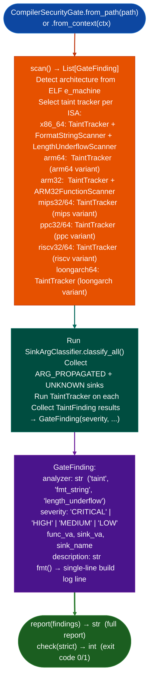

# CI/CD and Post-Linker Security Gate

Run Ablation's vulnerability detector suite on a freshly compiled binary before it ships: catching post-optimization vulnerabilities that sanitizers miss because they run before compiler optimization passes complete, with multi-architecture support and structured `GateFinding` output.

---

## Why this exists

1. **Address-sanitizers and undefined-behavior-sanitizers run on instrumented builds before optimization: they miss vulnerabilities introduced by optimization passes such as inlined string functions, vectorized memory copies, and dead-code elimination that removes safety checks.** `CompilerSecurityGate.scan()` runs on the optimized release binary, after linking, catching the vulnerabilities that the sanitizer build would not expose.

2. `CompilerSecurityGate` supports 11 architectures: x86_64, x86_32, arm32, arm64, MIPS32, MIPS64, PPC32, PPC64, RISC-V 32, RISC-V 64, LoongArch64: with taint analysis adapted to each ISA's calling convention and register set. Additional x86_64-only scanners format string, heap corruption, length underflow run alongside the cross-architecture taint analysis when the binary is x86_64.

3. Exit code 0 no HIGH/CRITICAL findings or 1 findings present enables CI/CD pipeline integration: `check(strict=False)` returns the exit code directly. In non-strict mode, MEDIUM and LOW findings do not block the build; in strict mode, any finding blocks. `GateFinding.fmt()` produces a single-line human-readable finding suitable for build log output.

---

## How it works



---

## Usage

```python
from ablation.analyzers.compiler_security_gate import CompilerSecurityGate

gate = CompilerSecurityGate.from_path('/path/to/release_binary')

# Run full scan
findings = gate.scan()
print(gate.report(findings))

# CI/CD integration (exit code)
import sys
sys.exit(gate.check(strict=False))  # 0 = clean, 1 = HIGH/CRITICAL found
```

```bash
# Shell usage:
python -m ablation.analyzers.compiler_security_gate /path/to/binary
echo "Exit code: $?"
```

---

## Example output

The following illustrates the gate output format. Actual findings are binary-specific.

```
CompilerSecurityGate: /path/to/binary  (x86_64)

Scanners: taint, format_string, length_underflow

[HIGH] Taint at <va>
  sink: system  arg: rdi
  source: recv() at <va>
  func: <name>

[HIGH] FormatString at <va>
  callee: syslog  fmt: rsi ← entry arg
  func: <name>

Gate result: FAILED  (<N> HIGH findings)
Exit code: 1
```

---

## False positives

**`CompilerSecurityGate` applies the same taint analysis as `TaintTracker` and inherits the same false positive profile**: path-insensitive analysis over-taints at join points. Use `SinkSanitizerFilter` to post-process `ARG_PROPAGATED` findings before the gate, reducing false positives in CI.

**Exit code 1 means HIGH or CRITICAL findings were detected, not that they are confirmed exploitable.** In initial CI integration, run in observation mode (`check()` but don't fail the build) for one release cycle to calibrate the false positive rate before enforcing the gate.

---

## Pipeline position

Run `CompilerSecurityGate` as a post-link CI/CD step, before the release artifact is published. On a clean codebase, it runs in under 30 seconds for binaries under 10MB. For larger firmware images httpsd at 50MB+, gate only the core network-facing binaries rather than all binaries in the image.

---

## Reading findings

`CompilerSecurityGate.scan()` returns `List[GateFinding]`:

| Field | Content |
|:---|:---|
| `severity` | `'CRITICAL'` / `'HIGH'` / `'MEDIUM'` / `'LOW'` |
| `category` | `'TAINT_FLOW'` / `'FORMAT_STRING'` / `'HEAP'` / `'LENGTH_UNDERFLOW'` |
| `func_va` | VA of the function containing the finding |
| `site_va` | VA of the specific call site sink instruction |
| `description` | Human-readable explanation of the vulnerability |
| `detector` | Which scanner produced this finding for example `'taint'`, `'format_string'` |
| `taint_dag` | Optional `SemanticBlock` DAG for taint path visualization |
| `fmt()` | Single-line formatted string for build log output |

`CompilerSecurityGate.check(strict=False)` returns `int`: `0` if no HIGH/CRITICAL findings, `1` otherwise. In strict mode (`strict=True`), returns `1` on any finding regardless of severity.

---

## See also

- [Taint Analysis](taint-analysis.md): underlying taint engine used by the gate
- [Format String Scanning](format-string-scanning.md): x86_64-only scanner included in the gate
- [Protocol Length Underflow Detection](protocol-length-underflow-detection.md): x86_64-only scanner included in the gate
