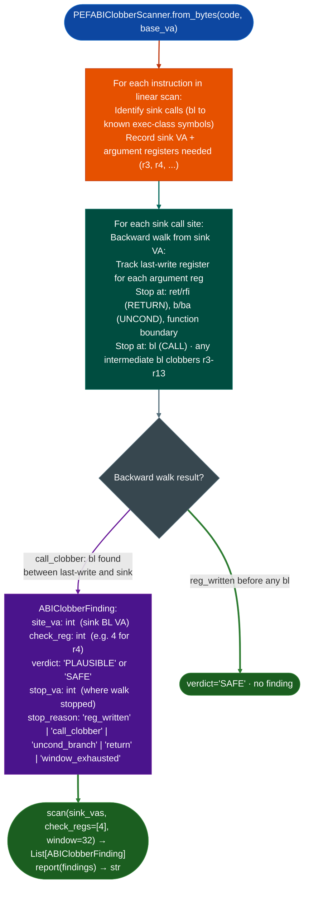

# Classic Mac ABI Clobber Scanning

Detect PPC32 PEF ABI register clobber bugs in classic Mac OS / OpenTransport binaries: finding call sites where an argument register is clobbered by an intermediate `bl` instruction between the time it was last written and the time it is read by a sink call.

---

## Why this exists

1. **Classic Mac OS PEF Preferred Executable Format binaries use PPC32 BE with the classic ABI r3-r10 args, r3 return, r14-r31 callee-saved: a bug class unique to this ABI is the argument clobber: argument register rN is written, an intermediate `bl` clears it BL clobbers r3-r13 as caller-saved, then the original value is read by the sink.** `PEFABIClobberScanner` detects this pattern without requiring symbols, using a backward walk from each sink call to find intermediate `bl` instructions between the last write to the sink's argument registers and the sink call itself.

2. **Three structural bugs in a prior hand-written OpenTransport scanner are impossible in `PEFABIClobberScanner` because the fix is structural.** `ori`/`addi` use D-form with different dest-field positions RT vs RA at different bit positions: one shared field extractor silently produces wrong register names for one of the forms. `Ppc32Template`/`Ppc32Field` use separate templates per instruction form with named bitfield positions, eliminating the asymmetry. `addic` opcode 12 was missing from the r4-write detection list: adding opcode 12 is a single dict entry, not a hidden path. Unconditional `b`/`ba` instructions were not treated as basic-block boundaries: the semantic dispatch on `_UNCOND` stops the backward walk immediately.

3. **`ABIClobberFinding` reports the exact call chain: sink VA, intermediate `bl` VA, clobbered register, argument index: providing the precise information needed to confirm exploitability.** A clobbered argument can be a false positive if the intermediate `bl` restores the value via callee-saved chain, so the finding includes enough detail for manual confirmation.

---

## How it works



---

## Usage

```python
from ablation.analyzers.pef_abi_clobber_scanner import PEFABIClobberScanner

# Load PEF code section bytes
with open('/path/to/opentransport.pef', 'rb') as f:
    pef_data = f.read()

# Extract the code section (PEF-specific offset)
code_section = pef_data[<code_section_offset>:<code_section_end>]
base_va = <code_section_load_address>

scanner = PEFABIClobberScanner.from_bytes(code_section, base_va=base_va)

# Provide the VAs of known sink BL instructions and the argument registers to check
sink_vas = [0x01690, 0x01774]  # BL to OTStrCat
findings = scanner.scan(sink_vas=sink_vas, check_regs=[4])  # check r4 (source arg)
print(PEFABIClobberScanner.report(findings))

# Inspect individual findings
for f in findings:
    print(f.fmt())  # [PLAUSIBLE]  0x001690  r4  call_clobber @ 0x001650
    if f.verdict == 'PLAUSIBLE':
        print(f"  site={f.site_va:#x}, reg=r{f.check_reg}")
        print(f"  stopped at {f.stop_va:#x} ({f.stop_reason})")
```

---

## Example output

The following illustrates the finding format. Actual addresses and symbols are binary-specific.

```
ABIClobberFinding:
  sink:     <sink-va>  (<sink-symbol>)
  arg:      arg<N> (<register>)  last written at <write-va>
  clobber:  bl at <bl-va> (intermediate call clears <register> as caller-saved)
  Note: verify whether <bl-va> target preserves <register> via callee-saved chain

Report:
  <N> clobber findings in <binary>
  <sink-va>  <sink-sym>  arg<N>/<register>  clobber=<bl-va>
```

---

## False positives

**The intermediate `bl` clobbers the register in the caller-saved ABI sense, but if the intermediate callee saves and restores the value for example a leaf function that happens to not write r4, there is no actual clobber.** `PEFABIClobberScanner` reports the structural pattern: the `bl` is between the write and the read of an argument register, but does not track whether the callee preserves the value. Confirm by inspecting the callee at `clobber_bl_va`.

**Linear scan without a CFG means the scanner may traverse dead code paths.** Functions with conditional branches that bypass the clobber `bl` may generate findings for paths that are not taken. Pair with `CFGBuilder` for confirmation when `ABIClobberFinding` appears on a short function with obvious branch structure.

---

## Pipeline position

`PEFABIClobberScanner` is a standalone tool for classic Mac OS PEF binaries, it does not depend on `BinaryContext` or `XRefGraph`. Run it on extracted PEF code section bytes with the correct `base_va`. The finding output feeds into manual disassembly at `clobber_bl_va` to confirm whether the intermediate callee preserves the argument register.

---

## Reading findings

`PEFABIClobberScanner.scan()` returns a list of `ABIClobberFinding` objects:

| Attribute | Content |
|:---|:---|
| `site_va` | VA of the sink `bl` (call) instruction |
| `check_reg` | Register index examined for example `4` for `r4` |
| `verdict` | `'PLAUSIBLE'`: backward walk reached function start without a write; `'SAFE'`: register was written before the call |
| `stop_va` | VA where the backward walk stopped |
| `stop_reason` | `'reg_written'` / `'call_clobber'` / `'uncond_branch'` / `'return'` / `'window_exhausted'` |

---

## See also

- [PPC32/PPC476 Dedicated Lifting](ppc32-ppc476-dedicated-lifting.md): Ppc32Lifter for human-readable PPC32 pseudocode
- [Taint Analysis](taint-analysis.md): general taint model; PEF clobber scanning is a PPC32-specific structural analogue
- [PowerPC PEF/CFM](powerpc-pef-cfm.md): PEF binary format parsing for classic Mac OS targets
