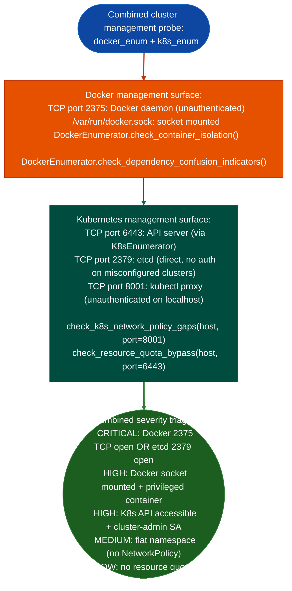

# Cluster Management Exposure

Enumerate the combined Docker and Kubernetes cluster management API surface: identifying unauthenticated Docker daemon TCP exposure, Kubernetes API server accessibility, etcd direct access, and cluster-admin credential paths: from a foothold within the cluster network, via `modules/docker_enum.py` and `modules/k8s_enum.py`.

---

## Why this exists

1. Container orchestration management APIs are the highest-value targets in a cluster compromise: Docker daemon TCP port 2375, Kubernetes API server port 6443, and etcd port 2379/2380 are each sufficient for full cluster control when unauthenticated. `cluster-management-exposure` combines the Docker and Kubernetes enumeration to produce a single triage of the three highest-severity exposure classes.

2. **`check_k8s_network_policy_gaps()` in `docker_enum.py`** probes the Kubernetes API at port 8001 from within the cluster network to identify namespaces without NetworkPolicy objects: the same flat-network finding as `kubernetes-policy-posture.md`, but accessible here from a Docker container context that may not have service account token access.

3. **`check_resource_quota_bypass()`** identifies Kubernetes clusters where individual pods can request unlimited CPU and memory: an indicator that LimitRange and ResourceQuota are not enforced. In clusters without resource quotas, a compromised pod can exhaust host resources denial-of-service against other pods or request a pod with `resources.requests.cpu: 1000` to trigger node-level scheduling pressure.

---

## How it works



---

## Usage

```python
from modules.docker_enum import DockerEnumerator, check_container_isolation
from modules.docker_enum import check_k8s_network_policy_gaps, check_resource_quota_bypass
from modules.k8s_enum import K8sEnumerator

# Docker side
iso_findings = check_container_isolation(host)
net_findings = check_k8s_network_policy_gaps(host)
quota_findings = check_resource_quota_bypass(host)

# Kubernetes side (if SA token available)
enumerator = K8sEnumerator(api_server, token, ca_cert)
k8s_results = enumerator.enumerate_all()

print("Cluster management exposure:")
# Each finding: {severity, title, detail, host, port}
for f in iso_findings + net_findings + quota_findings:
    print(f"  [{f['severity']}] {f['title']}: {f['detail'][:80]}")
```

---

## Example output

The following illustrates cluster management exposure output format.

```
Cluster management exposure triage:

[CRITICAL] Docker daemon TCP 2375: OPEN (unauthenticated)
[HIGH]     Kubernetes API 6443: accessible, cluster-admin SA present
[MEDIUM]   Namespace 'default': no NetworkPolicy (flat network)
[MEDIUM]   Namespace 'monitoring': no NetworkPolicy (flat network)
[LOW]      No ResourceQuota in 3 of 5 namespaces
```

---

## False positives

**Docker TCP 2375 probe is a connection check only**: a TCP response on port 2375 does not guarantee it is a Docker daemon. Verify by sending a `GET /version` HTTP request and checking for a Docker version JSON response before treating this as a confirmed finding.

**`check_k8s_network_policy_gaps()` requires Kubernetes API access at port 8001**: if the target cluster does not have `kubectl proxy` running on port 8001, this check will fail silently. Use `K8sEnumerator` with a service account token for reliable network policy enumeration.

---

## Pipeline position

Run cluster management exposure as the first enumeration step after gaining any foothold within a container or cluster network. The triage severity directly determines the next action: CRITICAL findings 2375/2379 open enable immediate full cluster compromise without further enumeration.

---

## Reading findings

Each probe function returns a list of finding dicts with `{severity, title, detail, host, port}`:

| Field | Content |
|:---|:---|
| `severity` | `CRITICAL` / `HIGH` / `MEDIUM` / `LOW` |
| `title` | Finding code for example `DOCKER_DAEMON_TCP_UNAUTH`, `K8S_CLUSTER_ADMIN_SA_PRESENT` |
| `detail` | Specific evidence: namespace names, endpoint URLs, policy gaps |
| `host` | Target host |
| `port` | Target port |

---

## See also

- [Docker Inventory and Posture](docker-inventory-and-posture.md): `DockerEnumerator` detailed Docker surface
- [Kubernetes Inventory](kubernetes-inventory.md): `K8sEnumerator` detailed Kubernetes enumeration
- [Kubernetes Policy Posture](kubernetes-policy-posture.md): RBAC and policy gap analysis
