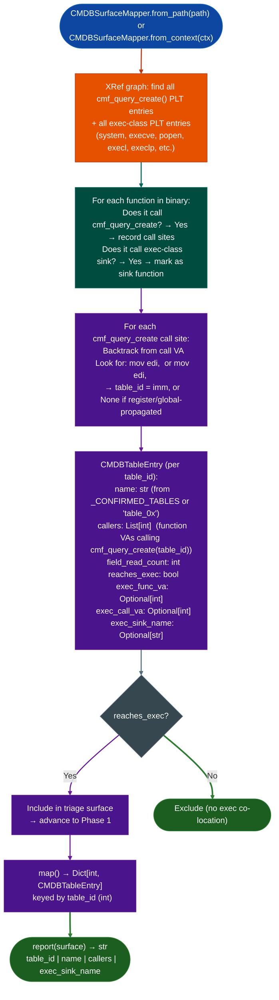

# CMDB-to-Sink Mapping

Phase 0.5 FortiOS/FortiWeb triage tool: enumerate every `cmf_query_create()` call site, identify the CMDB table being accessed, then flag functions where the same function both reads a CMDB field and calls an exec-class sink in the same function body.

---

## Why this exists

1. **FortiOS and FortiWeb use a configuration database (CMDB) system where all configuration fields are read via `cmf_query_createtable_id, field_id`: without knowing which table IDs map to attacker-controlled fields HTTP headers, URL parameters, form data, TaintTracker would need to be run on every CMDB-reading function in the binary.** `CMDBSurfaceMapper.map()` provides the forward triage: identify which table IDs are accessed by functions that also call `system()`, `execve()`, `popen()`, or `execve`-class sinks. This reduces the TaintTracker surface from hundreds of functions to dozens.

2. **CMDB table IDs in FortiOS are integer constants passed as `rdi` in x86-64 SysV ABI: `CMDBSurfaceMapper` resolves `mov edi, <imm>` immediately before each `cmf_query_create` call site to extract the table ID.** Register-propagated or globally-loaded table IDs where the constant is loaded from a global variable are reported as `table_id=None` and excluded from the surface map to avoid false positive labeling.

3. **Phase 0.5 is a co-location heuristic, not verified data-flow: a function that reads table T and calls `system()` in the same body is flagged, but the actual data flow from the field read to the `system()` argument is NOT verified.** This is by design. The tool answers "which CMDB tables are co-located with exec sinks?" so SinkArgClassifier and TaintTracker can be targeted only on the resulting candidate list: reducing total analysis time by 5-10x on a typical 100MB FortiOS binary.

---

## How it works



---

## Usage

```python
from ablation.analyzers.cmdb_surface_mapper import CMDBSurfaceMapper
from ablation.analyzers.binary_context import BinaryContext

# From path (builds its own XRef graph)
mapper = CMDBSurfaceMapper.from_path('/path/to/httpsd')

# From existing BinaryContext (reuses XRef graph and PLT map)
ctx = BinaryContext.load_or_build('/path/to/httpsd')
mapper = CMDBSurfaceMapper.from_context(ctx)

# Run the surface map
surface = mapper.map()
print(CMDBSurfaceMapper.report(surface))

# Inspect specific entries
for table_id, entry in surface.items():
    if entry.reaches_exec:
        print(f"  table_id={table_id:#x}  name={entry.name}  sink={entry.exec_sink_name}")
        print(f"    exec_func_va: {entry.exec_func_va:#x}")
        print(f"    callers:      {[f'{v:#x}' for v in entry.callers]}")
```

---

## Example output

The following illustrates the surface map report format. Actual table IDs and addresses are FortiOS-version-specific.

```
CMDB Surface Map (Phase 0.5 — co-location heuristic):
  func_va     table_id  sinks
  ─────────────────────────────────────────────
  <func-va>   <id>      system, popen
  <func-va>   <id>      execl
  <func-va>   None      system   (table_id unresolved — register-propagated)

  Total: <N> functions with exec-class co-location
  Unresolved table_id: <M> functions excluded
```

---

## False positives

**Co-location heuristic produces false positives when a function reads a CMDB field for logging and also calls `system()` for an unrelated task in the same function body.** Phase 0.5 intentionally flags these: the purpose is over-inclusion for TaintTracker targeting, not confirmed findings. Every `CMDBSurfaceMapper` finding must be confirmed by running TaintTracker on the flagged function with the relevant CMDB read source set as the taint source.

**`table_id=None` entries appear in the map as excluded, but functions with register-propagated or computed table IDs that co-locate with exec sinks are silently dropped from the surface.** On binaries where CMDB access is heavily inlined or uses computed table IDs, the surface map will under-count. Supplement with a manual search for `cmf_query_create` call sites in functions near exec-class imports.

---

## Pipeline position

Run `CMDBSurfaceMapper` as Phase 0.5 in the FortiOS RE methodology: after `SemanticSearcher` initial sweep, before `SinkArgClassifier` and `TaintTracker` runs. The `surface` output provides the targeted function list for `TaintTracker.run_on_function()` calls. Do not run TaintTracker on all functions in a FortiOS binary: the CMDB surface map reduces the scope to the functions most likely to contain controllable exec sinks.

---

## Reading output

`CMDBSurfaceMapper.map()` returns `Dict[int, CMDBTableEntry]` keyed by `table_id` (integer):

| Attribute | Type | Content |
|:---|:---|:---|
| `name` | `str` | Table name from `_CONFIRMED_TABLES` dict, or `'table_0x<hex>'` if unknown |
| `callers` | `List[int]` | VAs of all functions that call `cmf_query_createtable_id` |
| `field_read_count` | `int` | Count of CMDB accessor calls co-located in caller functions |
| `reaches_exec` | `bool` | `True` if any caller body also contains an exec-class sink call |
| `exec_func_va` | `Optional[int]` | VA of the function with co-located exec call |
| `exec_call_va` | `Optional[int]` | VA of the exec sink call instruction itself |
| `exec_sink_name` | `Optional[str]` | Name of the exec sink `'system'`, `'popen'`, etc. |

---

## See also

- [Taint Analysis](taint-analysis.md): next step after CMDB surface map identifies candidate functions
- [SinkArgClassifier](sink-arg-classifier.md): filter `ARG_PROPAGATED` vs `RODATA_CONST` before TaintTracker
- [Fortinet Build Track Classification](fortinet-build-track-classification.md): FortiOS-specific binary triage tooling
- [Generic Vulnerability Profile Sweeps](generic-vulnerability-profile-sweeps.md): semantic sweep that precedes CMDB analysis
