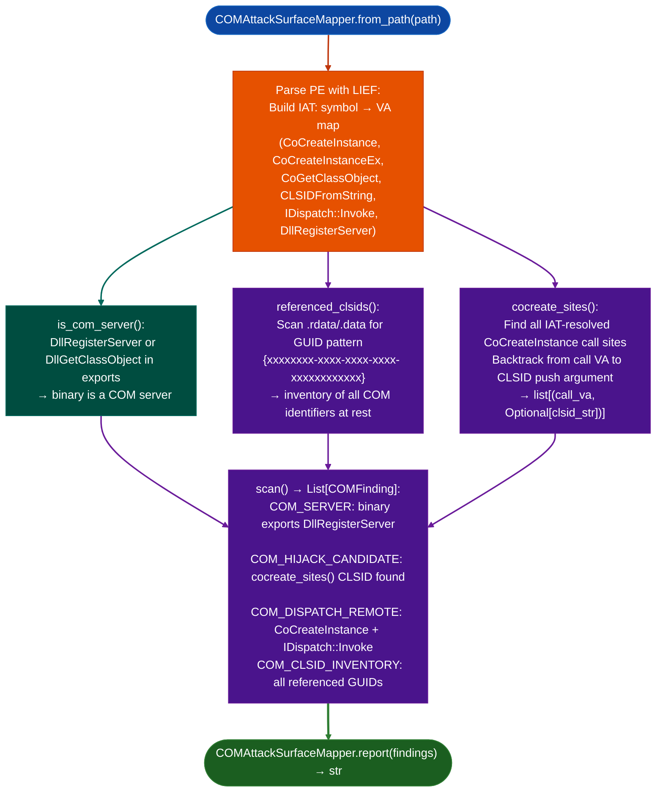

# COM Attack Surface Mapping

Enumerate the Windows COM attack surface in PE binaries: detecting self-registering COM servers, `CoCreateInstance` call sites with hijackable CLSIDs, IDispatch-based DCOM lateral movement patterns, and all GUID strings referenced at rest.

---

## Why this exists

1. **COM is the dominant inter-process and privilege-boundary crossing mechanism on Windows: security tools, browsers, AV products, and OS services all expose COM interfaces.** A PE binary that exports `DllRegisterServer` or `DllGetClassObject` is itself a COM server whose CLSID is an activation target for any process with the right permissions. `COMAttackSurfaceMapper.scan()` identifies all three COM attack vectors in one pass: the binary as a COM server, the binary as a COM client activation of other objects, and CLSIDs referenced in the binary's read-only data that may be hijackable via registry key manipulation.

2. **COM hijacking exploits machine-writable registry keys at `HKCU\Software\Classes\CLSID\{...}`: if a CLSID registered under `HKLM` can be overridden per-user, any low-privilege process can register a malicious COM server for that CLSID.** `cocreate_sites()` returns `call_va, clsid_string` tuples for all `CoCreateInstance` call sites, providing the inventory needed to check each referenced CLSID against the registry for hijackability. Without this inventory, COM hijacking assessment requires manual enumeration.

3. **`CoCreateInstance` combined with `IDispatch::Invoke` is a common DCOM lateral movement pattern: the binary activates a remote COM object and drives it via the `Invoke` dispatch interface.** `scan()` detects `IDispatch` usage `IDispatch::Invoke`, `CoCreateInstanceEx`, `CLSIDFromString` combined with `CoCreateInstance` in the same binary and reports `COM_DISPATCH_REMOTE` findings, which are candidates for DCOM-based lateral movement.

---

## How it works



### Finding reference

| Code | Severity | Description |
|:---|:---|:---|
| `COM_SERVER` | INFO | Binary exports `DllRegisterServer`/`DllGetClassObject`: is a COM server |
| `COM_HIJACK_CANDIDATE` | HIGH | `CoCreateInstance` call with resolvable CLSID: check registry hijackability |
| `COM_DISPATCH_REMOTE` | MEDIUM | `CoCreateInstance` + `IDispatch::Invoke`: possible DCOM lateral movement |
| `COM_CLSID_INVENTORY` | INFO | GUID string found in `.rdata`/`.data`: referenced COM identifier |

---

## Usage

```python
from ablation.analyzers.com_attack_surface_mapper import COMAttackSurfaceMapper

mapper = COMAttackSurfaceMapper.from_path('path/to/shdocvw.dll')
findings = mapper.scan()
print(COMAttackSurfaceMapper.report(findings))

# Check whether binary is a COM server
if mapper.is_com_server():
    print("Exports:", mapper.com_server_exports())

# Inventory all referenced CLSIDs
for clsid in mapper.referenced_clsids():
    print(f"  CLSID: {clsid}")

# Get all CoCreateInstance call sites with resolved CLSIDs
for call_va, clsid in mapper.cocreate_sites():
    print(f"  {call_va:#x}: CoCreateInstance({clsid or 'unresolved'})")
```

---

## Example output

The following illustrates the finding report format. Actual CLSIDs and addresses are binary-specific.

```
[HIGH] COM_HIJACK_CANDIDATE
  VA: <call-va>  CoCreateInstance({<clsid>})
  Check HKCU\Software\Classes\CLSID\{<clsid>} for user-writable override

[INFO] COM_SERVER
  Exports: DllRegisterServer, DllGetClassObject

[INFO] COM_CLSID_INVENTORY
  {<guid-1>}
  {<guid-2>}
  ...
```

---

## False positives

**`cocreate_sites()` attempts to backtrack from the call VA to the CLSID push argument, but indirect CLSID loading CLSID from registry, CLSID from configuration file, CLSID from IPC will produce `call_va, None` entries.** A `None` CLSID indicates the CLSID is not statically recoverable. These entries still appear in `COM_HIJACK_CANDIDATE` findings to flag the call site: they require dynamic analysis or manual reverse engineering to resolve.

**`COM_DISPATCH_REMOTE` fires on any binary that imports both `CoCreateInstance` and `IDispatch::Invoke`, this includes benign shell extensions and document viewers that use COM for in-process object activation.** Confirm lateral movement potential by checking whether `CoCreateInstanceEx` cross-machine DCOM or `CLSCTX_REMOTE_SERVER` flag is used at the specific call site.

---

## Pipeline position

Run `COMAttackSurfaceMapper` on Windows PE binaries DLLs and EXEs during Windows privilege escalation and lateral movement triage. The CLSID inventory from `referenced_clsids()` feeds registry hijacking checks: cross-reference each CLSID against `HKCU\Software\Classes\CLSID\` on the target system. See [Windows Artifact Discovery](windows-artifact-discovery.md) for the broader Windows assessment workflow.

---

## Reading findings

`COMAttackSurfaceMapperpe, path, raw.scan()` returns `list[COMFinding]`:

| Attribute | Content |
|:---|:---|
| `severity` | `'HIGH'` / `'MEDIUM'` / `'LOW'` / `'INFO'` |
| `category` | Finding category: `'com_server'` / `'com_create'` / `'com_hijack_risk'` / `'com_marshal'` / `'clsid_inventory'` / `'idispatch'` |
| `title` | Short finding title |
| `location` | Import name, section, or symbol that triggered the finding |
| `description` | Detailed explanation with CLSID, VA, or flag specifics |
| `va` | VA of the relevant call or reference 0 if not applicable |
| `cwe` | CWE identifier string, or empty if not classified |

`COMAttackSurfaceMapper.referenced_clsids()` returns `list[str]`: all statically recovered CLSID strings for registry cross-reference.

---

## See also

- [Windows Artifact Discovery](windows-artifact-discovery.md): registry, scheduled tasks, and artifact triage
- [Windows Escalation Indicators](windows-escalation-indicators.md): privilege escalation surface including COM hijacking
- [ETW Provider Extraction](etw-provider-extraction.md): COM-adjacent Windows telemetry surface
- [PDB Integration](pdb-integration.md): PDB symbols resolve COM interface method names in stripped binaries
