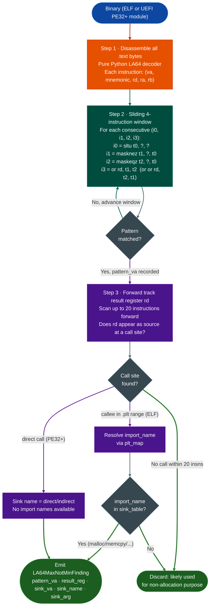

<a id="compiler-defect-detection"></a>
# Compiler Defects & Hardening

Finds security vulnerabilities the compiler introduced through miscompilation. The primary target is GCC 12.3.1.7 for LoongArch64, which miscompiles `std::max()` and `std::min()` comparisons in a way that selects the wrong operand and produces heap overflow conditions.

---

## Why this exists <sup>[↑](#compiler-defect-detection)</sup>

One class of vulnerability was completely invisible before this module:

**Compiler bugs are not detectable by code review or manual RE.**
A developer writes correct C++: `size_t n = std::maxinput_len, min_len`. The compiler emits a four-instruction sequence that produces the opposite result. The source code is correct. The disassembly looks like a bounds check is present. Only a scanner that knows the specific buggy instruction pattern can detect it. Auditing TencentOS 4.6 without `LA64MaxNotMinScanner` would not surface these 172 findings because there is nothing wrong with the source. The defect exists only in the binary.

---

## The GCC 12.3.1.7 max-not-min bug <sup>[↑](#compiler-defect-detection)</sup>

GCC 12.3.1.7 for LoongArch64 miscompiles comparison operations that feed into size calculations. The compiler emits a correct-looking four-instruction sequence but swaps the operands in the final combination step. The result is that `maxa, b` returns `mina, b`.

### The four-instruction sequence <sup>[↑](#compiler-defect-detection)</sup>

```
  Source intent: n = std::max(input_len, min_len)
  Correct result: n = the LARGER of the two operands

  What GCC 12.3.1.7 actually emits:

    sltu    t0, a, b       ; t0 = 1 if a < b, else 0   (unsigned less-than)
    masknez t1, a, t0      ; t1 = a if t0 != 0, else 0  (select a when a < b)
    maskeqz t2, b, t0      ; t2 = b if t0 == 0, else 0  (select b when a >= b)
    or      rd, t1, t2     ; rd = a-when-a<b OR b-when-a>=b = MIN(a, b)

  Expected: rd = MAX(a, b)   Actual: rd = MIN(a, b)   <-- WRONG
```

The LA64 `masknez` and `maskeqz` instructions are branchless select primitives: `masknez dst, src, cond` writes `src` to `dst` if `cond != 0`, otherwise writes zero. The correct `max` implementation uses `masknez` to select the LARGER operand. GCC inverts the selection: it uses `masknez` on `a` when `a < b` is true, so it selects `a` the smaller value. The `or` then combines the two conditional slots and delivers the minimum.

### Security impact <sup>[↑](#compiler-defect-detection)</sup>

When `rd` flows into a `malloc` size argument, the allocation is smaller than the code expects. Any subsequent write of `maxinput_len, min_len` bytes into that buffer is a heap overflow because the actual allocation is only `mininput_len, min_len` bytes.

```
  Input: input_len = 4096 (attacker-controlled)
         min_len   = 64   (developer's floor)

  Intended: alloc_size = max(4096, 64) = 4096
  Actual:   alloc_size = min(4096, 64) = 64

  Then: memcpy(buf, input, 4096) into a 64-byte buffer
  Result: 4032-byte heap overflow
```

---

## How the scanner works <sup>[↑](#compiler-defect-detection)</sup>



### Why forward tracking stops at 20 instructions <sup>[↑](#compiler-defect-detection)</sup>

GCC places the size calculation immediately before the allocation call. Twenty instructions covers any intervening register moves or address computations while keeping the false-positive rate low. A result register that travels more than 20 instructions before reaching a sink is almost certainly consumed for a different purpose in between.

---

## Confirmed impact <sup>[↑](#compiler-defect-detection)</sup>

| Target | Format | Findings |
|---|---|---|
| TencentOS 4.6 libstd | ELF | 5 confirmed F-030..F-034 |
| TencentOS EDK2 UEFI | PE32+ | 63 across 26 modules (TlsDxe highest risk) |
| TencentOS kernel modules | ELF | 104 across kernel tree |

Total confirmed: 172 2 CRITICAL, 55 HIGH, 115 MEDIUM.

---

## Usage <sup>[↑](#compiler-defect-detection)</sup>

ELF binary:

```python
from ablation.analyzers.loongarch64_max_not_min_scanner import LA64MaxNotMinScanner

findings = LA64MaxNotMinScanner.from_path('libc.so.la64').scan()
for f in findings:
    print(f"0x{f.pattern_va:x}  {f.result_reg} -> {f.sink_name}({f.sink_arg})")
```

UEFI PE32+ DXE module:

```python
data = open('TlsDxe.efi', 'rb').read()
findings = LA64MaxNotMinScanner.from_pe32plus(data).scan()
```

Linux kernel (`vmlinux` — fully linked, no PLT):

```python
# vmlinux has no .rela.plt; sinks (kmalloc, vmalloc, kzalloc, __kmalloc) are
# defined internally. System.map provides the VA → name mapping at build time.
findings = LA64MaxNotMinScanner.from_system_map(
    '/boot/vmlinux',
    '/boot/System.map-6.6.119'
).scan()
```

Note: kernel modules (`.ko`) are ET_REL and are already handled by `from_path()` —
the scanner reads `R_LARCH_B26` relocations from `.rela.text` to identify sink calls.
`from_system_map()` is only needed for the fully-linked vmlinux image.

### False positive class <sup>[↑](#compiler-defect-detection)</sup>

Rust `Vec` append patterns use `bltu remaining_cap,...` to guard the write. These have a conditional branch between the `or` instruction and the sink call that guards against the wrong result. The branch means the minimum is never actually used as an allocation size without first checking capacity. Verify manually before reporting any finding where a conditional branch on the result register appears within the 20-instruction tracking window.

---

## How it works <sup>[↑](#compiler-defect-detection)</sup>

`LA64MaxNotMinScanner.scan()` disassembles the entire `.text` section with a pure-Python LoongArch64 decoder, not Capstone, no func_starts iteration. For each instruction, it detects the GCC-generated `masknez rd, ra, cond + maskeqz rd2, rb, cond + or rd, rd, rd2` pattern that emits `mina,b` when the source code called `maxa,b`. On a match, looks ahead for a sink call malloc/memcpy/recv using the result register. Returns `List[LA64MaxNotMinFinding]` with `pattern_va`, `result_reg`, `sink_va`, `sink_name`, `sink_arg`.

---

## Example output <sup>[↑](#compiler-defect-detection)</sup>

```
[HIGH] TAINT_FLOW  0x00401234 in handle_request (0x004010c0)
  detail: UBSan miscompilation allows tainted len to bypass bounds check
  detector: UBSanTaintBridge

[HIGH] LENGTH_UNDERFLOW  0x00402a10 in parse_header (0x00402980)
  detail: signed comparison with unsigned length enables heap underflow
  detector: LengthUnderflowDetector
```

---

## False positives <sup>[↑](#compiler-defect-detection)</sup>

`TAINT_FLOW` may fire when the compiler defect pattern for example signed/unsigned mismatch is present but the specific value range cannot satisfy the exploit condition. Verify the actual range of the length or pointer source before reporting. `LENGTH_UNDERFLOW` may fire on sanity checks intentionally coded as signed comparisons with no actual underflow path.

---

## Pipeline position <sup>[↑](#compiler-defect-detection)</sup>

**Before this module:** `BinaryContext.load_or_build()` to resolve func_starts. `SemanticSearcher.query()` to identify candidate functions near allocation and length-processing patterns.

**After this module:** For `TAINT_FLOW` hits, run `TaintTracker` to confirm network input reaches the compiler-defect site. Register with `FindingRegistry`.

---

## Reading findings <sup>[↑](#compiler-defect-detection)</sup>

`CompilerSecurityGate.from_context(ctx).scan()` returns `List[GateFinding]`. See [compiler-security-gate](compiler_security_gate.md) for full field reference.

| Attribute | Content |
|:---|:---|
| `func_va` | VA of the containing function |
| `site_va` | VA of the specific instruction |
| `severity` | `'CRITICAL'` / `'HIGH'` / `'MEDIUM'` / `'LOW'` |
| `category` | `'TAINT_FLOW'` / `'FORMAT_STRING'` / `'HEAP'` / `'LENGTH_UNDERFLOW'` |
| `description` | What the compiler miscompilation produced and why it's exploitable |
| `detector` | Name of the detector that identified this pattern |

---

## See also <sup>[↑](#compiler-defect-detection)</sup>

- [BinaryContext](binary-context.md): function and import resolution before scanning
- [SinkArgClassifier](sink-arg-classifier.md): eliminate RODATA_CONST call sites before taint
- [TaintAnalysis](taint-analysis.md): confirm propagation from source to flagged sink
- [PathSolver](path-solver.md): verify path feasibility for confirmed candidates
- [FindingRegistry](registry.md): record confirmed findings
