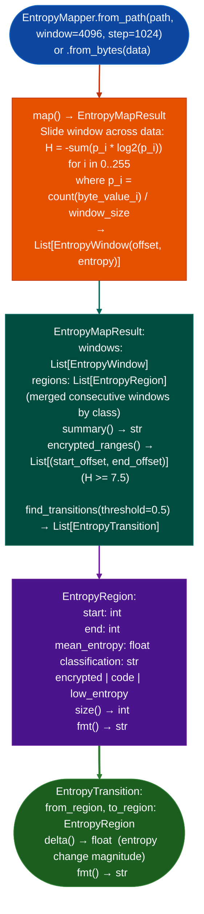

# Entropy Mapping

Map Shannon entropy across a binary file using a sliding window: classifying byte regions as encrypted/compressed (H≈8.0), code H≈4.0–6.0, or low-entropy data/padding H≈0.0–4.0, and identifying region boundaries and transitions to locate encrypted partitions, compressed filesystems, and embedded compressed payloads.

---

## Why this exists

1. **Before extracting or disassembling firmware, analysts need to know which byte ranges contain encrypted or compressed data versus executable code versus empty padding.** `EntropyMapper` produces a visual entropy map with region-level classification, enabling targeted extraction attempts on high-entropy regions (H≥7.5) without wasting time running `binwalk` on padding-heavy ROM images.

2. **`EntropyMapResult.encrypted_ranges()` returns offset ranges with H≥7.5**, these are the candidates for XOR key recovery (`XorSolver`), AES decryption, or squashfs decompression. Combined with `find_transitions()` entropy drops of ≥0.5 between adjacent windows, boundary detection narrows extraction targets to specific byte offsets without manual inspection.

3. **`EntropyMapper` is architecture- and format-agnostic**, it operates on raw bytes with no ELF header requirement, making it suitable as the first-pass tool for flat ECU ROMs, NAND flash dumps, VMDK raw images, and any unknown binary where structure is not yet established.

---

## How it works



---

## Usage

```python
from ablation.analyzers.entropy_mapper import EntropyMapper

mapper = EntropyMapper.from_path('/path/to/firmware.bin')
result = mapper.map()

print(result.summary())

# Find encrypted/compressed regions
for start, end in result.encrypted_ranges():
    size_kb = (end - start) / 1024
    print(f"  Encrypted region: {start:#x}–{end:#x}  ({size_kb:.1f} KB)")

# Find entropy transitions (partition boundaries)
transitions = result.find_transitions(threshold=0.5)
for t in transitions:
    print(f"  Transition at {t.from_region.end:#x}: {t.from_region.mean_entropy:.2f} → {t.to_region.mean_entropy:.2f}  Δ={t.delta():.2f}")

# Check a specific region
enc = result.encrypted_ranges()
if enc:
    start, end = enc[0]
    print(f"First encrypted region: {start:#x}–{end:#x}")
    # Feed to FortiOSHardwareExtractor or XorSolver
```

---

## Example output

The following illustrates the entropy map output format. Actual offsets and entropies are binary-specific.

```
EntropyMapper: firmware.bin  (<N> KB, window=4096, step=1024)

Regions:
  <0x000000>–<0x004000>   low_entropy   H=1.2   (boot/header padding)
  <0x004000>–<0x080000>   code          H=5.4   (ARM64 ELF .text)
  <0x080000>–<0x200000>   encrypted     H=7.9   (squashfs or XOR-encrypted)
  <0x200000>–<0x210000>   low_entropy   H=0.0   (NAND 0xFF padding)

Encrypted ranges: [(0x080000, 0x200000)]
Transitions: 3  (threshold=0.50)
```

---

## False positives

**`encrypted_ranges()` threshold H≥7.5 also fires on valid compressed data**: standard gzip, xz, squashfs filesystems all have H close to 8.0. The distinction between encrypted and compressed is not deterministic from entropy alone; use the offset returned by `encrypted_ranges()` as the starting point for magic-byte detection `1f 8b` for gzip, `68 73 71 73` for squashfs before applying a decryption attempt.

**Small window sizes < 512 bytes produce noisy entropy estimates** for regions with sparse content. Use the default 4096-byte window for firmware analysis; smaller windows are appropriate only for detailed region inspection.

---

## Pipeline position

Run `EntropyMapper` as the first analysis step on any unknown binary before `EcuArchDetector`, `BinaryContext.load_or_build()`, or `FortiOSHardwareExtractor`. Entropy analysis answers "is this encrypted?" before committing to any architecture-specific decoding.

---

## Reading output

`EntropyMapper(path).run()` returns an `EntropyMapResult`. The result exposes a `regions` list of `EntropyRegion` objects:

| Attribute | Content |
|:---|:---|
| `offset_start` | Start file offset inclusive |
| `offset_end` | End file offset exclusive |
| `cls` | Entropy classification: `'ENCRYPTED'` / `'CODE'` / `'SPARSE'` / `'PADDING'` |
| `avg_entropy` | Mean Shannon entropy across windows in this region (0.0–8.0) |
| `min_entropy` | Minimum entropy window value in this region |
| `max_entropy` | Maximum entropy window value in this region |

`EntropyMapResult.encrypted_ranges()` returns `List[Tuple[int, int]]`: `start, end` offset pairs for `ENCRYPTED`-classified regions.

`EntropyMapResult.find_transitions(threshold=0.5)` returns `List[EntropyTransition]`: each representing a sharp entropy class change:

| Attribute | Content |
|:---|:---|
| `offset` | File offset where the transition occurs |
| `from_cls` | Entropy class of the preceding region |
| `to_cls` | Entropy class of the following region |
| `from_entropy` | Entropy value at the end of the preceding region |
| `to_entropy` | Entropy value at the start of the following region |

---

## See also

- [Firmware Extraction](firmware-extraction.md): XOR key recovery pipeline for high-entropy FortiOS regions
- [Flat ROM Function Discovery](flat-rom-function-discovery.md): `EcuArchDetector` for code-region ISA identification
- [Persistent Analysis Context](persistent-analysis-context.md): `BinaryContext` for code regions after decryption
