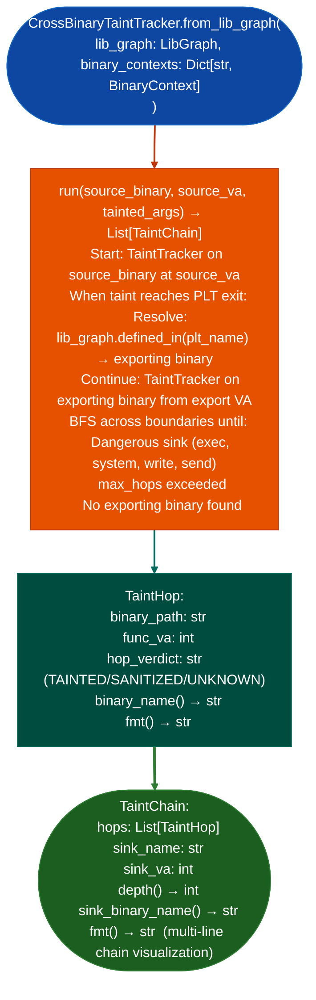

# Cross-Binary Taint Tracking

Follow tainted arguments across shared library boundaries: extending `TaintTracker.run_interprocedural()` beyond PLT call sites by resolving import names to exporting binaries via `LibGraph`, then continuing the taint BFS from the exported function's entry point: producing typed `TaintChain` evidence chains with per-hop binary attribution.

---

## Why this exists

1. **Single-binary `TaintTracker.run_interprocedural()` stops when a tainted argument is passed into a PLT entry.** It knows the PLT symbol name `recv`, `read`, `wm_popen` but not the address of the code that handles it. In a system where `libcommon.so` wraps `recv` and all daemons import from `libcommon.so`, single-binary taint stops at every inter-library boundary and misses the full path from network input to command execution.

2. **`CrossBinaryTaintTracker` resolves PLT symbol names to export VAs via `LibGraph.defined_in()`** and continues the taint BFS from the exporting binary: producing a `TaintChain` that spans multiple binaries. Each hop is a `TaintHop` with the binary name, function VA, and taint verdict, enabling full attack chain reconstruction across a multi-binary firmware system.

3. `TaintChain.depth()` and `sink_binary_name()` enable triage prioritization: short chains depth ≤ 2 with a `sink_binary_name()` of a privileged binary for example `httpd`, `sslvpnd` are higher priority than long chains terminating in unprivileged workers. `TaintChain.fmt()` produces a full chain visualization for inclusion in vulnerability findings.

---

## How it works



---

## Usage

```python
from ablation.analyzers.cross_binary_taint import CrossBinaryTaintTracker
from ablation.analyzers.lib_graph import LibGraph
from ablation.analyzers.binary_context import BinaryContext

# Build LibGraph from all firmware shared libraries
lib_paths = ['/path/to/libcommon.so', '/path/to/httpd', '/path/to/sslvpnd']
contexts = {p: BinaryContext.load_or_build(p) for p in lib_paths}
lib_graph = LibGraph.from_contexts(list(contexts.values()))

tracker = CrossBinaryTaintTracker.from_lib_graph(lib_graph, contexts)

# Track taint from recv() through the full library chain
chains = tracker.run(
    source_binary='/path/to/httpd',
    source_va=0x12340,  # recv() call site
    tainted_args={'rdi': 'TAINTED'}
)

for chain in chains:
    print(f"Depth: {chain.depth()}  Sink: {chain.sink_name} in {chain.sink_binary_name()}")
    print(chain.fmt())
```

---

## Example output

The following illustrates the cross-binary taint chain output format. Actual addresses and binary names are firmware-specific.

```
CrossBinaryTaintTracker: httpd → libcommon.so → sslvpnd

TaintChain (depth=3):
  hop 0: httpd        func=<va>  recv() PLT exit  [TAINTED]
  hop 1: libcommon.so func=<va>  parse_header()   [TAINTED]
  hop 2: sslvpnd      func=<va>  system() call    [TAINTED → SINK]

Sink: system  binary=sslvpnd  depth=3
```

---

## False positives

**`LibGraph.defined_in()` returns `None` when the exporting binary is not in the provided `binary_contexts` dict**: if `libssl.so` is not included in the analysis set, taint crossing into SSL library functions produces `TaintHop` with unknown binary attribution and stops. Always include all shared libraries that could carry tainted data.

**Cross-binary taint BFS is bounded by `max_hops`**: the default hop limit prevents infinite recursion in circular import graphs. Increase `max_hops` for complex library dependency chains if taint stops prematurely.

---

## Pipeline position

Run `CrossBinaryTaintTracker` after single-binary `TaintTracker` has established that taint exits a binary through a PLT entry. Cross-binary tracking adds depth to findings that would otherwise stop at a library boundary without identifying the ultimate sink.

---

## Reading output

`CrossBinaryTaintTracker.runsource_binary, source_va, tainted_args` returns a list of `TaintChain` objects:

| Attribute | Content |
|:---|:---|
| `hops` | `List[TaintHop]`: one per binary crossed |
| `sink_binary` | Path to the binary where taint arrives at the sink |
| `sink_va` | VA of the sink call in `sink_binary` |
| `sink_name` | Sink function name |
| `tainted_args` | `List[int]`: which argument indices are tainted at the sink |
| `source_name` | Name of the taint source function |

Each `TaintHop`:

| Attribute | Content |
|:---|:---|
| `binary_path` | Path to the binary for this hop |
| `func_va` | VA of the function in this binary |
| `func_name` | Name of the function |
| `tainted_arg_indices` | `List[int]`: which argument positions arrived tainted |
| `calls_made` | `List[str]`: notable calls made within this function |

---

## See also

- [Named Taint Sources and Bounds](named-taint-sources-and-bounds.md): single-binary TaintTracker that cross-binary extends
- [Interprocedural Field Writer Discovery](interprocedural-field-writer-discovery.md): `IPRegAnnotator` for N-hop argument tracing
- [Cross-Library Import/Export Matrix](cross-library-import-export-matrix.md): `LibGraph` that provides import/export resolution
