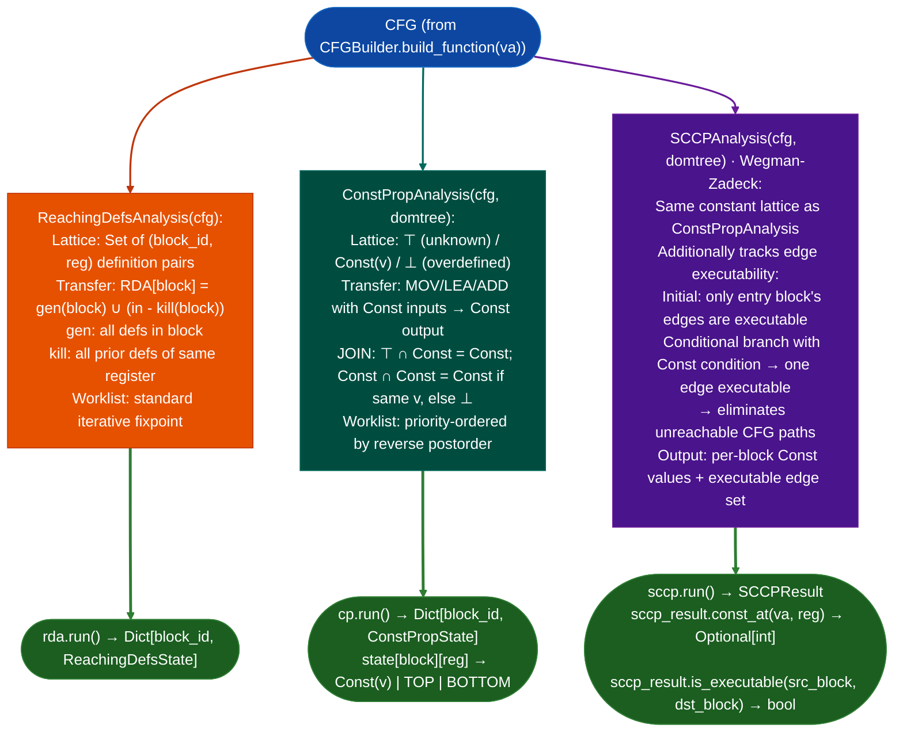

# Constant Propagation and Reaching Definitions

Track which instruction definitions reach each program point, and propagate constant values to eliminate symbolic unknowns: implemented as the `ReachingDefsAnalysis` and `ConstPropAnalysis`/`SCCPAnalysis` analyses in the MFP worklist framework; used to resolve indirect branch targets, identify buffer sizes, and eliminate unreachable paths before taint analysis.

---

## Why this exists

1. `TaintTracker` and `SinkArgClassifier` produce false positives when a register that appears tainted is actually always a constant at the call site: for example, a buffer size computed as `16 * n` where `n` is a function argument that the caller always passes as `3` thus always 48. `ConstPropAnalysis` eliminates these false positives by propagating constant values through the CFG and marking registers as `CONST(v)` at each call site. `SCCPAnalysis` Sparse Conditional Constant Propagation per Wegman-Zadeck goes further: it marks edges as `EXECUTABLE`/`UNEXECUTABLE` based on conditional branch outcomes, enabling dead-code elimination and unreachable-path pruning.

2. **`ReachingDefsAnalysis` tracks which `instruction, register` pairs define a value that may reach each basic block.** This enables use-def chains: given a use of `rdi` at a call site, `ReachingDefsAnalysis` identifies all definitions of `rdi` that might reach that point. Use-def chains are the foundation for `SinkArgClassifier`'s backward walk and `FormatStringScanner`'s provenance trace.

3. The MFP Maximal Fixed Point worklist framework from Nielson/Nielson/Hankin §2.4.1 provides the termination guarantee: both analyses iterate until a fixed point where no lattice value changes. For `ConstPropAnalysis` the lattice is `⊤ (unknown) → Const(v) → ⊥ non-constant`. For `ReachingDefsAnalysis` the lattice is a gen/kill power set. ACC Ascending Chain Condition guarantees termination because both lattices have finite height.

---

## How it works



---

## Usage

```python
from ablation.analyzers.cfg_builder import CFGBuilder
from ablation.analyzers.dataflow_engine import (
    ReachingDefsAnalysis, ConstPropAnalysis, SCCPAnalysis
)
from ablation.analyzers.binary_context import BinaryContext

ctx = BinaryContext.load_or_build('/path/to/target.elf')
builder = CFGBuilder(ctx)
cfg = builder.build_function(0x1000)
domtree = cfg.dominator_tree()

# Reaching definitions
rda = ReachingDefsAnalysis(cfg)
rda_result = rda.run()

# Constant propagation
cp = ConstPropAnalysis(cfg, domtree)
cp_result = cp.run()

# Sparse conditional constant propagation
sccp = SCCPAnalysis(cfg, domtree)
sccp_result = sccp.run()

# Query: what is rdi's constant value at the call site?
const_val = sccp_result.const_at(va=0x1050, reg='rdi')
if const_val is not None:
    print(f"rdi is always {const_val:#x} at 0x1050")

# Query: is a conditional branch target reachable?
reachable = sccp_result.is_executable(src_block=cfg.block_at(0x1040), dst_block=cfg.block_at(0x1060))
```

---

## Example output

The following illustrates constant propagation output. Actual values are function-specific.

```
SCCPAnalysis at <function-va>:
  <va>: rdi = Const(0x3)     ; confirmed constant at call site
  <va>: rsi = BOTTOM         ; non-constant (loop-modified)
  <va>: rdx = TOP            ; value not yet determined (unreachable block)

Executable edges: <N> / <total>  (<M> pruned as unreachable)
```

---

## False positives

**`ConstPropAnalysis` is intra-procedural: a constant passed from a caller is treated as `⊤ (unknown)` unless `RegAnnotator` seeds the entry state.** Seed the entry state with `cp.set_entry(rdi=Const(caller_value))` when the caller is known to always pass a constant argument.

**`SCCPAnalysis` edge executability requires a Const conditional: if the branch condition is non-constant (`BOTTOM`), both edges remain executable.** This is conservative and correct; it means that non-constant conditional branches do not prune any paths.

---

## Pipeline position

Run `ConstPropAnalysis`/`SCCPAnalysis` before `TaintTracker` when a suspicious call site has many `ARG_PROPAGATED` or `UNKNOWN` sinks: constant propagation may resolve some as constant-argument sites and remove them from the taint queue. Run `ReachingDefsAnalysis` when implementing a new backward-walk analyzer that needs use-def chains.

---

## Reading output

`SCCPAnalysisdata, base_addr, arch.solvefunc_addr` returns `Tuple[cp_vals, exec_edges]`:

| Component | Content |
|:---|:---|
| `cp_vals` | `Dict[int, Any]`: block label → register state dict (`None` = unreachable / ⊥) |
| `exec_edges` | `Set[Tuple[int, int]]`: `src_label, dst_label` edges proven executable |

`ReachingDefsAnalysisdata, base_addr, arch.solvefunc_addr` returns `Tuple[in_sets, out_sets]`:

| Component | Content |
|:---|:---|
| `in_sets` | `Dict[int, FrozenSet]`: reaching definitions at block entry |
| `out_sets` | `Dict[int, FrozenSet]`: reaching definitions at block exit |

Each set element is a `register_name, def_va` tuple where `def_va=None` means the initial unknown definition.

---

## See also

- [CFG Fixpoint Dataflow](cfg-fixpoint-dataflow.md): `SCCPAnalysis` Wegman-Zadeck and MFP worklist implementation details
- [CFG Construction](control-flow-graph-construction.md): `CFGBuilder` input
- [Structured Control-Flow Recovery](structured-control-flow-recovery.md): uses dominator tree from the same pipeline
