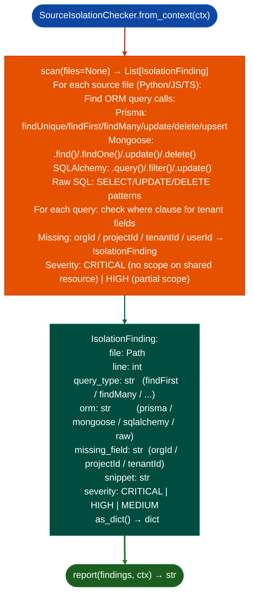

# Tenant Isolation Checking

Detect missing tenant-scope predicates in database queries: finding `findUnique`, `findFirst`, `findMany`, `update`, `delete`, and `upsert` calls Prisma, Mongoose, SQLAlchemy, raw SQL where the `where` clause does not include an `orgId`, `projectId`, or `tenantId` field: the highest-yield pattern class in multi-tenant SaaS audits.

---

## Why this exists

1. **A single missing `projectId` in a Prisma `findFirst` where clause is an IDOR Insecure Direct Object Reference: any authenticated user in the system can access records belonging to other tenants.** `SourceIsolationChecker` detects this pattern at scale across entire codebases, finding every query that touches a tenant-scoped resource without the scoping predicate. This is the first scan to run on any multi-tenant SaaS codebase before deeper vulnerability analysis.

2. Prisma, Mongoose, and SQLAlchemy each use different syntactic patterns for scoping predicates: Prisma uses `where: { projectId }`, Mongoose uses `.find({ orgId: req.user.orgId })`, SQLAlchemy uses `.filter(Model.tenant_id == tenant_id)`. `SourceIsolationChecker` includes matchers for all three ORMs plus raw SQL `WHERE tenant_id =` patterns, enabling consistent detection across mixed-ORM codebases.

3. `IsolationFinding.as_dict()` provides structured output for integration with `AgentLoop`: findings include file path, line number, query type, missing scope field, and the query text snippet. `AgentLoop` can use these as pre-analyzed evidence for generating IDOR hypothesis reports, referencing the exact file and line where the scope is missing.

---

## How it works



---

## Usage

```python
from ablation.analyzers.source_isolation_checker import SourceIsolationChecker
from ablation.analyzers.source_ingestion import SourceContext

ctx = SourceContext.from_path('/path/to/saas_backend')

checker = SourceIsolationChecker.from_context(ctx)
findings = checker.scan()
print(SourceIsolationChecker.report(findings, ctx))

# Summary
critical = [f for f in findings if f.severity == 'CRITICAL']
print(f"Critical IDOR candidates: {len(critical)}")

for f in critical:
    print(f"  {f.file}:{f.line}  {f.query_type} missing {f.missing_field}")
    print(f"  {f.snippet}")
```

---

## Example output

The following illustrates the isolation check output format. Actual paths and fields are codebase-specific.

```
SourceIsolationChecker: /path/to/saas_backend

Queries scanned: <N>  (Prisma: <A>, Mongoose: <B>, SQLAlchemy: <C>)

Findings (<M> total):
  [CRITICAL] prisma.findFirst  api/projects.ts:<line>
    missing: projectId
    snippet: prisma.document.findFirst({ where: { id: documentId } })

  [CRITICAL] prisma.findMany   api/users.ts:<line>
    missing: orgId
    snippet: prisma.user.findMany({ where: { role: 'admin' } })
```

---

## False positives

**Pattern matching may not capture all multi-line query objects**: a Prisma `findFirst` with a complex `where` object spanning multiple lines may not be parsed, causing `SourceIsolationChecker` to miss the `projectId` field if it appears on a later line. Validate `CRITICAL` findings by inspecting the full query object, not just the detected snippet.

**`orgId` fields in non-scoping positions**: a query that includes `orgId` as a returned field for example `select: { orgId: true }` but not in the `where` clause may incorrectly suppress a finding if the pattern matcher does not distinguish field positions. `missing_field` should be interpreted as "not found in where clause," not "not found anywhere."

---

## Pipeline position

Run `SourceIsolationChecker` as the first scan on any multi-tenant SaaS backend codebase, before `SourceSinkScanner` or `SourceTaintTracker`. IDOR findings are typically the highest-severity class in SaaS audits and require the least analysis time to validate. Feed `CRITICAL` findings directly to manual review.

---

## Reading findings

`SourceIsolationChecker.check()` returns a list of finding dicts:

| Field | Content |
|:---|:---|
| `severity` | `CRITICAL` / `HIGH` |
| `orm` | ORM type `prisma`, `mongoose`, `sqlalchemy` |
| `method` | ORM query method for example `findFirst`, `findMany` |
| `file` | Source file path and line number |
| `missing` | Missing tenant/owner isolation field for example `projectId`, `orgId` |
| `snippet` | Code snippet showing the unguarded query |

---

## See also

- [Source Code Analysis Pipeline](bare-integration.md): `SourceContext` that `SourceIsolationChecker` consumes
- [Source Dangerous Sink Detection](source-dangerous-sink-detection.md): `SourceSinkScanner` for complementary source-level vulnerability scanning
- [Assisted Vulnerability Hypotheses](assisted-vulnerability-hypotheses.md): `AgentLoop` for IDOR hypothesis generation from isolation findings
