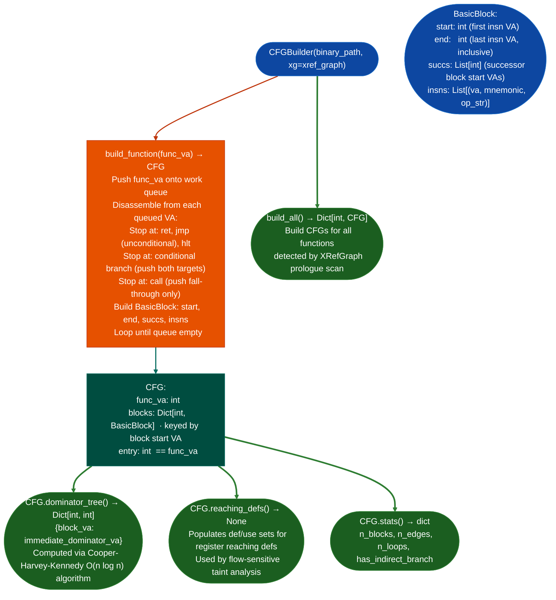

# Control-Flow Graph Construction

Per-function control-flow graph construction for x86-64 ELF binaries using iterative recursive disassembly: producing `BasicBlock` and `CFG` structures with dominator trees, reaching definitions, and successor edges for use by flow-sensitive taint analysis and structural analysis tools.

---

## Why this exists

1. **Flow-sensitive taint analysis (`analyze_function_flow_sensitive()`) and dominator-based loop detection both require a correctly built CFG: without it, all analysis treats a function's instructions as a flat sequence, missing the semantics of conditional branches and loop back-edges.** `CFGBuilder.build_function()` constructs the CFG using iterative recursive disassembly Andriesse, "Practical Binary Analysis" §8.2.4: follow direct branches from each basic block, stop at `ret`/`jmp`/`hlt`, push both sides of a conditional branch. The result is a `CFG` with correct successor edges across all paths.

2. **Each ISA has an ISA-specific CFG builder `cfg_arm64.py`, `cfg_mips.py`, `cfg_riscv.py`, etc. that handles ISA-specific branch semantics: ARM32 conditional execution, MIPS delay slots, RISC-V compressed (RVC) branches.** The x86-64 `CFGBuilder` in `cfg_builder.py` is the primary builder for stripped server and appliance binaries. ISA-specific builders share the same `CFG`/`BasicBlock` type contracts and produce the same analysis interface.

3. **`CFG.dominator_tree()` computes the dominance relation for loop detection and structured control-flow recovery: a block `d` dominates block `n` if every path from the function entry to `n` passes through `d`.** Back-edges edges from a block to one of its dominators identify loop headers. `CFGBuilder` exposes `dominator_tree()` and loop head detection without requiring a full SSA transformation, keeping build time under 10ms per function.

---

## How it works



### ISA-specific CFG builders

| Module | ISA | Special handling |
|:---|:---|:---|
| `cfg_builder.py` | x86-64 | Iterative recursive disassembly; call fall-through |
| `cfg_arm64.py` | ARM64 | `cbz`/`cbnz`/`tbz`/`tbnz` conditional branches |
| `cfg_arm32.py` | ARM32/Thumb | Conditional execution codes; Thumb IT blocks |
| `cfg_mips.py` | MIPS-32/64 | Delay-slot awareness: branch insn carries next insn |
| `cfg_riscv.py` | RISC-V | RVC 16-bit compressed branch instructions |
| `cfg_ppc.py` | PPC-32/64 | `bc`/`bcl` conditional links; CTR-based loops |
| `cfg_arc.py` | ARC EM/HS | `bbit0`/`bbit1` bit-test branches; delay slots |
| `cfg_v850.py` | V850/RH850 | Conditional branches across all condition codes |
| `cfg_loongarch64.py` | LoongArch64 | `beqz`/`bnez`/`bl` extended branch range |
| `cfg_sh2a.py` | SH-2A | Delay-slot branches; `bt`/`bf`/`bsr` |
| `cfg_x86.py` | x86-32/64 | Shared with `cfg_builder.py`; `jmp [mem]` guard |

---

## Usage

```python
from ablation.analyzers.cfg_builder import CFGBuilder
from ablation.analyzers.xref_graph import XRefGraph

# Build XRef graph (provides function boundaries)
xg = XRefGraph.from_path('/path/to/binary')
xg.build()

builder = CFGBuilder('/path/to/binary', xg=xg)

# Build CFG for one function
cfg = builder.build_function(func_va=0x401200)
print(f"Blocks: {len(cfg.blocks)}")
print(f"Stats: {cfg.stats()}")

# Dominator tree (for loop detection)
dtree = cfg.dominator_tree()
loop_headers = {b for b, succs in [(va, bb.succs) for va, bb in cfg.blocks.items()]
                for s in succs if dtree.get(va) == s}

# Iterate basic blocks
for va, bb in sorted(cfg.blocks.items()):
    print(f"  Block {va:#x} → succs {[f'{s:#x}' for s in bb.succs]}")
    for insn_va, mnem, ops in bb.insns:
        print(f"    {insn_va:#x}  {mnem}  {ops}")

# Build CFGs for all functions
all_cfgs = builder.build_all()
print(f"Total CFGs built: {len(all_cfgs)}")
```

---

## Example output

The following illustrates the CFG stats and block structure format. Actual values are function-specific.

```
CFG for <func-va>:
  Stats: {'n_blocks': <N>, 'n_edges': <E>, 'n_loops': <L>, 'has_indirect_branch': False}
  Block <va>  → succs [<succ1>, <succ2>]
    <va>  cmp    rdi, 0
    <va>  je     <succ2>
  Block <succ1>  → succs [<succ3>]
    ...
```

---

## False positives

**`build_function()` stops at `jmp` unconditional jump without following jump-table targets.** Functions with switch statements that use a `jmp [rax*8+table]` pattern will have their jump-table cases appear as unreachable blocks in the CFG. The `stats()` field `has_indirect_branch: True` flags this. Flow-sensitive analysis on such functions may miss paths through switch cases.

**`build_all()` uses `XRefGraph` prologue scan to identify function starts, this misses functions that don't match the prologue pattern `push rbp; mov rbp, rsp` or `sub rsp, N`.** On heavily optimized binaries or firmware compiled with `-fomit-frame-pointer`, the prologue scan underestimates function count. Supply explicit `func_starts` to `CFGBuilder` when known entry points are available from other sources.

---

## Pipeline position

Build CFGs after `XRefGraph` provides function boundaries and PLT mapping. `CFGBuilder` is a prerequisite for `analyze_function_flow_sensitive()`, `SubsequenceSearcher` which uses op-category sequences derived from CFG blocks, and `StructureRecovery` which reads dominator trees. Build once per session and cache: `BinaryContext.load_or_build()` handles this automatically.

---

## Reading output

`CFGBuilder.build(va)` returns a `CFG` object:

| Attribute / Method | Content |
|:---|:---|
| `blocks` | `Dict[int, BasicBlock]` keyed by block start VA |
| `stats()` | `{n_blocks, n_edges, n_loops, has_indirect_branch}` dict |
| `dominator_tree()` | `Dict[int, int]` mapping each block VA to its immediate dominator VA |
| `loops()` | List of `header_va, body_blocks` natural loop tuples |
| `successors(va)` | List of successor block VAs for block starting at `va` |
| `predecessors(va)` | List of predecessor block VAs for block starting at `va` |

`BasicBlock` attributes (`cfg_builder.py`):

| Attribute | Content |
|:---|:---|
| `start` | Start VA of the block |
| `end` | VA of the last instruction inclusive |
| `insns` | `List[Tuple[int, str, str]]`: `va, mnemonic, op_str` per instruction |
| `succs` | `List[int]`: successor block start VAs |

---

## See also

- [XRefGraph](xref-graph.md): provides function starts and PLT map; required for `CFGBuilder`
- [Taint Analysis](taint-analysis.md): `analyze_function_flow_sensitive()` uses CFG basic blocks
- [Dominator and Loop Analysis](dominators-and-loop-analysis.md): reads `CFG.dominator_tree()` for structured recovery
- [Behavioral Subsequence Search](behavioral-subsequence-search.md): uses op-category sequences from CFG instruction lists
