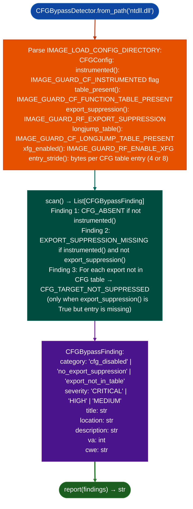

# Control Flow Guard Review

Analyze Windows PE binaries for Control Flow Guard (CFG) bypass opportunities: detecting whether CFG is absent, whether export suppression is missing expanding the valid-target bitmap to the entire export table, and which specific exports are reachable as CFG bypass targets when export suppression is enabled but incomplete.

---

## Why this exists

1. **CFG validates indirect call targets against a compiler-built bitmap of valid function entry points: a target not in the bitmap triggers a CFG violation.** When CFG is not enabled at all (`CFGConfig.instrumented() == False`), every `CALL [reg]` and `JMP [reg]` in the binary is unprotected and an attacker can redirect execution to any gadget. `CFGBypassDetector` identifies this condition immediately from the PE's `IMAGE_LOAD_CONFIG_DIRECTORY` flags.

2. When CFG is enabled but export suppression is missing, all exported functions are automatically added to the valid-target bitmap: even functions that were never intended as indirect call targets. This expands the attacker's gadget surface from the minimal set of legitimate virtual dispatch targets to the entire export table, which in `ntdll.dll` can be hundreds of useful gadgets.

3. **XFG (eXtended Flow Guard) is a superset of CFG that adds type hashes to call sites and target addresses: `CFGConfig.xfg_enabled()` checks for XFG instrumentation.** Binaries with XFG provide stronger protection than CFG-only binaries; the presence of XFG reduces the exploitability of CFG bypass findings.

---

## How it works



---

## Usage

```python
from ablation.analyzers.cfg_bypass_detector import CFGBypassDetector

det = CFGBypassDetector.from_path('ntdll.dll')
findings = det.scan()
print(CFGBypassDetector.report(findings))

# Check CFG configuration directly
cfg = det.config
print(f"CFG instrumented: {cfg.instrumented()}")
print(f"Export suppression: {cfg.export_suppression()}")
print(f"XFG enabled: {cfg.xfg_enabled()}")
print(f"CFG entry stride: {cfg.entry_stride()} bytes")

# Filter to specific finding types
bypass_targets = [f for f in findings if f.category == 'export_not_in_table']
print(f"Unsuppressed exports: {len(bypass_targets)}")
for f in bypass_targets:
    print(f"  {f.location}  VA={f.va:#x}")
```

---

## Example output

The following illustrates the CFG analysis output format. Actual findings are binary-specific.

```
CFGBypassDetector: ntdll.dll  (x86_64 PE)

CFGConfig:
  Instrumented: True
  Table present: True
  Export suppression: False   ← MISSING
  XFG: False
  Entry stride: 4 bytes

Findings:

[HIGH] EXPORT_SUPPRESSION_MISSING
  All <N> exports are valid CFG targets including non-entrypoint functions
  Attack surface includes: NtAllocateVirtualMemory, RtlCopyMemory, ...

Severity: HIGH  (CFG present but export suppression absent)
```

---

## False positives

**`CFG_TARGET_NOT_SUPPRESSED` fires on exports that appear in the export table but not in the CFG table**: some exports especially forwarded exports and data exports are legitimately absent from the CFG table because they are not code entry points. Verify that the flagged export is actual code before treating it as a bypass target.

**`CFG_ABSENT` on a binary compiled for a non-CFG target for example a debug build or a driver compiled with `/guard:cf-` override is expected, not a security vulnerability**: check whether the binary is a security-sensitive component before treating CFG absence as a finding.

---

## Pipeline position

Run `CFGBypassDetector` when analyzing Windows PE binaries for exploit development surface, it is an early triage check that determines whether CFG protections constrain the available call gadgets before spending time on ROP chain construction. `CFGBypassDetector` is independent of taint analysis and ELF-specific tools; it requires only the PE binary path.

---

## Reading findings

`CFGBypassDetector.from_path(path).scan()` returns `List[CFGBypassFinding]`. See [cfg-bypass-detector](cfg-bypass-detector.md) for the full field reference.

| Attribute | Content |
|:---|:---|
| `severity` | `'CRITICAL'` / `'HIGH'` / `'MEDIUM'` / `'LOW'` |
| `category` | `'cfg_disabled'` / `'cfg_table_absent'` / `'no_export_suppression'` / `'export_not_in_table'` / `'indirect_call_stats'` |
| `title` | Short finding title |
| `location` | PE path or export name identifying the bypass surface |
| `description` | Explanation of the bypass opportunity and impact |
| `va` | VA of the relevant export or call site 0 if not applicable |
| `cwe` | CWE identifier for example `'CWE-693'` |

`CFGBypassDetector.cfg_config()` returns a `CFGConfig` object:

| Attribute | Content |
|:---|:---|
| `cfg_enabled` | `True` if CFG is enabled in the binary |
| `guard_flags` | Raw `GuardFlags` integer from `IMAGE_LOAD_CONFIG` |
| `function_count` | Number of functions in the CFG table |
| `function_table_va` | VA of the CFG function table |
| `function_table_rvas` | `List[int]`: RVAs of all CFG-protected functions |
| `instrumented` | Property: `True` if `CF_INSTRUMENTED` flag is set |
| `table_present` | Property: `True` if `CF_TABLE_PRESENT` flag is set |
| `export_suppression` | Property: `True` if `__guard_suppress_export_checks` is set |
| `xfg_enabled` | Property: `True` if XFG (eXtended Flow Guard) is enabled |
| `entry_stride` | Property: CFG bitmap stride in bytes |

---

## See also

- [SEH and SafeSEH Review](seh-and-safeseh-review.md): Windows PE structured exception handler chain analysis
- [Crash Offset and ROP Helpers](crash-offset-and-rop-helpers.md): ROP gadget enumeration using the CFG bypass surface
- [Windows Artifact Discovery](windows-artifact-discovery.md): broader Windows binary analysis context
