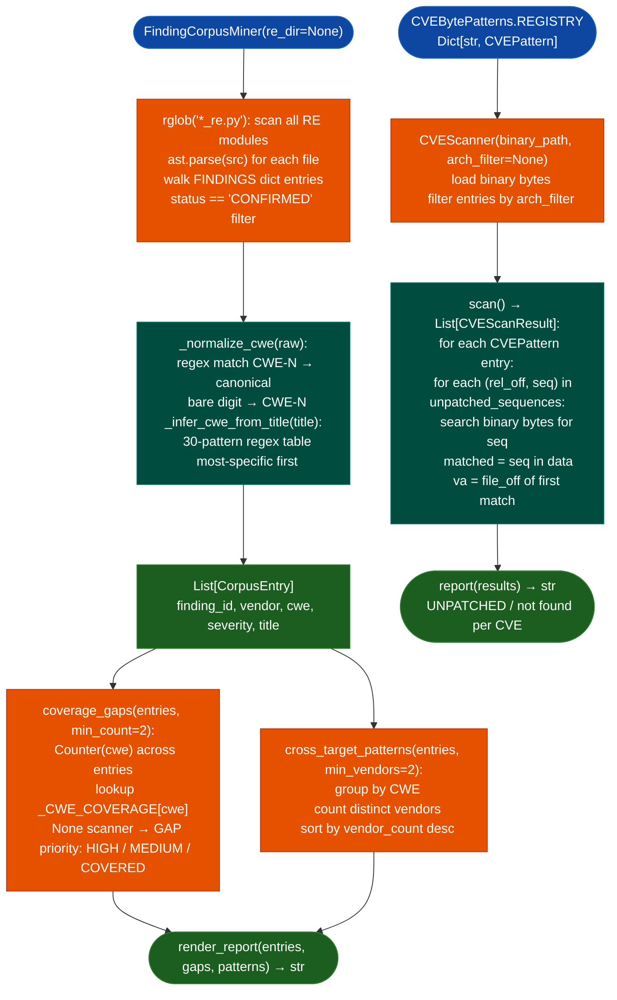

<a id="findingcorpusminer--cvebytepatterns"></a>
# Vulnerability Pattern Mining

  - [What is cross-target corpus mining?](#what-is-cross-target-corpus-mining)
  - [What is CVE byte pattern scanning?](#what-is-cve-byte-pattern-scanning)
  - [Why this exists](#why-this-exists)
  - [How it works](#how-it-works)
  - [Module relationships](#module-relationships)
  - [API reference](#api-reference)
    - [FindingCorpusMiner](#findingcorpusminer)
    - [Result records](#result-records)
    - [CVEBytePatterns / CVEScanner](#cvebytepatterns--cvescanner)
    - [CVEPattern](#cvepattern)
    - [CVEScanResult](#cvescanresult)
  - [Usage](#usage)
  - [Limitations](#limitations)
  - [Pipeline position](#pipeline-position)
  - [See also](#see-also)

---

## What is cross-target corpus mining? <sup>[↑](#findingcorpusminer--cvebytepatterns)</sup>

A corpus, in the context of vulnerability research, is the full collection of confirmed findings accumulated across every target an analyst has examined. For Ablation, this corpus lives in `re/<vendor>/<target>_re.py` files: Python modules where each confirmed finding is a dict entry in a `FINDINGS` constant, tagged with severity, CWE classification, and title.

Mining that corpus means reading every `FINDINGS` entry across all RE modules, normalizing CWE identifiers from free-text descriptions, and computing frequency tables that answer questions no single-target analysis can answer: which vulnerability classes appear most often across an entire vendor's product line? Which CWEs lack an Ablation scanner? Which vulnerability patterns recur across multiple vendors and therefore represent strong module-candidate priorities?

The technique originates in large-scale vulnerability dataset analysis. Researchers at Carnegie Mellon's CERT and the National Vulnerability Database have long aggregated CVE data to identify structural weaknesses in software categories, for example finding that memory corruption accounts for more than half of all firmware vulnerabilities. `FindingCorpusMiner` applies the same aggregation at the engagement level: instead of aggregating public CVEs, it aggregates confirmed internal findings, producing a picture of a specific vendor's structural weaknesses rather than industry averages.

CWE normalization is a non-trivial component. Analysts tag findings inconsistently: one entry might say `CWE-78`, another `"OS Command Injection"`, and a third nothing at all. `FindingCorpusMiner` applies two normalization paths. Explicit `CWE-N` tags in the findings dict pass through a regex parser that strips surrounding text and returns a canonical `CWE-N` string. Entries with no CWE tag pass through a 30-pattern title regex table, ordered most-specific first, that infers the CWE from the finding title. This two-pass approach captures CWEs from entries that predate the explicit-tag convention.

Coverage gaps are the actionable output. For each CWE that appears in the corpus, `FindingCorpusMiner` checks whether Ablation has a scanner that handles it, using the `_CWE_COVERAGE` map. CWEs with `None` in that map have no automated scanner: every finding for them was discovered manually. When a `None` CWE appears across three or more vendors, it becomes a `HIGH`-priority module candidate because the manual discovery cost has already proven the attack surface is real.

Cross-target patterns are the second actionable output. When the same CWE appears in multiple vendors' products, that pattern indicates a structural vulnerability shared across product families. A format string bug in one vendor's product is interesting. The same pattern in Cisco, Fortinet, and Juniper is a sign that an underlying library or firmware SDK shared between vendors carries the vulnerability.

## What is CVE byte pattern scanning? <sup>[↑](#findingcorpusminer--cvebytepatterns)</sup>

A published CVE describes a vulnerability in a specific library version. When that library is patched, the patch changes specific bytes in the binary. The unpatched code contains one byte sequence; the patched code contains a different sequence at the same location. If an analyst confirms the exact bytes of the unpatched sequence in a known-vulnerable binary, those bytes become a signature: a binary fingerprint for the presence of the unpatched vulnerability.

CVE byte pattern scanning applies this principle to firmware. Embedded devices routinely bundle open-source libraries at specific versions and ship those versions for years without patching. A device running a 2012 firmware image might bundle `libxml2` 2.7.8, which carries CVE-2011-3919. No source code access is needed to confirm this: if the specific bytes from the unpatched `libxml2` 2.7.8 function body appear in the device's `libeaexml2.so`, the device is vulnerable.

The technique predates Ablation: binary patch diffing has been used in malware research since at least 2007, when researchers began comparing patched and unpatched Windows DLLs to reverse-engineer security fixes before Microsoft published patch details. `CVEBytePatterns` applies the same method to confirm bundled library vulnerabilities in stripped firmware with no version strings and no symbol table.

The key discipline is byte verification. Version strings can be spoofed, stripped, or wrong. The bytes at a specific function offset are the ground truth. `CVEBytePatterns.REGISTRY` stores only entries where the analyst has confirmed the unpatched bytes in a real binary. Entries with empty `unpatched_sequences` lists are explicitly invalid and marked as unverified. This matches the same byte-verify-everything standard that Ablation's VA confirmation rules enforce for all other findings.

## Why this exists <sup>[↑](#findingcorpusminer--cvebytepatterns)</sup>

1. Confirmed findings accumulated in RE modules carry no feedback loop unless something reads them. Before `FindingCorpusMiner`, every finding stayed in its target's RE module and never influenced tooling priorities. The corpus miner closes the Ablation flywheel: engagement findings drive module development rather than sitting inert.

2. Bundled library CVEs are common in firmware and require no taint analysis to confirm. When a vendor ships `libxml2` 2.7.8 for five years across twenty products, the vulnerability exists across all twenty. `CVEScanner` automates the confirmation check that would otherwise require manually identifying the unpatched bytes on each target.

3. Pattern-only claims for CVE presence carry false-positive risk. Version string matching reports any binary that contains the string "2.7.8" as vulnerable, including patched rebuilds where the version string was not updated. Byte-sequence matching reports only binaries that contain the specific unpatched bytes, with the same standard that Ablation applies to every other confirmed finding.

---

## How it works <sup>[↑](#findingcorpusminer--cvebytepatterns)</sup>



The corpus miner reads RE modules as text using `ast.parse`, never as live Python, so it is safe to run on any RE module regardless of what code those modules contain. The FINDINGS dict is extracted by walking the AST for `ast.Assign` nodes with a `FINDINGS` target name, then calling `ast.literal_eval` on each key-value pair. Non-literal values are skipped rather than raising an error.

The CVE scanner reads the target binary as a raw byte stream and searches for each registered pattern using a linear byte-sequence search. It does not disassemble or parse the binary format. A match at any file offset counts as a hit, so the scanner works on stripped binaries with no section headers.

---

## Module relationships <sup>[↑](#findingcorpusminer--cvebytepatterns)</sup>

`FindingCorpusMiner` reads `re/<vendor>/<target>_re.py` modules produced by analyst RE sessions. It does not modify those modules or the `FindingRegistry`. The output is a standalone text report or JSON, consumed offline.

`CVEBytePatterns.REGISTRY` is populated by analyst calls to `CVEBytePatterns.register()` after confirming the unpatched bytes in a known-positive binary. The registry is not persisted to disk across sessions unless the source file is updated directly.

The coverage gap output from `FindingCorpusMiner` informs module development priorities: a `HIGH`-priority gap signals that a new Ablation scanner should be written. Once the scanner is written, its CWE entry in `_CWE_COVERAGE` changes from `None` to the scanner name, and the gap disappears from future reports.

`PatternLibrary` stores confirmed semantic query patterns per engagement. `FindingCorpusMiner` is complementary: `PatternLibrary` drives the next engagement's scan by replaying patterns, while `FindingCorpusMiner` drives module development by aggregating confirmed findings into frequency tables.

---

## API reference <sup>[↑](#findingcorpusminer--cvebytepatterns)</sup>

### FindingCorpusMiner <sup>[↑](#findingcorpusminer--cvebytepatterns)</sup>

```python
from sweeps.corpus_miner import FindingCorpusMiner, CorpusEntry, CoverageGap, CrossTargetPattern
```

**Constructor and methods**

```text
FindingCorpusMiner(re_dir: Optional[Path] = None)
miner.extract() -> List[CorpusEntry]
miner.coverage_gaps(entries, min_count=2) -> List[CoverageGap]
miner.cross_target_patterns(entries, min_vendors=2) -> List[CrossTargetPattern]
miner.render_report(entries, gaps, patterns) -> str
```

The miner scans `re_dir` for `*_re.py` files and defaults to `~/ablation/re/`. `extract()` returns confirmed entries and infers a missing CWE from the title when possible. Coverage gaps order CWEs by finding count and identify classes without a registered scanner. Cross-target patterns identify CWEs present in multiple vendors. The report combines severity, vendor, CWE, coverage, and cross-target summaries.

### Result records

`CorpusEntry` records the finding ID, vendor, source module, CWE, whether the CWE was inferred, severity, and a truncated title.

`CoverageGap` records the CWE and name, finding count, vendors, matching scanner if any, and priority. `HIGH` means no scanner and at least three vendors; `MEDIUM` means no scanner across fewer vendors; `COVERED` means a scanner is registered.

`CrossTargetPattern` records the CWE and name, vendor count, sorted vendors, total findings, and up to three example titles.

---

### CVEBytePatterns / CVEScanner <sup>[↑](#findingcorpusminer--cvebytepatterns)</sup>

```python
from modules.cve_byte_patterns import CVEBytePatterns, CVEScanner
```

`CVEBytePatterns.REGISTRY` maps CVE IDs to `CVEPattern` entries. Register a pattern with:

```text
CVEBytePatterns.register(
    cve_id: str,
    library: str,
    arch: str,
    function: str,
    unpatched_sequences: List[Tuple[int, bytes]],
    patched_note: str = '',
    severity: str = 'HIGH',
    fixed_version: str = '',
    notes: str = '',
) -> CVEPattern
```

Each unpatched sequence is a `(relative_offset, bytes)` pair. An empty sequence list means the entry is unverified.

Construct a scanner with `CVEScanner(binary_path, cve_ids=None, arch_filter=None)` or `CVEScanner.from_context(ctx, ...)`. `scan()` returns one `CVEScanResult` per selected registry entry, and `CVEScanner.report(results)` formats those results.

A `CVEPattern` stores library, architecture, function, severity, fixed version, byte sequences, patched-code notes, and analyst notes. A `CVEScanResult` records the CVE ID, match status, match offset/VA, and explanatory note. A byte match is candidate evidence of an unpatched sequence—not proof of reachability or exploitability.

---

### CVEPattern <sup>[↑](#findingcorpusminer--cvebytepatterns)</sup>

One CVE registry entry.

| Field | Type | Description |
|:------|:-----|:------------|
| `cve_id` | `str` | CVE identifier (e.g. `CVE-2011-3919`) |
| `library` | `str` | Library name (e.g. `libxml2`) |
| `arch` | `str` | Architecture string: `x86`, `ppc32`, `x86_64`, `arm32`, etc. |
| `function` | `str` | Name of the vulnerable function |
| `severity` | `str` | `CRITICAL`, `HIGH`, `MEDIUM`, or `LOW` |
| `fixed_version` | `str` | First library version that contains the fix |
| `unpatched_sequences` | `List[Tuple[int, bytes]]` | Byte sequences present in unpatched code. Each tuple is `(relative_offset, bytes)`. An empty list means the entry is unverified. |
| `patched_note` | `str` | Description of what the patched code looks like at the same location |
| `notes` | `str` | Additional analyst notes |

---

### CVEScanResult <sup>[↑](#findingcorpusminer--cvebytepatterns)</sup>

One scan result for one CVE pattern against one binary.

| Field | Type | Description |
|:------|:-----|:------------|
| `cve_id` | `str` | CVE identifier |
| `matched` | `bool` | `True` if the unpatched byte sequence was found in the binary |
| `va` | `int` | File offset of the first matching byte sequence; `0` when `matched` is `False` |
| `offset` | `int` | File offset of the match (same as `va` for flat byte searches) |
| `note` | `str` | Analyst notes from the registry entry when matched, otherwise `"Pattern not found (possibly patched or different arch variant)"` |

---

## Usage <sup>[↑](#findingcorpusminer--cvebytepatterns)</sup>

### Corpus mining report

```python
from sweeps.corpus_miner import FindingCorpusMiner

miner = FindingCorpusMiner()
entries = miner.extract()
print(f'{len(entries)} confirmed findings across corpus')

gaps = miner.coverage_gaps(entries, min_count=2)
patterns = miner.cross_target_patterns(entries, min_vendors=2)

print(miner.render_report(entries, gaps, patterns))
```

From the command line:

```bash
# Text report to stdout
python3 sweeps/corpus_miner.py

# Raise the minimum count threshold
python3 sweeps/corpus_miner.py --min-count 3 --min-vendors 3

# Machine-readable JSON for downstream processing
python3 sweeps/corpus_miner.py --json > corpus_analysis.json

# Write report to file
python3 sweeps/corpus_miner.py --out /tmp/corpus_report.md
```

### Identify coverage gaps and prioritize module work

```python
from sweeps.corpus_miner import FindingCorpusMiner

miner = FindingCorpusMiner()
entries = miner.extract()
gaps = miner.coverage_gaps(entries, min_count=2)

high_priority = [g for g in gaps if g.priority == 'HIGH']
for gap in high_priority:
    print(f'{gap.cwe} ({gap.cwe_name}): {gap.count} findings in {len(gap.vendors)} vendors — no scanner')
```

### Scan a binary for bundled CVE vulnerabilities

```python
from modules.cve_byte_patterns import CVEBytePatterns, CVEScanner

# Check which CVEs are registered
for cve_id, pattern in CVEBytePatterns.REGISTRY.items():
    print(f'{cve_id}: {pattern.library} {pattern.arch} — {pattern.function}')

# Scan a firmware binary
scanner = CVEScanner('/path/to/libeaexml2.so', arch_filter='x86')
results = scanner.scan()
print(CVEScanner.report(results))

# Check a specific result
for r in results:
    if r.matched:
        print(f'{r.cve_id} CONFIRMED UNPATCHED at file offset {r.va:#x}')
```

### Register a new CVE pattern after byte verification

```python
from modules.cve_byte_patterns import CVEBytePatterns

# After confirming the bytes in a known-positive binary:
CVEBytePatterns.register(
    cve_id='CVE-XXXX-YYYY',
    library='libopenssl',
    arch='ppc32',
    function='SSL_verify_cert',
    unpatched_sequences=[
        (0x40, b'\x38\x60\x00\x00'),   # li r3, 0 — always returns 0 (success)
    ],
    severity='CRITICAL',
    fixed_version='1.0.2b',
    patched_note='patched version calls X509_verify_cert and checks return value',
)
```

---

## Limitations <sup>[↑](#findingcorpusminer--cvebytepatterns)</sup>

1. `FindingCorpusMiner` reads only `FINDINGS` dicts with `status == 'CONFIRMED'`. Candidates and eliminated entries do not appear in the corpus. The frequency tables reflect confirmed findings, not the full scope of what was investigated.

2. CWE inference from titles is heuristic. A finding titled "Heap allocation overflow in packet parser" matches CWE-122 but a finding titled "Unsafe use of memcpy" does not match any pattern and returns `unknown`. Frequency tables undercount CWEs that analysts describe without standard terminology.

3. `CVEScanner` performs a flat byte search with no disassembly. If a compiler emits the same bytes in a different context for an unrelated reason, the scanner reports a false match. All `matched=True` results should be confirmed by examining the bytes in context before reporting.

4. `CVEBytePatterns.REGISTRY` is in-memory and resets when the process exits. Patterns registered in one session are not available in the next unless the source file is edited. This is intentional: the registry only grows when an analyst has confirmed the bytes in a real binary, not from version-string heuristics.

5. The CVE scanner does not cache results per binary version. Running the same binary twice computes the scan twice. For large firmware sweeps across many binaries, wrap `scan()` with an external cache keyed on the binary's SHA-256 hash.

6. Corpus mining does not verify that CONFIRMED findings in RE modules have passed byte verification. It trusts the `status == 'CONFIRMED'` tag at face value. The analyst is responsible for ensuring findings are not promoted to CONFIRMED without the byte-verify step.

---

## Pipeline position <sup>[↑](#findingcorpusminer--cvebytepatterns)</sup>

`FindingCorpusMiner` runs after engagements, not during them. It is a post-engagement tool that synthesizes across all RE modules and feeds back into module development priorities. The natural cadence is to run it after committing a new target's RE module.

`CVEScanner` runs early in an engagement, before any disassembly. It takes under a second per binary and confirms or rules out known CVEs immediately. If a bundled library match is confirmed, it goes directly into the RE module as a CONFIRMED finding without requiring taint analysis.

---

## See also <sup>[↑](#findingcorpusminer--cvebytepatterns)</sup>

- [`PatternLibrary`](pattern-library.md): stores and replays semantic query patterns from confirmed findings; complementary flywheel mechanism
- [`FindingRegistry`](finding-validation.md): registers findings after Z3 path solving; the source of `status == 'CONFIRMED'` entries that the corpus miner reads
- [`SemanticSearcher`](semantic-code-search.md): the scan step that produces the candidates that become corpus entries after confirmation
- [`TaintTracker`](taint-analysis.md): confirms taint paths that produce the CONFIRMED findings the corpus miner aggregates
