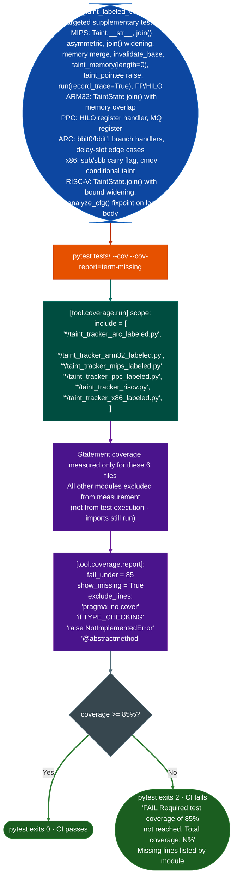

# Coverage Gate

TCL3-qualified coverage measurement for Ablation's labeled-taint engine modules: enforcing 85% statement coverage on the safety-critical subset of taint tracker code via pytest-cov and `pyproject.toml` coverage configuration.

---

## Why this exists

1. **Ablation's labeled-taint engine is used to generate findings for automotive ECU firmware under ISO 26262 TCL3 scope: a qualification level that requires evidence of systematic test coverage for safety-relevant software.** The coverage gate exists to produce that evidence. It applies only to the six labeled-taint tracker modules that feed into safety-relevant findings, not to the full ablation/analyzers tree which would require hundreds of binary fixture files that are not available in the CI environment. Scoping coverage to the labeled-taint modules means the 85% threshold is achievable in CI with pure-Python unit tests, no firmware required.

2. **Labeled-taint engine modules have complex lattice operations: `TaintState.join()`, `TaintState.invalidate_base()`, `Taint.__str__()`, and instruction-handler dispatch, that are easy to leave uncovered if only happy-path tests are written.** `tests/test_taint_labeled_coverage.py` specifically targets code paths identified during TCL3 coverage measurement: `join()` with asymmetric taint one state tainted, one clean, join with different bounds (widening to `None`), memory merge at join-points, `invalidate_base()` stack-clobber detection, and `FP`/`HILO` instruction handlers that are not reached by normal CFG traversal.

3. **`fail_under = 85` in `pyproject.toml` means a `pytest --cov` run that produces below-85% coverage fails with exit code 2: blocking CI.** This is the enforcement mechanism. Without a `fail_under` threshold, coverage measurement is advisory and will be ignored under schedule pressure. The threshold of 85% not 100% reflects the TCL3 standard's allowance for uncoverable branches: `pragma: no cover`, `TYPE_CHECKING` guards, `raise NotImplementedError` in abstract base methods, and `@abstractmethod` decorators.

---

## How it works



### Coverage scope

| Module | ISA | TCL3 qualified |
|:---|:---|:---|
| `taint_tracker_arc_labeled.py` | ARC EM/HS | Yes |
| `taint_tracker_arm32_labeled.py` | ARM32/Thumb | Yes |
| `taint_tracker_mips_labeled.py` | MIPS-32 | Yes |
| `taint_tracker_ppc_labeled.py` | PPC-32/64 | Yes |
| `taint_tracker_riscv.py` | RISC-V 32/64 | Yes |
| `taint_tracker_x86_labeled.py` | x86-32/64 | Yes |

All other modules in `ablation/analyzers/` are excluded from coverage measurement. Binary-path non-labeled taint trackers, ISA decoders, CFG builders, format parsers, and network enumeration modules are not in the TCL3 qualification scope.

---

## Usage

```bash
# Run coverage (TCL3 scope only)
python -m pytest tests/ --cov --cov-report=term-missing

# Run with HTML report
python -m pytest tests/ --cov --cov-report=html
open htmlcov/index.html

# Run only the coverage supplementary tests
python -m pytest tests/test_taint_labeled_coverage.py -v

# Check current coverage without failing
python -m pytest tests/ --cov --cov-report=term --no-cov-on-fail || true

# Run coverage on a single module
python -m pytest tests/ --cov=ablation.analyzers.taint_tracker_riscv --cov-report=term-missing
```

### Adding coverage for a new labeled-taint module

When a new TCL3-qualified labeled-taint module is added:

1. Add the module path to `[tool.coverage.run] include` in `pyproject.toml`.
2. Run `pytest --cov --cov-report=term-missing` to identify uncovered lines in the new module.
3. Add targeted test cases to `tests/test_taint_labeled_coverage.py` for each uncovered path.
4. Confirm `pytest --cov` exits 0 with `>= 85%` before committing.

---

## Example output

The following illustrates the coverage report format. Actual percentages and missing line numbers reflect the current test suite state.

```
---------- coverage: platform linux, python 3.11 ----------
Name                                          Stmts   Miss  Cover   Missing
---------------------------------------------------------------------------
ablation/analyzers/taint_tracker_arc_labeled.py   <n>    <n>   <pct>%  <lines>
ablation/analyzers/taint_tracker_arm32_labeled.py <n>    <n>   <pct>%  <lines>
ablation/analyzers/taint_tracker_mips_labeled.py  <n>    <n>   <pct>%  <lines>
ablation/analyzers/taint_tracker_ppc_labeled.py   <n>    <n>   <pct>%  <lines>
ablation/analyzers/taint_tracker_riscv.py         <n>    <n>   <pct>%  <lines>
ablation/analyzers/taint_tracker_x86_labeled.py   <n>    <n>   <pct>%  <lines>
---------------------------------------------------------------------------
TOTAL                                            <n>    <n>   <pct>%
Required test coverage of 85.0% reached. Total coverage: <pct>%
```

---

## False positives

**`fail_under = 85` will fail the CI run if a new labeled-taint module is added to `[tool.coverage.run] include` without corresponding test coverage.** Adding a module to the coverage scope without writing tests is the most common way to trigger an unexpected CI failure. Always write supplementary coverage tests or confirm the existing test suite reaches 85% before adding a new module to the scope.

**`show_missing = True` outputs line numbers for uncovered statements, but some line numbers reference `else` branches of `if TYPE_CHECKING` guards that are never executed at runtime.** These are in the `exclude_lines` list but may still appear if the pattern match fails due to indentation or trailing whitespace. Add `# pragma: no cover` to any line that appears in the missing list but is structurally uncoverable.

---

## Pipeline position

The coverage gate runs as part of the CI test job (`ci.yml`). It is the last step in the test job and does not block the import smoke tests or integration test. Coverage below 85% fails the test job, which blocks merge to `main`. The FORGE pre-commit gate (`forge.py`) runs before commits, independently of CI coverage: they are complementary quality gates.

---

## Reading output

The coverage gate does not return a Python object. It outputs a `pytest-cov` coverage report to stdout and exits `0` if coverage meets the minimum threshold, non-zero otherwise.

Relevant terminal fields:

| Field | Content |
|:---|:---|
| `Cover` | Line coverage percentage for each module |
| `Missing` | Line numbers with no test coverage |
| `TOTAL` | Aggregate line coverage across all covered modules |
| `Required test coverage of X%` | Gate pass/fail message with threshold |

---

## See also

- [CI and Release Automation](ci-and-release-automation.md): full CI workflow description; coverage runs as part of the `test` job
- [FORGE Module](forge.md): pre-commit module audit gate; complements coverage with structural quality checks
- [Taint Analysis](taint-analysis.md): general labeled-taint model; the modules in the TCL3 scope implement this model
