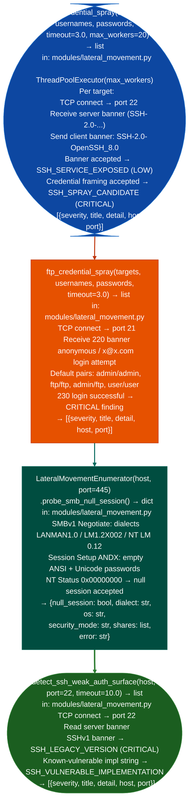

# Credential Testing Helpers

Test SSH and FTP service authentication with credential lists using parallel threads, probe SMB for null session access (via `LateralMovementEnumerator`), detect SSH legacy protocol versions and vulnerable implementations, and identify SSH weak authentication surface keyboard-interactive, password auth acceptance: via `modules/lateral_movement.py`.

---

## Why this exists

1. **`ssh_credential_spray()` performs banner-layer SSH surface probing against a list of targets and credentials**, it implements a thread pool where each worker connects to TCP/22, reads the SSH server banner, sends the client banner `SSH-2.0-OpenSSH_8.0`, and evaluates banner responses against a credential pair. Detection is banner-layer only no full KEX or authentication exchange; a `CRITICAL SSH_SPRAY_CANDIDATE` finding indicates the banner exchange completed and the transport accepted the framing: upgrade to a full paramiko KEX session in a controlled lab for definitive authentication confirmation. All findings return `{severity, title, detail, host, port}`.

2. **`LateralMovementEnumerator.probe_smb_null_session()` tests SMB for unauthenticated IPC$ access**, it sends a raw `SMBv1 Negotiate` dialects: LANMAN1.0, LM1.2X002, NT LM 0.12 followed by `Session Setup ANDX` with empty ANSI and Unicode password fields. A `STATUS_SUCCESS` (0x00000000) response confirms null session access. Returns `{'null_session': bool, 'dialect': str, 'os': str, 'security_mode': str, 'shares': list, 'error': str}`, not the standard `{severity, title, detail, host, port}` shape.

3. **`detect_ssh_weak_auth_surface()` identifies legacy SSH implementations and vulnerable versions**, it connects to TCP/22, reads the server banner, and checks for: (1) SSHv1 banners (`SSH-1.x`) that indicate a legacy protocol version; (2) implementation strings matching known-vulnerable versions in `vuln_map` for example old Dropbear, old OpenSSH with specific CVEs. Returns `[{severity, title, detail, host, port}]`. This is a passive banner-read operation, no authentication exchange, no log entries generated on the target.

---

## How it works



---

## Usage

```python
from modules.lateral_movement import (
    ssh_credential_spray,
    ftp_credential_spray,
    detect_ssh_weak_auth_surface,
    LateralMovementEnumerator
)

# SSH banner-layer spray
targets = ['<target-a>', '<target-b>']
usernames = ['root', 'admin', 'ubuntu']
passwords = ['root', 'admin', 'password']
for finding in ssh_credential_spray(targets, usernames, passwords, max_workers=10):
    print(f"  [{finding['severity']}] {finding['host']}: {finding['title']}")
    print(f"    {finding['detail'][:100]}")

# Weak legacy version detection (no login attempt)
for finding in detect_ssh_weak_auth_surface('<target-ip>'):
    print(f"  [{finding['severity']}] {finding['title']}: {finding['detail'][:80]}")

# SMB null session (class-based)
enum = LateralMovementEnumerator('<target-ip>', port=445)
result = enum.probe_smb_null_session()
if result['null_session']:
    print(f"  NULL SESSION: dialect={result['dialect']}  os={result['os']}")
```

---

## Example output

The following is a schematic example showing output structure and field names. Values are illustrative.

```
ssh_credential_spray: <target-ip>:22

  [LOW]      SSH_SERVICE_EXPOSED
               detail: host=<target-ip> port=22 banner='SSH-2.0-OpenSSH_8.2p1 Ubuntu'

  [CRITICAL] SSH_SPRAY_CANDIDATE
               detail: host=<target-ip> port=22 user=root pair accepted at transport layer

ftp_credential_spray: <target-ip>:21

  [CRITICAL] FTP_ANONYMOUS_LOGIN
               detail: user=anonymous banner='220 FTP server ready'

detect_ssh_weak_auth_surface: <target-ip>:22

  [CRITICAL] SSH_LEGACY_VERSION
               detail: host=<target-ip> port=22 banner='SSH-1.99-OpenSSH_...' version=1.99

LateralMovementEnumerator.probe_smb_null_session: <target-ip>:445

  null_session=True  dialect='NT LM 0.12'  os='Windows Server 2008'
```

---

## False positives

**`ssh_credential_spray()` banner-layer limitation**: the spray function does not perform a full SSH key exchange or authentication. `SSH_SPRAY_CANDIDATE` indicates that the transport framing was accepted at the banner layer; it does not confirm that the credential pair authenticates successfully. Confirm with a full paramiko KEX in a controlled lab before treating the finding as a verified login.

**`probe_smb_null_session()` SMBv1 dialect requirement**: null sessions require SMBv1. Hosts with SMBv1 disabled Windows Server 2016+, modern Samba with `server min protocol = SMB2` will return `STATUS_NOT_SUPPORTED` or close the connection at the negotiate step. A `null_session=False` result with an `error` field does not confirm that SMB authentication is hardened: only that the null session path is blocked.

---

## Pipeline position

Run `detect_ssh_weak_auth_surface()` first, it is entirely passive no auth attempt, no log entry. Use results to determine which hosts are viable spray targets before running `ssh_credential_spray()`. SMB null session testing applies to any Windows host running SMBv1, particularly domain controllers and file servers on enterprise networks.

---

## Reading output

`ssh_credential_spray()` returns a list of result dicts, one per credential attempt:

| Field | Content |
|:---|:---|
| `host` | Target host |
| `port` | SSH port |
| `username` | Username tested |
| `password` | Password tested |
| `success` | `True` if authentication succeeded |
| `error` | Error message if failed, else `None` |

`probe_smb_null_session()` returns `{host, null_session: bool, error}`.

`detect_ssh_weak_auth_surface()` returns a list of finding dicts `{severity, title, detail, host, port}` for banner and key exchange weaknesses detected without authentication.

---

## See also

- [Internal Network Reconnaissance](internal-network-reconnaissance.md): `CredentialHarvester` for filesystem credential extraction before spray
- [Credential/Token/Key Discovery](credential-token-key-discovery.md): credential and API token enumeration from the compromised host filesystem
- [Remote Management and Identity Probes](remote-management-and-identity-probes.md): `LateralMovementEnumerator` for WMI, RPC, WinRM, and RDP probing
