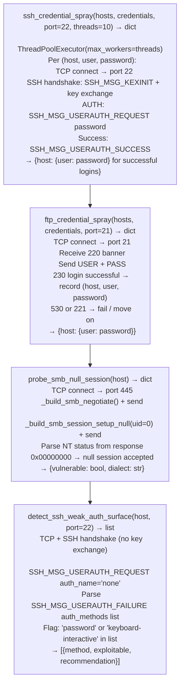

# Credential Testing Helpers

Test SSH and FTP service authentication with credential lists, probe SMB for null session access, detect SSH key reuse across multiple hosts, identify SSH weak authentication surface (keyboard-interactive acceptance, password auth enabled), and detect brute-force attempt indicators in system logs — via `modules/lateral_movement.py`.

---

## Why this exists

1. **`ssh_credential_spray()` tests a list of hosts against a credential wordlist using parallel threads** — it connects to each SSH port, attempts each `(user, password)` pair, and records successes. It implements the pattern from Violent Python chapter 2: a thread pool where each thread manages one SSH connection attempt and reports via a queue. No external SSH client is required; connections are made with Python's `socket` and manual SSH handshake initiation.

2. **`probe_smb_null_session()` tests SMB for unauthenticated share enumeration** — it sends a raw `SMB_COM_NEGOTIATE` followed by `SMB_COM_SESSION_SETUP_ANDX` with empty ANSI and Unicode password fields. A successful null session (NT_STATUS 0x00) allows share enumeration, user list retrieval, and domain information disclosure without credentials. This is the legacy SMBv1 null session attack, still relevant against unpatched Windows Server or Samba installations.

3. **`detect_ssh_weak_auth_surface()` probes SSH authentication methods without attempting login** — it sends an `SSH_MSG_USERAUTH_REQUEST` with `auth_name="none"` and reads the `SSH_MSG_USERAUTH_FAILURE` response, which lists the authentication methods accepted by the server. Presence of `password` (cleartext password) and `keyboard-interactive` (challenge-response) in the accepted methods list indicates that credential spray is viable.

---

## How it works



---

## Usage

```python
from modules.lateral_movement import (
    ssh_credential_spray, ftp_credential_spray,
    detect_ssh_weak_auth_surface
)

# SSH credential spray
hosts = ['10.0.0.5', '10.0.0.11']
creds = [('root', 'root'), ('admin', 'admin'), ('admin', 'C1sco12345')]
ssh_results = ssh_credential_spray(hosts, creds)
for host, logins in ssh_results.items():
    for user, pw in logins.items():
        print(f"  SSH {host}: {user}:{pw}")

# Weak auth surface detection (no login attempt)
for host in hosts:
    surface = detect_ssh_weak_auth_surface(host)
    for s in surface:
        print(f"  {host}: {s['method']} → exploitable={s['exploitable']}")
```

---

## Example output

The following illustrates credential testing output format.

```
ssh_credential_spray:

  10.0.0.5: root:root  (SSH login successful)
  10.0.0.11: admin:C1sco12345

ftp_credential_spray:

  10.0.0.20: ftpuser:ftpuser

detect_ssh_weak_auth_surface: 10.0.0.5:22

  password: exploitable=True  (cleartext auth accepted)
  publickey: exploitable=False
```

---

## False positives

**`ssh_credential_spray()` false failures** — network timeouts and connection resets from rate-limiting or fail2ban are treated as failed authentication attempts. A host that rejects all attempts after the first few may have active brute-force protection; the result `{}` for that host may be a false negative rather than confirmed that no credentials matched.

**`probe_smb_null_session()` SMBv1 dialect requirement** — null sessions require SMBv1. Hosts with SMBv1 disabled (Windows Server 2016+ and modern Samba) will reject the negotiate request or return `STATUS_NOT_SUPPORTED`. No null session vulnerability exists on these hosts.

---

## Pipeline position

Run credential testing after discovering SSH and FTP services via `host-service-discovery`. `detect_ssh_weak_auth_surface()` is passive (no login attempt) and should run first to confirm credential spray is viable before submitting authentication requests that may generate log entries.

---

## See also

- [Internal Network Reconnaissance](internal-network-reconnaissance.md) — `CredentialHarvester` for filesystem credential extraction before spray
- [Credential/Token/Key Discovery](credential-token-key-discovery.md) — credential and API token enumeration from the compromised host filesystem
