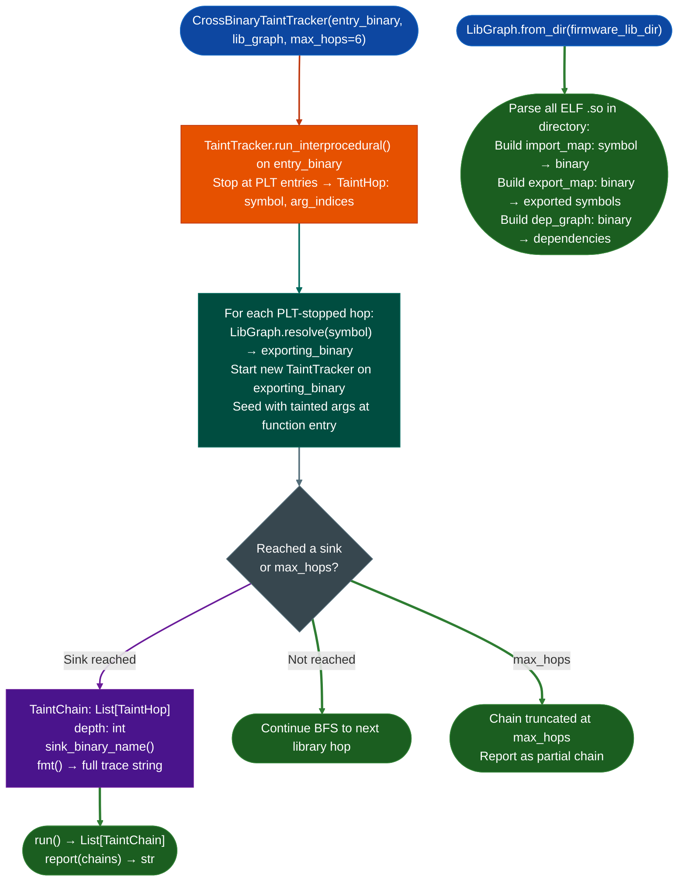

# Cross-Library Analysis

Extend interprocedural taint tracking across shared library boundaries: following taint from a PLT call site in one binary through the exporting library's entry point, across multiple hops, using `LibGraph`'s import/export resolution to build complete cross-binary taint chains.

---

## Why this exists

1. **Single-binary `TaintTracker.run_interprocedural()` stops at PLT entries, it knows the symbol name but not the address of the implementation in the exporting library.** `CrossBinaryTaintTracker` resolves PLT symbol names to their implementations in the firmware's shared library collection using `LibGraph`, then continues the taint BFS from the exported function's entry point. A taint chain that originates in `httpsd`, passes through `libservice.so`, and reaches `system()` in `libc.so` is recovered.

2. **Network appliance firmware is a layered shared library ecosystem: FortiOS `httpsd` calls into `libcmdb.so`, which calls into `libservice.so`, which calls `system()`.** Without cross-library tracking, each library is analyzed in isolation and the end-to-end taint path is invisible. `CrossBinaryTaintTracker` rebuilds the complete chain by BFS over the library graph, bounded by `max_hops` to prevent infinite traversal.

3. **`TaintChain` records every hop in the path: `TaintHop.binary_name()`, `func_va`, `sink_name`, and `arg_indices`: providing the complete cross-binary execution trace needed for CVE write-up and patch targeting.** Each hop identifies the exact function VA in the exact binary where taint propagates, enabling byte-level verification.

---

## How it works



---

## Usage

```python
from ablation.analyzers.cross_binary_taint import CrossBinaryTaintTracker
from ablation.analyzers.lib_graph import LibGraph

# Build library graph from firmware lib directory
lg = LibGraph.from_dir('/path/to/firmware/lib/')

# Start cross-binary taint tracking
tracker = CrossBinaryTaintTracker(
    entry_binary='/path/to/firmware/lib/libservice.so',
    lib_graph=lg,
    max_hops=6,
)

chains = tracker.run()
print(tracker.report(chains))

# Inspect individual chains
for chain in chains:
    print(f"Chain depth={chain.depth}  sink_binary={chain.sink_binary_name()}")
    for hop in chain.hops:
        print(f"  {hop.binary_name()}:{hop.func_va:#x}  → {hop.sink_name}(arg{hop.arg_indices})")

# From lib graph directly
tracker2 = CrossBinaryTaintTracker.from_lib_graph(
    entry_binary='/path/to/httpsd',
    lib_graph=lg,
)
```

---

## Example output

The following illustrates the cross-binary chain format. Actual binaries and symbols are firmware-specific.

```
CrossBinaryTaintChain (depth=<N>):
  <binary-1>:<func-va>  recv() → tainted arg0 (rdi)
  <binary-1>:<func-va>  → call to <symbol> (PLT, arg0 tainted)
  <binary-2>:<func-va>  tainted arg0 passed to <symbol> (PLT, arg0 tainted)
  <binary-3>:<func-va>  → system(arg0)  [SINK HIT]
```

---

## False positives

**`LibGraph.from_dir()` resolves imports by symbol name: if two `.so` files export the same symbol name, `LibGraph` will pick the first one found filesystem ordering.** On firmware with multiple ABI-compatible implementations of a symbol for example a debug and release variant of `libservice.so`, the wrong exporting binary may be selected. Always verify the resolved binary path in each `TaintHop`.

**`max_hops=6` stops BFS at 6 library crossings: some taint chains in large firmware ecosystems may require more hops.** Increase `max_hops` if chains are consistently truncated at the limit. The cost is linear in `max_hops` × number of chains explored.

---

## Pipeline position

Run `CrossBinaryTaintTracker` after single-binary TaintTracker confirms that a taint path reaches a PLT entry not a direct sink. `LibGraph.from_dir()` should be built once per firmware image and reused across all analysis passes. The complete cross-binary chains feed `FindingRegistry` for CVE documentation.

---

## Reading output

`LibGraph.from_dirdir_path` returns a `LibGraph` object.

`LibGraph.defined_insym_name` returns the path to the binary that exports `sym_name`, or `None` if unresolved.

`CrossBinaryTaintTracker.runsource_binary, source_va, tainted_args` returns a list of `TaintChain` objects:

| Attribute | Content |
|:---|:---|
| `hops` | `List[TaintHop]`: one per library crossing |
| `sink_binary` | Path to the binary where taint reaches the sink |
| `sink_name` | Sink function name in `sink_binary` |
| `sink_va` | VA of the sink call |
| `tainted_args` | `List[int]`: argument indices tainted at the sink |
| `source_name` | Name of the taint source function |

Each `TaintHop`:

| Attribute | Content |
|:---|:---|
| `binary_path` | Path to the binary for this hop |
| `func_va` | VA of the function in this binary |
| `func_name` | Name of the function |
| `tainted_arg_indices` | `List[int]`: which argument positions arrived tainted |

---

## See also

- [Taint Analysis](taint-analysis.md): single-binary taint; prerequisite for cross-library analysis
- [x86 Taint Tracking](x86.md): x86-64 TaintTracker used as the per-binary engine
- [Function Identity Database](function-identity-database.md): resolved function names across libraries for chain annotation
