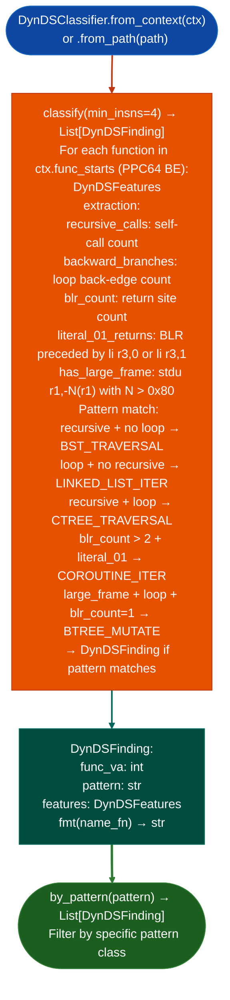

# PPC64 Dynamic Data Structure Classification

Classify stripped PPC64/Cell PPU functions as instances of dynamic data structure traversal or manipulation patterns: identifying BST traversal, block linked list iteration, C-tree traversal, B-tree mutation, and coroutine iterators from pure structural instruction patterns without requiring string cross-references, symbol names, or debug information.

---

## Why this exists

1. **Stripped PPC64 firmware has no function names.** On Cell PPU targets PS3 system binaries, Demonware network stack, IBM PowerVM management firmware, `SigLibrary` and `SemanticSearcher` are both limited without symbol anchors. `DynDSClassifier` identifies function classes from their instruction structure: BST traversal produces recursive self-calls; B-tree mutation produces distinct loop shapes and multiple return sites: enabling semantic labeling of stripped functions without any string evidence.

2. Patterns are derived from Chou & Amarasinghe, "Compilation of Dynamic Sparse Tensor Algebra", OOPSLA 2022: sparse dynamic data structures produce code with predictable structural shapes when traversed or modified. Each shape maps to a combination of: recursive self-calls BST/C-tree traversal, backward conditional branches for-loops over array chunks, and multiple `BLR` sites with literal 0/1 return values coroutine iterators. `DynDSClassifier` implements these discriminators for PPC64 big-endian encoding.

3. `DynDSFinding.fmt(name_fn)` accepts a name function: when called with `ctx.name`, it annotates the output with any existing names for the function VA and its self-call targets, combining structure-based classification with symbol-based labeling where available.

---

## How it works



---

## Usage

```python
from ablation.analyzers.ppc64_dynds_classifier import DynDSClassifier
from ablation.analyzers.binary_context import BinaryContext

ctx = BinaryContext.load_or_build('/path/to/ps3_system_binary.self')
classifier = DynDSClassifier.from_context(ctx)

findings = classifier.classify()
print(DynDSClassifier.report(findings, ctx.name))

# BST traversal functions only
bst = classifier.by_pattern('BST_TRAVERSAL')
for f in bst:
    print(f.fmt(ctx.name))
```

---

## Example output

The following illustrates dynamic data structure classification output format. Actual VAs are binary-specific.

```
DynDSClassifier: ps3_system_binary.self

Findings: <N>

  <va>  BST_TRAVERSAL
    recursive_calls=3  backward_branches=0  blr_count=2
    Features: recursive-only traversal pattern

  <va>  COROUTINE_ITER
    blr_count=4  literal_01_returns=3
    Features: multiple return sites with 0/1 literal — iterator protocol
```

---

## False positives

**Structural patterns may match non-data-structure functions**: a function with recursive self-calls and the right loop shape for a reason unrelated to data structures for example a parsing function or an algorithm with similar structural features will be classified. Structural classification is a labeling hint, not a confirmed semantic: verify with `FuncProfiler` before treating as a BST/linked-list implementation.

**`min_insns=4` threshold may produce low-quality findings for very short functions**: functions with fewer than the minimum instruction count are excluded, but functions just above the threshold may not have enough instruction variety to reliably match a pattern. Increase `min_insns` for higher-confidence results.

---

## Pipeline position

Run `DynDSClassifier` after `BinaryContext.load_or_build()` and `SigLibrary` matching on PPC64 BE targets. Use structural classification to label unnamed functions before running `TaintTracker`: named functions produce more interpretable taint traces.

---

## Reading findings

`DynDSClassifier.classify()` returns a list of finding dicts:

| Field | Content |
|:---|:---|
| `va` | Virtual address of the classified function |
| `classification` | Data structure class for example `BST_TRAVERSAL`, `COROUTINE_ITER`, `LINKED_LIST`, `HASH_TABLE` |
| `features` | Dict of raw behavioral features used for classification recursive_calls, blr_count, etc. |
| `detail` | Human-readable classification rationale |

---

## See also

- [Function Semantic Search](semantic-code-search.md): `SemanticSearcher` for complementary semantic labeling
- [PPC64 ELFv1 Resolution](ppc64-elfv1-resolution.md): `Ppc64ElfV1Resolver` for preprocessing PPC64 ELFv1 targets before classification
