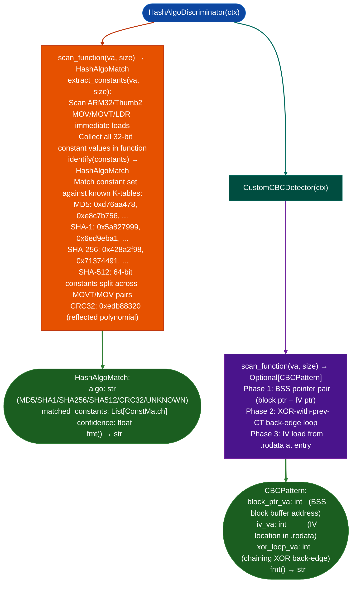

# Cryptographic Pattern Detection

Identify cryptographic algorithm implementations in compiled ARM32/Thumb2 firmware: discriminating hash algorithms MD5, SHA-1, SHA-256, SHA-512, CRC32 from K-table constants and detecting hand-rolled AES-128-CBC through BSS-tracked block pointer and XOR-with-previous-ciphertext chaining patterns.

---

## Why this exists

1. **Compiled hash implementations leave algorithm-specific K-table constants round constants, magic numbers embedded in `.rodata` or as immediate loads in code: `HashAlgoDiscriminator` identifies these constants against known algorithm fingerprints without requiring disassembly of the full hash round loop.** For example, SHA-256 round constants `0x428a2f98`, `0x71374491`, ... appear as distinct 32-bit values that cannot be misidentified as another algorithm, enabling instant hash algorithm identification from static data.

2. **Hand-rolled AES-128-CBC in ARM32/Thumb2 has a characteristic BSS-tracked block pointer, XOR-with-previous-ciphertext chaining loop, and IV loaded from `.rodata`.** `CustomCBCDetector` identifies these structural patterns without requiring the AES S-box to be present: critical for implementations that use hardware AES acceleration for the block cipher but implement the CBC chaining mode in software. The Fortinet ARM32 pattern was the original motivation.

3. **`HashAlgoDiscriminator.scan_function()` and `CustomCBCDetector.scan_function()` integrate directly with `BinaryContext` function boundaries**: the same `func_starts` that drive `SemanticSearcher` and `FuncProfiler` drive crypto pattern detection, enabling batch scan of all functions in a binary to identify all crypto implementations in a single pass.

---

## How it works



---

## Usage

```python
from ablation.analyzers.crypto_pattern_detector import HashAlgoDiscriminator, CustomCBCDetector
from ablation.analyzers.binary_context import BinaryContext

ctx = BinaryContext.load_or_build('/path/to/arm32_firmware.elf')

# Identify all hash implementations
disc = HashAlgoDiscriminator(ctx)
for va, size in zip(ctx.func_starts, ctx.func_sizes):
    match = disc.scan_function(va, size)
    if match.algo != 'UNKNOWN':
        print(f"  {match.algo} at {va:#x}: {match.fmt()}")

# Detect hand-rolled AES-CBC
cbc = CustomCBCDetector(ctx)
for va, size in zip(ctx.func_starts, ctx.func_sizes):
    pattern = cbc.scan_function(va, size)
    if pattern:
        print(f"  Custom CBC at {va:#x}: {pattern.fmt()}")

# Scan a specific range
patterns = cbc.scan_range(va=0x10000, size=0x2000)
print(f"Found {len(patterns)} CBC patterns in range")
```

---

## Example output

The following illustrates crypto detection output. Actual addresses and constants are firmware-specific.

```
HashAlgoDiscriminator: arm32_firmware.elf

  SHA-256 at <va>  confidence=0.97
    matched: 0x428a2f98 (K[0]), 0x71374491 (K[1]), 0xb5c0fbcf (K[2])

  MD5 at <va>  confidence=0.99
    matched: 0xd76aa478 (T[1]), 0xe8c7b756 (T[2])

CustomCBCDetector:
  Custom CBC at <va>
    block_ptr: <bss_va>  iv_va: <rodata_va>  xor_loop: <va>
```

---

## False positives

**K-table constant matching may fire on coincidental constant sequences**: data structures that happen to contain hash K-values for example test vectors or lookup tables may produce false `HashAlgoMatch` results. Validate by inspecting the surrounding disassembly for the characteristic round-function structure bitwise rotate, and, or, xor operations on 4–8 registers.

**`CustomCBCDetector` requires all three phases to match**: BSS pointer pair alone, without the XOR back-edge and `.rodata` IV, is not flagged as a CBC pattern. This reduces false positives from other BSS-based buffer patterns but may miss unusual CBC implementations that initialize the IV differently.

---

## Pipeline position

Run `HashAlgoDiscriminator` and `CustomCBCDetector` during initial binary triage to identify crypto implementations before vulnerability analysis. Identified crypto functions should be excluded from taint tracking to avoid alert fatigue from crypto internals, and named in `BinaryContext` with `ctx.set_name()` for reference in findings.

---

## Reading findings

`HashAlgoDiscriminator.scan()` returns a list of `HashAlgoMatch` objects:

| Attribute | Content |
|:---|:---|
| `algo` | Algorithm name for example `'SHA256'`, `'MD5'`, `'CRC32'` |
| `confidence` | Integer 0–100: confidence score based on K-table constant coverage |
| `matched` | `List[ConstMatch]`: each matched constant with `.va` and `.name` |

`CustomCBCDetector.scan()` returns a list of `CBCPattern` objects:

| Attribute | Content |
|:---|:---|
| `outer_func_va` | VA of the outer function or scan range |
| `block_func_va` | VA of the single-block AES call BL target inside the loop |
| `chaining_reg` | Register carrying the previous ciphertext / IV pointer |
| `iv_va` | `Optional[int]`: VA of IV in `.rodata` (None if not resolved) |
| `iv_bytes` | `Optional[bytes]`: 16-byte IV value (None if not resolved) |
| `xor_va` | VA of the first XOR instruction in the loop body |
| `loop_va` | VA of the loop start back-edge target |
| `confidence` | Integer 0–100 |

---

## See also

- [Firmware Signature and Secret Triage](firmware-signature-and-secret-triage.md): key and credential discovery in firmware
- [Generic Vulnerability Profile Sweeps](generic-vulnerability-profile-sweeps.md): `SemanticSearcher` for identifying crypto-adjacent vulnerability patterns
- [Global Symbol and BSS Tracking](global-symbol-and-bss-tracking.md): `BssTaintTracker` that complements CBC BSS pointer detection
