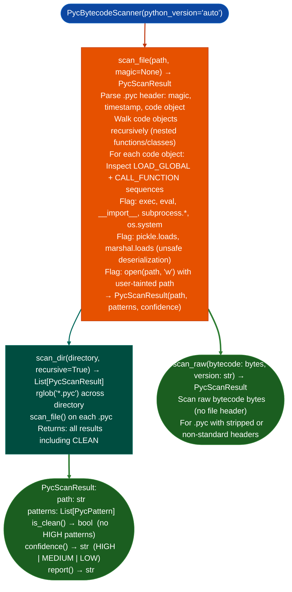

# Python Bytecode Scanning

Scan Python `.pyc` bytecode files for dangerous patterns: detecting `exec()`, `eval()`, `subprocess.call()`, OS command sinks, and unsafe deserialization without requiring full decompilation: by parsing code objects directly via `xdis` and inspecting `LOAD_GLOBAL`/`CALL_FUNCTION` opcode sequences.

---

## Why this exists

1. **FortiSwitch management plane Python analysis was blocked because the firmware ships only `.pyc` bytecode: no `.py` source files.** Full decompilation via `uncompyle6` fails on Python 3.10+ bytecode and on bytecode with non-standard magic numbers. `PycBytecodeScanner` bypasses decompilation entirely, scanning at the bytecode level using `xdis` (already installed as an `uncompyle6` dependency) to find dangerous patterns from opcode sequences.

2. **`PycScanResult.is_clean()` returns `True` when no dangerous patterns are found at `HIGH` confidence**, this gives a defensible "clean" verdict for firmware Python layers without requiring successful decompilation. FortiSwitch v7 Python layer was confirmed `CLEAN` on 2026-10-16 using this scanner.

3. `PycBytecodeScanner.scan_dir()` recursively processes an entire Python package directory: enabling batch scan of all `.pyc` files in an extracted firmware filesystem without manual enumeration. Results include file path, pattern class, line number (from code object `co_firstlineno`), and confidence level.

---

## How it works



---

## Usage

```python
from ablation.analyzers.pyc_bytecode_scanner import PycBytecodeScanner

scanner = PycBytecodeScanner()

# Scan entire firmware Python directory
results = scanner.scan_dir('/tmp/fortiswitch_extracted/usr/lib/python3/')
print(scanner.report(results))

# Summary
total = len(results)
clean = sum(1 for r in results if r.is_clean())
flagged = [r for r in results if not r.is_clean()]
print(f"Clean: {clean}/{total}  Flagged: {len(flagged)}")

# Single file
result = scanner.scan_file('/tmp/fortiswitch_extracted/usr/lib/python3/mgmt.pyc')
if result.is_clean():
    print(f"CLEAN ({result.confidence()})")
else:
    for p in result.patterns:
        print(f"  {p.severity}: {p.pattern_class} at line {p.lineno}")
```

---

## Example output

The following illustrates the bytecode scanner output format. Actual paths and patterns are firmware-specific.

```
PycBytecodeScanner: /tmp/fortiswitch_extracted/usr/lib/python3/

Scanned: <N> .pyc files

  CLEAN     mgmt.pyc          (confidence=HIGH)
  CLEAN     config.pyc        (confidence=HIGH)
  FLAGGED   admin_handler.pyc
    [HIGH] exec_sink: LOAD_GLOBAL 'exec' at co_firstlineno=<line>
    [MEDIUM] subprocess_call: subprocess.call at co_firstlineno=<line>

Summary: <C> clean, <F> flagged
```

---

## False positives

**`LOAD_GLOBAL 'exec'` fires on any use of the built-in `exec()` function**: legitimate use of `exec()` in Python for dynamic code evaluation in a management CLI context is not a vulnerability unless the argument is tainted. `PycScanResult.confidence()` returns `HIGH` for direct `exec` calls without a literal string argument; `MEDIUM` for calls with constant string arguments.

**`xdis` version compatibility**: `PycBytecodeScanner` relies on `xdis` for code object parsing. Python versions with non-standard `.pyc` magic numbers for example Fortinet-patched Python, PyPy may fail to parse; `scan_file()` returns `PycScanResult` with `confidence='LOW'` and an error message in this case.

---

## Pipeline position

Run `PycBytecodeScanner.scan_dir()` on any extracted firmware Python directory as part of initial triage: before binary analysis. A `CLEAN` verdict with `HIGH` confidence allows skipping the Python layer in vulnerability analysis. `FLAGGED` results with `HIGH` confidence warrant further investigation via `AgentLoop` or manual decompilation of the specific flagged file.

---

## Reading findings

`PycBytecodeScanner.scan()` returns a list of file result dicts:

| Field | Content |
|:---|:---|
| `path` | Path to the `.pyc` file |
| `status` | `CLEAN` or `FLAGGED` |
| `confidence` | `HIGH` / `MEDIUM` / `LOW` confidence in the classification |
| `findings` | List of `{severity, code, line, detail}` for flagged files |

Each finding in `findings`:

| Field | Content |
|:---|:---|
| `severity` | `HIGH` / `MEDIUM` |
| `code` | Finding code for example `exec_sink`, `subprocess_call`, `pickle_load` |
| `line` | `co_firstlineno` of the flagged opcode |
| `detail` | Human-readable description |

---

## See also

- [Source Dangerous Sink Detection](source-dangerous-sink-detection.md): `SourceSinkScanner` for `.py` source files when available
- [Assisted Vulnerability Hypotheses](assisted-vulnerability-hypotheses.md): LLM hypothesis generation for flagged bytecode patterns
- [Firmware Extraction](firmware-extraction.md): firmware extraction pipeline before Python analysis
