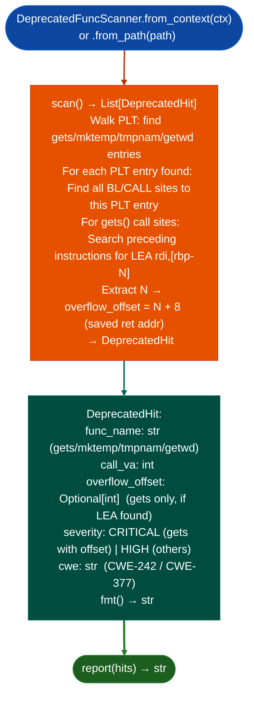

# Deprecated Function Detection

Detect inherently unsafe deprecated functions: `gets()`, `mktemp()`, `tmpnam()`, and `getwd()`: whose mere presence in the PLT is a confirmed finding regardless of call context, with buffer overflow offset calculation for `gets()` call sites where the destination buffer address is extractable from a preceding `LEA` instruction.

---

## Why this exists

1. **`gets()`, `mktemp()`, `tmpnam()`, and `getwd()` have no safe use.** A `gets()` call will overflow any fixed-size buffer; no input validation or sanitization can make it safe. Their presence in the PLT is a `CWE-242` confirmed finding without taint analysis. `DeprecatedFuncScanner` detects them in a single PLT walk, no disassembly required for the initial finding.

2. **Buffer overflow offset calculation at each `gets()` call site.** For `gets()` calls where the destination buffer is at `[rbp-N]`, the module extracts `N` from the preceding `LEA rdi, [rbp-N]` instruction and reports the exact byte count needed to reach the saved return address: `N + 8` on x86-64. This converts a `HIGH` finding into a `CRITICAL` with a verified exploit offset, eliminating the manual offset-calculation step.

3. **`mktemp()`/`tmpnam()` findings include the call site VA and the race-window description**: documenting the TOCTOU gap between the filename generation and the subsequent `open()` call. This is the evidence needed for a session finding entry without additional analysis.

---

## How it works



---

## Usage

```python
from ablation.analyzers.deprecated_func_scanner import DeprecatedFuncScanner
from ablation.analyzers.binary_context import BinaryContext

ctx = BinaryContext.load_or_build('/path/to/target.so')
scanner = DeprecatedFuncScanner.from_context(ctx)

hits = scanner.scan()
print(DeprecatedFuncScanner.report(hits))

# Gets findings with verified offset
gets_hits = [h for h in hits if h.func_name == 'gets' and h.overflow_offset]
for h in gets_hits:
    print(f"  gets() at {h.call_va:#x}: overflow at {h.overflow_offset} bytes")
```

---

## Example output

The following illustrates deprecated function detection output format. Actual VAs and offsets are binary-specific.

```
DeprecatedFuncScanner: target.so

[CRITICAL] gets()  call_va=<va>
  CWE-242: gets() has no safe use
  LEA rdi,[rbp-0x80] → overflow_offset=136 (0x88)
  Overflow saved return address at 136 bytes of input

[HIGH] mktemp()  call_va=<va>
  CWE-377: mktemp() TOCTOU race between filename gen and open()
```

---

## False positives

**`gets()` with `overflow_offset=None`**: a `gets()` call where the preceding `LEA` is not in the immediately preceding 5 instructions for example the buffer was set up earlier in the function or passed as an argument will not have an offset. The finding is still `HIGH`; manual offset calculation is required.

**`mktemp()` findings at call sites in test code or dead code**: `DeprecatedFuncScanner` finds all call sites including those in test functions or unreachable code. Verify that the call site is in a reachable code path before including in a finding.

---

## Pipeline position

Run `DeprecatedFuncScanner` as an early step in initial triage for any x86-64 ELF binary. `gets()` findings with `overflow_offset` are confirmed RCE candidates requiring no further taint analysis: proceed directly to `PathSolver.solve_path()` for feasibility confirmation.

---

## Reading findings

`DeprecatedFuncScanner.scan()` returns a list of finding dicts:

| Field | Content |
|:---|:---|
| `severity` | `CRITICAL` gets, getwd / `HIGH` strcpy, strcat, sprintf, mktemp |
| `func` | Deprecated function name |
| `call_va` | VA of the deprecated function call |
| `overflow_offset` | Frame-relative buffer offset in bytes (or `None` if not statically recoverable) |
| `reachability_chain` | Ordered list of caller VAs from entry point to the deprecated call |

---

## See also

- [Named Taint Sources and Bounds](named-taint-sources-and-bounds.md): `TaintTracker` for sink findings that require full dataflow
- [Single-Function Profiling](single-function-profiling.md): `FuncProfiler` for deep analysis of functions containing deprecated calls
