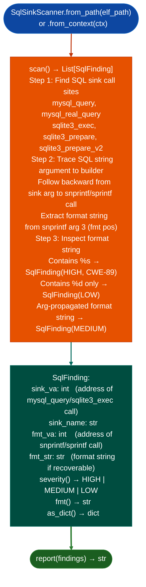

# SQL Injection Detection

Detect raw SQL injection in C/C++ ELF binaries that call the MySQL C API or SQLite3 directly: by chaining: find SQL sink `mysql_query`, `sqlite3_exec` → trace the SQL string argument → find the `snprintf`/`sprintf` format string builder → inspect the format string for `%s` injection specifiers: catching SQL injection that `FormatStringScanner` misses because it does not understand that `snprintf` safe-by-itself is unsafe when passed to a SQL sink.

---

## Why this exists

1. **`FormatStringScanner` identifies dangerous format strings at `printf`-family call sites but does not understand SQL sinks.** An `snprintfbuf, sizeof(buf, "SELECT ... WHERE login='%s'", username)` followed by `mysql_queryconn, buf` is SQL injection, but `FormatStringScanner` sees a safe-sized `snprintf` and stops. `SqlSinkScanner` specifically chains these two call sites and reports the combined pattern as SQL injection.

2. **MySQL C API and SQLite3 are the primary SQL libraries used in embedded network device firmware**: Fortinet, Cisco, and Juniper device management planes commonly use SQLite3 for configuration persistence. `SqlSinkScanner` includes both `mysql_query`/`mysql_real_query` (MySQL C API) and `sqlite3_exec`/`sqlite3_prepare` (SQLite3) sink catalogs.

3. **`SqlFinding.severity()` adjusts for prepared-statement protection**: if `sqlite3_prepare_v2` is called before the sink, the finding is downgraded from `HIGH` to `MEDIUM`. If the format string contains only `%d` or `%f` specifiers no string interpolation, severity is downgraded to `LOW`. This reduces false-positive triage time from integer-format SQL builds.

---

## How it works



---

## Usage

```python
from ablation.analyzers.sql_sink_scanner import SqlSinkScanner
from ablation.analyzers.binary_context import BinaryContext

ctx = BinaryContext.load_or_build('/path/to/management_daemon')
scanner = SqlSinkScanner.from_context(ctx)

findings = scanner.scan()
print(scanner.report(findings))

# Filter by severity
high = [f for f in findings if f.severity() == 'HIGH']
print(f"HIGH severity SQL injection candidates: {len(high)}")
for f in high:
    print(f.fmt())

# Export for downstream tools
import json
data = [f.as_dict() for f in findings]
print(json.dumps(data, indent=2))
```

---

## Example output

The following illustrates the SQL injection detection output format. Actual addresses are binary-specific.

```
SqlSinkScanner: management_daemon  (sqlite3)

SQL sinks found: <N>  (sqlite3_exec, sqlite3_prepare_v2)

Findings (<M> total):
  [HIGH] SQL injection  CWE-89
    sink: sqlite3_exec  at <va>
    fmt_builder: snprintf at <va>
    format: "SELECT * FROM users WHERE login='%s'"
    snprintf arg tainted from caller arg

  [LOW] Integer-only format
    sink: sqlite3_exec  at <va>
    format: "SELECT id FROM sessions WHERE timeout > %d"
```

---

## False positives

**Format string backward tracing is bounded to the same basic block**: `snprintf` calls in predecessor blocks that are not in the same basic block as the SQL sink may not be traced, producing `UNKNOWN` format string results (`severity='MEDIUM'`). Validate `MEDIUM` findings by inspecting the disassembly around the SQL sink for format-string builder calls.

**Prepared-statement detection uses PLT name matching**: if the binary uses a wrapper function that calls `sqlite3_prepare_v2` internally not through PLT directly, `SqlSinkScanner` will not detect the prepared-statement protection and may report a finding that is actually mitigated. Verify with `FuncProfiler` on the wrapper.

---

## Pipeline position

Run `SqlSinkScanner` after `SinkArgClassifier` on any binary with MySQL C API or SQLite3 imports. `SinkArgClassifier` handles shell-execution sinks `system`, `execve`; `SqlSinkScanner` handles SQL sinks. Both should run as part of the initial sink classification phase before `TaintTracker`.

---

## Reading findings

`SqlSinkScanner.scan()` returns a list of finding dicts:

| Field | Content |
|:---|:---|
| `severity` | `CRITICAL` confirmed format string injection / `HIGH` ARG_PROPAGATED without prepared statement / `MEDIUM` UNKNOWN classification |
| `sink` | SQL sink function name for example `mysql_query`, `sqlite3_exec` |
| `call_va` | VA of the sink call instruction |
| `arg_class` | `ARG_PROPAGATED`, `RODATA_CONST`, or `UNKNOWN` |
| `format_string_va` | VA of the format string if recovered, else `None` |
| `detail` | Classification rationale |

---

## See also

- [Sink Argument Classification](sink-argument-classifier.md): shell-class sink classification complements SQL analysis
- [Format String Scanning](format-string-scanning.md): `FormatStringScanner` for printf-family format string injection
- [Named Taint Sources and Bounds](named-taint-sources-and-bounds.md): `TaintTracker` for confirmed SQL injection paths
