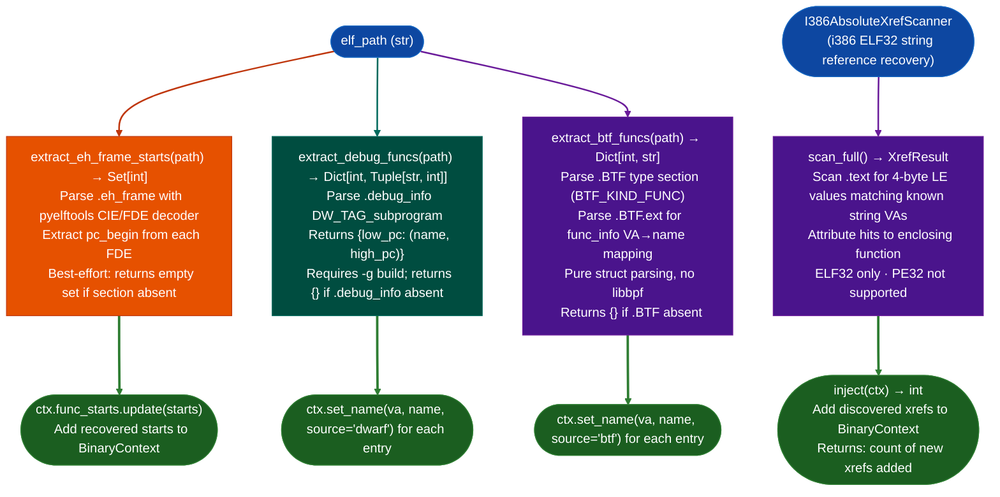

# Debug Metadata Recovery

Recover function boundaries, names, and type information from `.eh_frame` CFI records, DWARF `.debug_info`, and Linux BTF `.BTF`/`.BTF.ext` sections in ELF binaries: providing precise `start, end` function intervals and names even when `.symtab` is stripped, for LoongArch64 and all other ELF targets.

---

## Why this exists

1. **Stripped ELF binaries drop `.symtab` but typically retain `.eh_frame` CFI records emitted by GCC/Clang for C++ exception unwinding, these records contain precise function start VAs as FDE Frame Description Entry entries.** `extract_eh_frame_starts(path)` extracts all FDE start addresses, providing function boundaries without the noise of prologue-scan heuristics. On a typical stripped firmware binary, `.eh_frame` yields function start accuracy of 99%+ versus prologue scan's ~85%.

2. **`.debug_info` sections (present in `-g` builds) provide `name, low_pc, high_pc` triples via `DW_TAG_subprogram`**: `high_pc` eliminates the "next-function-start" approximation that `.eh_frame` alone requires. When `.debug_info` is present common in development firmware images or partial debug builds, `extract_debug_funcs(path)` yields precise function end addresses, enabling accurate function-size calculations and loop detection.

3. **Linux kernel modules stripped of `.symtab` often retain `.BTF` and `.BTF.ext` sections**: BTF maps section offsets to function names even without symbol tables, enabling name recovery for kernel modules and eBPF programs where DWARF is absent. `extract_btf_funcs(path)` parses the BTF string and type sections without external dependencies pure struct parsing, no libbpf required.

---

## How it works



---

## Usage

```python
from ablation.analyzers.dwarf_loongarch64 import (
    extract_eh_frame_starts,
    extract_debug_funcs,
    extract_btf_funcs,
)
from ablation.analyzers.i386_absolute_xref_scanner import I386AbsoluteXrefScanner
from ablation.analyzers.binary_context import BinaryContext

# ── ELF64 debug metadata (eh_frame / DWARF / BTF) ──────────────────────────
ctx = BinaryContext.load_or_build('/path/to/target.elf')

starts = extract_eh_frame_starts('/path/to/target.elf')
ctx.func_starts.update(starts)
print(f"Added {len(starts)} function starts from .eh_frame")

# Recover names from BTF (kernel modules)
btf_names = extract_btf_funcs('/path/to/target.elf')
for va, name in btf_names.items():
    ctx.set_name(va, name, source='btf')

# Recover debug intervals if available
debug_funcs = extract_debug_funcs('/path/to/target.elf')
for low_pc, (name, high_pc) in debug_funcs.items():
    ctx.set_name(low_pc, name, source='dwarf')

# ── i386 string xref recovery ──────────────────────────────────────────────
ctx32 = BinaryContext.load_or_build('/path/to/target32.elf')
xref_scanner = I386AbsoluteXrefScanner.from_context(ctx32)
result = xref_scanner.scan_full()
n_xrefs = xref_scanner.inject(ctx32)
print(f"Added {n_xrefs} i386 string xrefs")
print(result.report())
```

---

## Example output

The following illustrates the recovery output format. Actual counts and names are binary-specific.

```
extract_eh_frame_starts():
  FDE entries found: <N>
  Function starts added to context: <M>  (net new)

extract_btf_funcs():
  BTF functions found: <N>
  Names set in context: <N>

I386AbsoluteXrefScanner:
  Strings in .rodata: <N>
  Xrefs found: <M>  (vs <K> from RIP-relative scanner)
  Xrefs added to context: <M>
```

---

## False positives

**`.eh_frame` FDE start addresses include exception landing pads that are not function entry points.** These appear as spurious starts within function bodies. Filter by checking whether the FDE start is within an existing known-function interval i.e., it would overlap a function already in `ctx.func_starts`.

**`I386AbsoluteXrefScanner` may report false positives for 4-byte LE values in the code stream that coincidentally match a string VA but are operands to instructions where the value is not a pointer.** The false-positive rate is low for typical binaries but increases when `.rodata` is small and the VA space is densely populated.

---

## Pipeline position

Run debug metadata recovery immediately after `BinaryContext.load_or_build()` on any target binary: before `CorpusBuilder`, `SemanticSearcher`, or taint analysis. Better function boundaries and more string xrefs improve all downstream analyses. Add recovered starts to `ctx.func_starts` and set names via `ctx.set_name()` before any analysis pass.

---

## Reading output

`extract_eh_frame_starts(path)` returns `Set[int]`: VA of every function start found in `.eh_frame` FDE records. Returns an empty set if `.eh_frame` is absent.

`extract_debug_funcs(path)` returns `Dict[int, Tuple[str, int]]`: maps `low_pc` → `name, high_pc`. Returns `{}` if `.debug_info` is absent or contains no `DW_TAG_subprogram` entries.

`extract_btf_funcs(path)` returns `Dict[int, str]`: maps VA → function name from `.BTF`/`.BTF.ext` sections. Returns `{}` if BTF is absent.

`ARM32FunctionScanner.inject_into_context(ctx)` modifies `ctx.func_starts` in place and returns:

| Field | Content |
|:---|:---|
| `added` | Count of new function starts added to `ctx` |
| `existing` | Count of function starts already in `ctx` from symbols or prior analysis |

`I386AbsoluteXrefScanner.inject_into_context(ctx)` modifies `ctx.xrefs` in place and returns:

| Field | Content |
|:---|:---|
| `xrefs_added` | Count of new cross-references added |

---

## See also

- [ARM32 Allocation Arithmetic Overflow](arm32-allocation-arithmetic-overflow.md): `ARM32FunctionScanner` prologue scan for ARM32 stripped binaries
- [Function Corpus Builder](function-corpus-builder.md): uses function starts recovered here for corpus population
- [PPC32/PPC476 Dedicated Lifting](ppc32-ppc476-dedicated-lifting.md): PPC64 ELFv1 resolver that also patches BinaryContext
