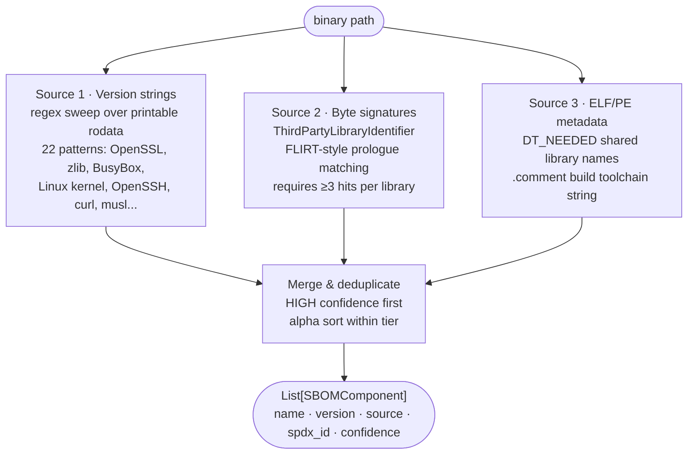

# SBOM & Supply-Chain Tooling

Extract a software bill of materials from a stripped firmware binary. Identifies embedded open-source library versions, build toolchain strings, and dynamic linker dependencies without source code or debug symbols.

---

## What is an SBOM

An SBOM — Software Bill of Materials — is a list of every software component inside a product: library name, version, and license. The concept comes from physical manufacturing, where a bill of materials lists every part that goes into a product so that a recall or defect can be traced to the exact affected units.

In firmware RE, an SBOM answers the question "which third-party libraries did the vendor ship, and are any of them vulnerable?" A vendor may ship OpenSSL 1.1.1k inside a firewall appliance without disclosing it. If a CVE drops for OpenSSL 1.1.1k two years later, the only way to know whether that appliance is affected is to have an SBOM. `SBOMExtractor` builds that list from the binary itself because vendors do not publish one.

The two dominant SBOM interchange formats are CycloneDX (used by OWASP) and SPDX (used by the Linux Foundation). Both represent the same data — component name, version, hash, license — in different schemas. `SBOMComponent` fields map to both conventions so output can be converted to either format.

---

## Why this exists

1. **Firmware vendors strip binaries but do not strip version strings.** Libraries such as OpenSSL, zlib, and BusyBox embed a human-readable version string in their `.rodata` section because they use it for diagnostic output. `SBOMExtractor` sweeps every printable byte sequence in the binary for 22 known patterns so a version like `OpenSSL 1.1.1k` surfaces even when every symbol is gone.

2. **Some libraries ship no version string at all.** `ThirdPartyLibraryIdentifier` closes this gap with byte-level function prologue signatures: the AES S-box constant `{0x63, 0x7c, 0x77...}`, SHA-256 init constants, and zlib's Adler-32 modulus appear at fixed offsets in every build of those libraries regardless of compiler or strip flags. Three or more signatures from the same library constitute a match.

3. **Knowing which library is present is not enough without a license.** Each identified component carries an SPDX license identifier so the output can feed a compliance check. `OpenSSL` maps to `OpenSSL`, `zlib` to `Zlib`, `musl` to `MIT`, and so on. Components with no known license are flagged with an empty `spdx_id` for manual review.

---

## How it works



### SBOMComponent fields

| Field | Content |
|:---|:---|
| `name` | Canonical library name, e.g. `OpenSSL`, `zlib`, `BusyBox` |
| `version` | Version string recovered from binary, or `'unknown'` / `'dynamic'` |
| `source` | `'version_string'` / `'signature'` / `'metadata(DT_NEEDED)'` / `'metadata(.comment)'` |
| `spdx_id` | SPDX license identifier, e.g. `OpenSSL`, `Zlib`, `MIT`, `GPL-2.0-only` |
| `confidence` | `HIGH` (version string or signature hit) / `MEDIUM` (metadata only) |
| `notes` | Matched signature names for signature-source components |

---

## Usage

```python
from modules.sbom_extractor import SBOMExtractor

# Standalone
extractor = SBOMExtractor('/path/to/firmware.bin')
components = extractor.extract()
print(extractor.report(components))

# With existing BinaryContext (avoids re-reading the file)
from ablation.analyzers.binary_context import BinaryContext
ctx = BinaryContext.load_or_build('/path/to/firmware.bin')
extractor = SBOMExtractor.from_context(ctx)
components = extractor.extract()

# Filter to HIGH confidence only
high = [c for c in components if c.confidence == 'HIGH']

# Filter to components with known CVE exposure
# (signature source notes carry CVE references when version is in a vulnerable range)
vuln = [c for c in components if any('CVE' in n for n in c.notes)]
```

---

## Example output

```
SBOMExtractor: 6 component(s) in /path/to/firmware.bin

  HIGH    OpenSSL 1.1.1k  (via version_string)  license=OpenSSL
  HIGH    zlib 1.2.11     (via version_string)  license=Zlib
  HIGH    BusyBox v1.33.1 (via version_string)  license=GPL-2.0-only
  HIGH    musl 1.2.3      (via signature)  license=MIT  [AES S-box constant; SHA-256 H0 init constant]
  MEDIUM  libssl.so.1.1   (via metadata(DT_NEEDED))
  MEDIUM  (build toolchain) GCC: (GNU) 10.2.1  (via metadata(.comment))
```

---

## False positives

**Version string patterns match substrings.** A binary that logs `"OpenSSL error"` without embedding a version number will not match because all patterns require a version string after the library name. A binary that ships a static error message like `"zlib 1.2.11 is required"` in a log message will match — confirm the version is from the library itself, not a requirements check.

**Byte signature matching requires three hits per library.** A single AES S-box constant in an unrelated crypto implementation will not fire because `ThirdPartyLibraryIdentifier` requires `min_matches=2` by default. Raise to 3 for lower false-positive rate on larger binaries.

**DT_NEEDED entries reflect link-time dependencies, not runtime presence.** A library listed in DT_NEEDED may be dlopen'd and absent from the firmware image. These entries are `MEDIUM` confidence for this reason.

---

## Pipeline position

Run `SBOMExtractor` as the first step on any new firmware image before taint analysis, because a vulnerable library version (e.g. OpenSSL <1.1.1l for CVE-2021-3711) changes which functions are worth tracing. Feed identified library names into `SemanticSearcher` to locate the relevant parse and crypto functions in the binary.

---

## See also

- [Third-Party Library Identifier](third-party-library-identifier.md): the signature engine `SBOMExtractor` calls for non-version-string detection
- [Semantic Search](semantic-search.md): query for library-specific functions once a library is confirmed present
- [Finding Registry](registry.md): record confirmed vulnerable component versions as findings
