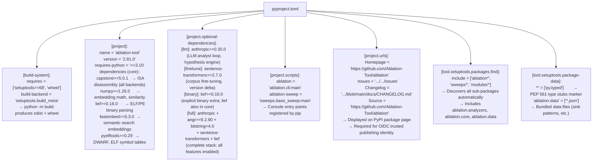

# Dependency and Supply Chain Tooling

`pyproject.toml` package configuration, dependency declarations, optional extras, and supply chain integrity controls for the `ablation-tool` package: covering core runtime dependencies, optional ML/decompiler extras, console entry points, and package discovery.

---

## Why this exists

1. **Ablation has hard runtime dependencies that must be pinned to floor versions to prevent breakage from upstream API changes: `capstone>=5.0.1` changed the `CsInsn.bytes` attribute to return `bytes` instead of `bytearray` in 5.x, breaking all `insn.bytes[0]` index patterns in 4.x code.** `pyproject.toml` records the minimum compatible versions for all six core dependencies `capstone`, `numpy`, `lief`, `fastembed`, `pyelftools`, ensuring that `pip install ablation-tool` on a fresh environment produces a working installation. Without floor pins, a user running 4.x capstone would get silent malfunction rather than a clear version error.

2. **Not all use cases require the full dependency stack: `fastembed` pulls in `onnxruntime` which is ~500MB; `angr` is ~1GB with all symbolic execution backends; `sentence-transformers` requires PyTorch ~2GB for CPU builds.** The optional extras system `[llm]`, `[finetune]`, `[binary]`, `[full]` allows users to install only what they need. The `[full]` extra installs everything: anthropic SDK for LLM analyst loop, sentence-transformers for fine-tune, lief for binary analysis, angr for optional symbolic execution, and bitstring for binary format parsing. A `pip install ablation-tool` without extras installs only the 500KB core stack needed for static taint analysis.

3. **OIDC trusted publishing used in the release workflow requires the package to be registered under the `Ablation-Tool` GitHub organization with `id-token: write` permissions: the `[project.urls]` table in `pyproject.toml` must list the canonical `Homepage` and `Source` URLs matching the PyPI trusted publisher configuration.** Without these URLs, the OIDC attestation cannot be verified, and PyPI will reject the upload. The `pyproject.toml` configuration is the source of truth for both the package metadata and the OIDC publisher identity.

---

## How it works



### Dependency reference

| Dependency | Floor version | Role |
|:---|:---|:---|
| `capstone` | `>=5.0.1` | ISA disassembly for all 18 architecture backends |
| `numpy` | `>=1.26.0` | Embedding similarity math; fastembed vector operations |
| `lief` | `>=0.16.0` | ELF/PE/Mach-O binary parsing; section map, PLT, DWARF |
| `fastembed` | `>=0.3.0` | ONNX-based embedding for semantic search |
| `pyelftools` | `>=0.29` | DWARF CFI records, symbol table, section headers |
| `anthropic` | `>=0.30.0` | LLM analyst loop, hypothesis engine (`[llm]` extra) |
| `sentence-transformers` | `>=2.7.0` | Corpus fine-tuning, version delta (`[finetune]` extra) |
| `angr` | `>=9.2.90` | Optional symbolic execution backend (`[full]` extra) |
| `bitstring` | `<4.0` | Binary format parsing for some decoders (`[full]` extra) |

### Install profiles

| Command | What's installed | Use case |
|:---|:---|:---|
| `pip install ablation-tool` | Core 5 deps | Static taint analysis, binary lifting, semantic search |
| `pip install ablation-tool[llm]` | + anthropic | LLM analyst loop, hypothesis engine |
| `pip install ablation-tool[finetune]` | + sentence-transformers | Corpus fine-tuning, version delta |
| `pip install ablation-tool[full]` | All deps | Complete feature set |
| `pip install -e ".[full]"` | Editable + all | Development (current install at `~/ablation/`) |

---

## Usage

```bash
# Development install (already done — editable with all extras)
pip install -e ~/ablation/".[full]"

# Check installed version
python -c "import ablation; print(ablation.__version__)"

# Verify entry points are registered
ablation --help
ablation-sweep --help

# Check what's installed
pip show ablation-tool

# Upgrade to latest PyPI release
pip install --upgrade ablation-tool

# Upgrade with all extras
pip install --upgrade "ablation-tool[full]"

# Check dependency tree
pip show ablation-tool | grep Requires
# or with pip-tree (if installed)
pipdeptree -p ablation-tool
```

### Updating the version

```bash
# Edit pyproject.toml version field
# Then verify the build:
pip install build
python -m build --wheel
pip show dist/ablation_tool-<version>-py3-none-any.whl
```

---

## Example output

The following illustrates representative output from package inspection commands. Actual version numbers will reflect the current release.

```
$ pip show ablation-tool
Name: ablation-tool
Version: <version>
Summary: Semantic function matching for stripped firmware. No symbols. No source. No setup.
Home-page: https://github.com/Ablation-Tool/ablation
Author: <author>
License: <license>
Location: <site-packages-path>
Requires: capstone, fastembed, lief, numpy, pyelftools
Required-by:

$ ablation --help
usage: ablation [-h] ...
Ablation binary RE toolkit v<version>
```

---

## False positives

**`lief` appears in both core dependencies and in the `[binary]` optional extra.** This is intentional: `lief` is required for core binary analysis and is listed in core `dependencies`. The `[binary]` extra exists for downstream packages that want to express "I need ablation with binary analysis capability" as an install constraint without depending on the full extras stack. `pip install ablation-tool[binary]` installs no additional packages beyond what `pip install ablation-tool` already provides.

**`bitstring<4.0` has an upper-bound cap: `bitstring` 4.x introduced breaking API changes that affect the binary decoder modules using it.** If a future `pip install --upgrade ablation-tool[full]` pulls in `bitstring>=4.0`, it may silently break bitstream decoding. The `<4.0` cap prevents this. When upgrading Ablation, check whether `bitstring` 4.x compatibility has been explicitly addressed before removing the cap.

---

## Pipeline position

The `pyproject.toml` configuration is the source of truth for the package, it gates installation, entry-point registration, and package discovery. Any change to the dependency floor versions, package discovery paths, or entry point targets must be tested with a fresh `pip install -e ".[full]"` before committing. See [CI and Release Automation](ci-and-release-automation.md) for the full release pipeline.

---

## Reading output

`pyproject.toml` is a configuration file, not a Python API. Relevant commands:

| Command | Output |
|:---|:---|
| `pip show ablation-tool` | Installed version, location, and dependency list |
| `ablation --help` | Available CLI entry points and flags |
| `pip install -e ".[full]"` | Exit 0 on success; dependency resolution errors on stdout |

`FORGE.audit_module()` produces a structured report; see [FORGE Module](forge.md) for the output schema.

---

## See also

- [CI and Release Automation](ci-and-release-automation.md): publish workflow that uses `python -m build` and `pypa/gh-action-pypi-publish`
- [Coverage Gate](coverage-gate.md): `[tool.coverage.run]` and `[tool.pytest.ini_options]` sections of `pyproject.toml`
- [FORGE Module](forge.md): pre-commit quality gate; runs before git commit, independent of package build
