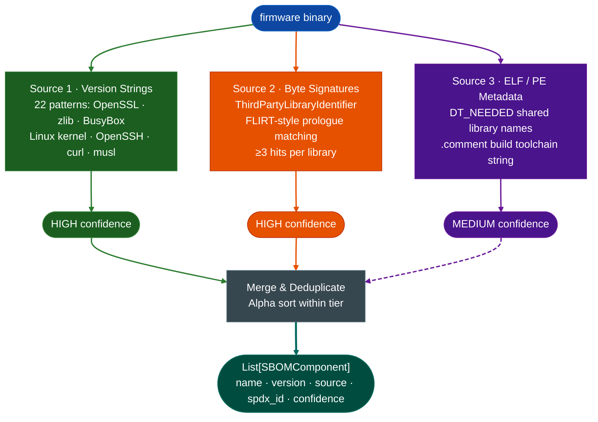

# SBOM & Supply-Chain Tooling

Extract a software bill of materials from a stripped firmware binary. Identifies embedded open-source library versions, build toolchain strings, and dynamic linker dependencies without source code or debug symbols.

---

## What is an SBOM and why it matters

SBOM stands for Software Bill of Materials. A bill of materials is a manufacturing concept: before a product ships, the manufacturer records every part that went into it, with part numbers and supplier names. When a defect surfaces in one part, the manufacturer knows exactly which finished products contain it. The same idea applied to software means recording every third-party library, its version, and its license before the product ships.

Firmware vendors ship products that contain dozens of open-source libraries. OpenSSL handles TLS. zlib handles compressed configuration files. BusyBox provides the shell environment. The vendor compiles these libraries directly into the firmware image. In most cases the vendor does not publish which versions they used because they are not required to, and maintaining a public SBOM requires ongoing effort they generally do not invest in.

This creates a concrete problem during RE. A CVE publishes for OpenSSL 1.1.1k describing a heap buffer overflow in the public key parsing path. You are analyzing a firewall appliance from that vendor. Without an SBOM you cannot answer the basic question: does this appliance contain OpenSSL 1.1.1k? You could spend hours tracing TLS code before confirming the version, or skip the appliance entirely and miss a real exposure. `SBOMExtractor` answers the version question in seconds so you decide whether to trace the vulnerable path before opening a disassembler.

An SBOM also changes where analysis starts. A binary that contains BusyBox 1.33.1 tells you that the shell environment has specific command injection surfaces documented in BusyBox CVE history. A binary that contains OpenSSH 8.0p1 tells you exactly which pre-auth parsing paths matter. `SemanticSearcher` works best when you give it a specific function name to search for, and the SBOM produces those function names from the component list before any disassembly runs.

The toolchain string from the `.comment` section carries separate value. A binary compiled with GCC 4.8.5 does not emit stack canaries by default and generates more predictable function prologues than a binary compiled with GCC 10.2.1. Knowing the compiler version tells `SinkArgClassifier` which patterns to expect so it produces fewer false positives.

SBOMExtractor improves the ablation pipeline in two concrete ways. First, it prioritizes which functions are worth tracing because a confirmed OpenSSL 1.1.1k presence means the `d2i_PublicKey` path exists and is a taint target, and without the SBOM that selection requires manual version confirmation. Second, it attaches the SPDX license identifier to each component so the output feeds a compliance tool without a separate lookup step.

CycloneDX and SPDX are the two standard machine-readable SBOM formats. CycloneDX is designed for security use cases and carries explicit vulnerability reference fields. SPDX is designed for license compliance and is the format the Linux kernel project uses. `SBOMComponent` fields map to both so downstream tooling consumes either format without post-processing.

---

## Why this exists

1. **Firmware vendors strip binaries but do not strip version strings.** Libraries such as OpenSSL, zlib, and BusyBox embed a human-readable version string in their `.rodata` section because they use it for diagnostic output. `SBOMExtractor` sweeps every printable byte sequence in the binary for 22 known patterns so a version like `OpenSSL 1.1.1k` surfaces even when every symbol is gone.

2. **Some libraries ship no version string at all.** `ThirdPartyLibraryIdentifier` closes this gap with byte-level function prologue signatures: the AES S-box constant `{0x63, 0x7c, 0x77...}`, SHA-256 init constants, and zlib's Adler-32 modulus appear at fixed offsets in every build of those libraries regardless of compiler or strip flags. Three or more signatures from the same library constitute a match.

3. **Knowing which library is present is not enough without a license.** Each identified component carries an SPDX license identifier so the output can feed a compliance check. `OpenSSL` maps to `OpenSSL`, `zlib` to `Zlib`, `musl` to `MIT`, and so on. Components with no known license are flagged with an empty `spdx_id` for manual review.

---

## How it works



### SBOMComponent fields

| Field | Content |
|:---|:---|
| `name` | Canonical library name, e.g. `OpenSSL`, `zlib`, `BusyBox` |
| `version` | Version string recovered from binary, or `'unknown'` / `'dynamic'` |
| `source` | `'version_string'` / `'signature'` / `'metadata(DT_NEEDED)'` / `'metadata(.comment)'` |
| `spdx_id` | SPDX license identifier, e.g. `OpenSSL`, `Zlib`, `MIT`, `GPL-2.0-only` |
| `confidence` | `HIGH` (version string or signature hit) / `MEDIUM` (metadata only) |
| `notes` | Matched signature names for signature-source components |

---

## Usage

```python
from modules.sbom_extractor import SBOMExtractor

# Standalone
extractor = SBOMExtractor('/path/to/firmware.bin')
components = extractor.extract()
print(extractor.report(components))

# With existing BinaryContext (avoids re-reading the file)
from ablation.analyzers.binary_context import BinaryContext
ctx = BinaryContext.load_or_build('/path/to/firmware.bin')
extractor = SBOMExtractor.from_context(ctx)
components = extractor.extract()

# Filter to HIGH confidence only
high = [c for c in components if c.confidence == 'HIGH']

# Filter to components with known CVE exposure
# (signature source notes carry CVE references when version is in a vulnerable range)
vuln = [c for c in components if any('CVE' in n for n in c.notes)]
```

---

## Example output

```
SBOMExtractor: 6 component(s) in /path/to/firmware.bin

  HIGH    OpenSSL 1.1.1k  (via version_string)  license=OpenSSL
  HIGH    zlib 1.2.11     (via version_string)  license=Zlib
  HIGH    BusyBox v1.33.1 (via version_string)  license=GPL-2.0-only
  HIGH    musl 1.2.3      (via signature)  license=MIT  [AES S-box constant; SHA-256 H0 init constant]
  MEDIUM  libssl.so.1.1   (via metadata(DT_NEEDED))
  MEDIUM  (build toolchain) GCC: (GNU) 10.2.1  (via metadata(.comment))
```

---

## False positives

**Version string patterns match substrings.** A binary that logs `"OpenSSL error"` without embedding a version number will not match because all patterns require a version string after the library name. A binary that ships a static error message like `"zlib 1.2.11 is required"` in a log message will match, so confirm the version string is from the library itself and not a requirements check before reporting.

**Byte signature matching requires three hits per library.** A single AES S-box constant in an unrelated crypto implementation will not fire because `ThirdPartyLibraryIdentifier` requires `min_matches=2` by default. Raise to 3 for lower false-positive rate on larger binaries.

**DT_NEEDED entries reflect link-time dependencies, not runtime presence.** A library listed in DT_NEEDED may be dlopen'd and absent from the firmware image. These entries are `MEDIUM` confidence for this reason.

---

## Pipeline position

Run `SBOMExtractor` as the first step on any new firmware image before taint analysis, because a vulnerable library version (e.g. OpenSSL <1.1.1l for CVE-2021-3711) changes which functions are worth tracing. Feed identified library names into `SemanticSearcher` to locate the relevant parse and crypto functions in the binary.

---

## See also

- [Third-Party Library Identifier](third-party-library-identifier.md): the signature engine `SBOMExtractor` calls for non-version-string detection
- [Semantic Search](semantic-search.md): query for library-specific functions once a library is confirmed present
- [Finding Registry](registry.md): record confirmed vulnerable component versions as findings
