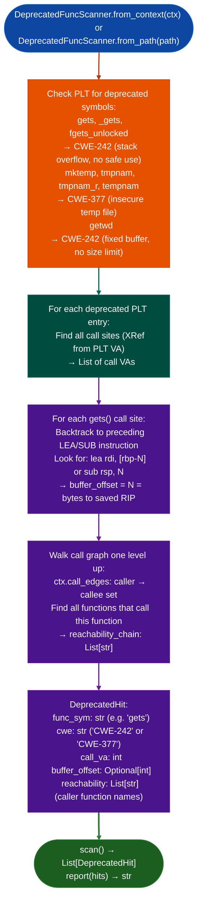

# Deprecated and Unsafe Function Scanning

Detect CWE-242/CWE-377 in stripped binaries without taint analysis: identifying unconditionally dangerous functions `gets`, `mktemp`, `tmpnam`, `getwd` directly from PLT entries, computing the overflow offset at each `gets` call site from the preceding `LEA` instruction, and reporting the reachability chain per call site.

---

## Why this exists

1. **`gets()`, `mktemp()`, `tmpnam()`, and `getwd()` have no safe use: their mere presence in the PLT is a confirmed finding regardless of call context.** `DeprecatedFuncScanner.scan()` reports these as `DeprecatedHit` findings directly from the PLT symbol table without running taint analysis. No data flow path is needed to confirm the finding: `gets()` reads an unbounded line from stdin into a caller-supplied buffer, making every call site a confirmed CWE-242 stack overflow.

2. **For each `gets()` call site where the destination buffer is at `[rbp-N]`, `DeprecatedFuncScanner` extracts `N` from the preceding `LEA` instruction and reports the exact number of bytes needed to reach the saved RIP.** This transforms a confirmed finding into a direct exploit primitive: the analyst knows the overflow offset without manual disassembly. Defenders get the exact input size that overwrites the return address.

3. **`DeprecatedFuncScanner` walks one level up the call graph (using `BinaryContext.call_edges`) to show which functions can trigger each `gets()` call site.** This replaces manual call graph tracing that was previously required before every taint run on a `gets` finding: the reachability chain is reported alongside the finding, not as a separate investigation step.

---

## How it works



---

## Usage

```python
from ablation.analyzers.deprecated_func_scanner import DeprecatedFuncScanner
from ablation.analyzers.binary_context import BinaryContext

ctx = BinaryContext.load_or_build('/path/to/target.elf')
scanner = DeprecatedFuncScanner.from_context(ctx)

hits = scanner.scan()
print(scanner.report(hits))

# Inspect individual hits
for hit in hits:
    print(hit.fmt())
    if hit.buffer_offset is not None:
        print(f"  Overflow offset to saved RIP: {hit.buffer_offset} bytes")
    if hit.reachability:
        print(f"  Reachable from: {', '.join(hit.reachability)}")
```

---

## Example output

The following illustrates the finding format. Actual addresses and offsets are binary-specific.

```
[CWE-242 HIGH] gets() at <call-va>
  Buffer: [rbp-<N>]  → <N> bytes to saved RIP
  Reachable from: <caller1>, <caller2>

[CWE-377 MEDIUM] mktemp() at <call-va>
  Race window: between mktemp() return and file open
  Reachable from: <caller>

Report: <N> deprecated function findings
  gets: <M> call sites
  mktemp: <K> call sites
```

---

## False positives

**`buffer_offset` extraction from the preceding LEA instruction is a heuristic, it looks backward from the `gets()` call for a `lea rdi, [rbp-N]` pattern, but the destination buffer may be in a different register or passed as a pre-computed argument.** A `None` `buffer_offset` means the buffer location was not statically recovered, not that the buffer is safe. Confirm with manual disassembly when `buffer_offset` is `None`.

**`getwd()` has a fixed 1024-byte buffer limit specified in POSIX, but implementations may vary.** The finding is always confirmed no size argument, but the overflow offset requires knowing the actual buffer size used by the caller, which `DeprecatedFuncScanner` does not attempt to recover.

---

## Pipeline position

Run `DeprecatedFuncScanner` early in the analysis pipeline: before `SinkArgClassifier` and `TaintTracker`: because its findings require no taint analysis to confirm. Any binary with `gets()` in its PLT has a confirmed stack overflow without further investigation. Use the `reachability_chain` output to identify which public-facing functions expose the overflow, then run `PathSolver` to confirm a feasible path.

---

## Reading findings

`DeprecatedFuncScanner.scan()` returns a list of finding dicts:

| Field | Content |
|:---|:---|
| `severity` | `CRITICAL` gets, getwd / `HIGH` strcpy, strcat, sprintf |
| `func` | Deprecated function name for example `gets`, `strcpy` |
| `call_va` | VA of the call instruction |
| `buffer_offset` | Destination buffer offset from frame base (or `None` if not statically recoverable) |
| `reachability_chain` | List of caller VAs from the entry point down to the deprecated function call |

---

## See also

- [Taint Analysis](taint-analysis.md): for non-deprecated sinks where taint analysis is required
- [Scanf-Family Overflow Candidates](scanf-family-overflow-candidates.md): `scanf` with `%s` is similar to `gets` but requires format string analysis
- [Source/Dangerous Sink Detection](source-dangerous-sink-detection.md): broader source-to-sink analysis; deprecated function scanner is a specialized fast path
- [x86 Taint Tracking](x86.md): follow up deprecated function findings with taint confirmation
