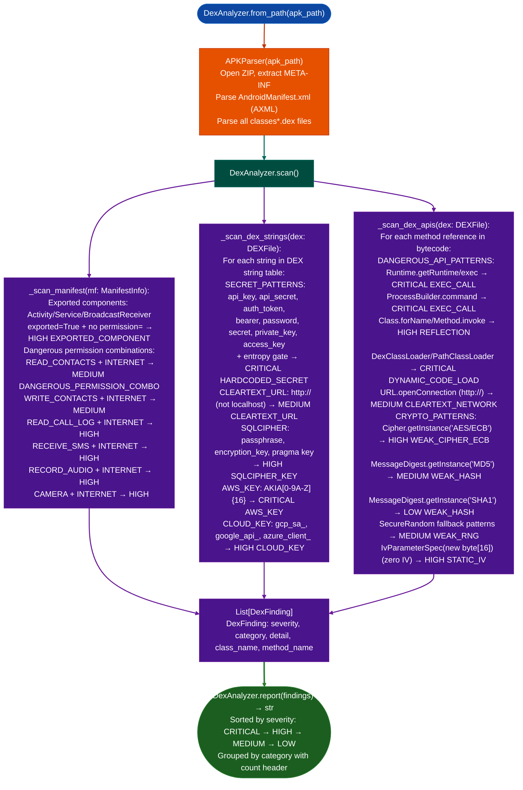

# DexAnalyzer

Scan Android APK packages for hardcoded secrets, dangerous API invocations, cryptographic misuse, cleartext network endpoints, exported attack surface, and dangerous permission combinations: without external dependencies, using ablation's native DEX and AXML parsers.

- [Why this exists](#why-this-exists)
- [How it works](#how-it-works)
  - [Finding reference](#finding-reference)
- [Usage](#usage)
- [Example output](#example-output)
- [False positives](#false-positives)
- [Pipeline position](#pipeline-position)
- [Reading findings](#reading-findings)
- [See also](#see-also)

---

## Why this exists <sup>[↑](#dexanalyzer)</sup>

1. Static analysis of Android APKs requires parsing two distinct binary formats simultaneously: Dalvik Executable (DEX) for bytecode and strings, and Android Binary XML (AXML) for manifest permissions and component declarations. Tools that use only dexdump or apktool miss cross-format findings. A `READ_CONTACTS` + `INTERNET` permission combination that feeds into a hardcoded C2 URL requires correlating manifest data with DEX string literals. `DexAnalyzer._scan_manifest()` and `_scan_dex_strings()` run together on the same `APKParser` instance so cross-format signals are always in scope.

2. Dangerous API detection must distinguish between intentional security mechanisms and misuse. `Cipher.getInstance("AES")` is not a finding by itself; `Cipher.getInstance("AES/ECB/NoPadding")` is. `CRYPTO_PATTERNS` maps full method-reference strings to severity labels, preserving method-level precision. `DANGEROUS_API_PATTERNS` covers reflection (`Class.forName`, `Method.invoke`), subprocess execution (`Runtime.getRuntime`, `ProcessBuilder`), and dynamic code loading (`DexClassLoader`, `PathClassLoader`) with class-and-method-reference matching that is not fooled by package obfuscation.

3. Hardcoded secret detection without false positives requires entropy-gated pattern matching, not keyword presence alone. A string containing `api_key` is only a finding when the value portion has sufficient entropy. `_scan_dex_strings()` applies Shannon entropy pre-screening before reporting, reducing noise from documentation strings while ensuring 32-char hex secrets and base64-encoded tokens are flagged regardless of their surrounding variable name.

---

## How it works <sup>[↑](#dexanalyzer)</sup>



### Finding reference <sup>[↑](#dexanalyzer)</sup>

| Category | Severity | Trigger condition |
|:---|:---|:---|
| `HARDCODED_SECRET` | CRITICAL | String matching secret pattern + entropy above threshold |
| `AWS_KEY` | CRITICAL | String matching `AKIA[0-9A-Z]{16}` |
| `EXEC_CALL` | CRITICAL | `Runtime.getRuntime().exec()` or `ProcessBuilder.command()` ref |
| `DYNAMIC_CODE_LOAD` | CRITICAL | `DexClassLoader`, `PathClassLoader`, `InMemoryDexClassLoader` ref |
| `WEAK_CIPHER_ECB` | HIGH | `Cipher.getInstance("AES/ECB/...")` method ref |
| `STATIC_IV` | HIGH | `IvParameterSpec` constructed with zero-filled or hardcoded byte array |
| `SQLCIPHER_KEY` | HIGH | String matching SQLCipher passphrase or pragma key pattern |
| `CLOUD_KEY` | HIGH | String matching GCP/Azure/Google API key pattern |
| `EXPORTED_COMPONENT` | HIGH | Exported Activity/Service/BroadcastReceiver with no `permission=` |
| `REFLECTION` | HIGH | `Class.forName`, `Method.invoke`, `Field.set` refs |
| `DANGEROUS_PERMISSION_COMBO` | HIGH | `RECEIVE_SMS`/`RECORD_AUDIO`/`CAMERA`/`READ_CALL_LOG` + `INTERNET` |
| `WEAK_HASH` | MEDIUM | `MessageDigest.getInstance("MD5"` or `"SHA1"` |
| `WEAK_RNG` | MEDIUM | `SecureRandom` fallback or predictable seed patterns |
| `CLEARTEXT_URL` | MEDIUM | `http://` string literal non-localhost |
| `CLEARTEXT_NETWORK` | MEDIUM | `URL.openConnection` with `http://` scheme |
| `DANGEROUS_PERMISSION_COMBO` | MEDIUM | `READ_CONTACTS`/`WRITE_CONTACTS` + `INTERNET` |

---

## Usage <sup>[↑](#dexanalyzer)</sup>

```python
from ablation.analyzers.dex_analyzer import DexAnalyzer

# DexAnalyzer
scanner = DexAnalyzer.from_path('/path/to/app.apk')
findings = scanner.scan()
print(DexAnalyzer.report(findings))

# DexAnalyzer
critical = [f for f in findings if f.severity == 'CRITICAL']
for f in critical:
    print(f"[{f.category}] {f.class_name}.{f.method_name}: {f.detail}")

# DexAnalyzer
from ablation.core.apk_parser import APKParser
apk = APKParser('/path/to/app.apk')
manifest = apk.parse_manifest()
scanner = DexAnalyzer(apk)
manifest_findings = scanner._scan_manifest(manifest)

# DexAnalyzer
for dex in apk.iter_dex():
    string_findings = scanner._scan_dex_strings(dex)
    api_findings = scanner._scan_dex_apis(dex)
```

---

## Example output <sup>[↑](#dexanalyzer)</sup>

The following illustrates the report format for representative findings. Actual class names, method names, string values, and permission lists will reflect the specific APK.

```
============================================================
DEX SECURITY SCAN - <apk-filename>
============================================================

CRITICAL (3)
[HARDCODED_SECRET] <class-path>.<method>: api_key='<redacted>'
[AWS_KEY] <class-path>.<method>: AKIA<redacted> in string literal
[DYNAMIC_CODE_LOAD] <class-path>.<method>: DexClassLoader invoked with external path

HIGH (4)
[EXPORTED_COMPONENT] <activity-class>: exported Activity with no android:permission
[REFLECTION] <class-path>.<method>: Class.forName + Method.invoke call chain
[WEAK_CIPHER_ECB] <class-path>.<method>: Cipher.getInstance("AES/ECB/NoPadding")
[DANGEROUS_PERMISSION_COMBO] manifest: RECEIVE_SMS + INTERNET

MEDIUM (2)
[CLEARTEXT_URL] <class-path>.<method>: http://<redacted> endpoint
[WEAK_HASH] <class-path>.<method>: MessageDigest.getInstance("MD5")
```

---

## False positives <sup>[↑](#dexanalyzer)</sup>

`HARDCODED_SECRET` fires on any high-entropy string matching a key pattern, including test fixture values and build-time-injected constants that are not real credentials. Debug builds frequently embed test API keys with real entropy. Cross-reference findings against the class name: strings in classes ending with `Test`, `Mock`, or `Fixture` are unlikely production secrets. Also check whether the string appears only in `static final` constants initialized to known-bad test values from a test library.

`EXPORTED_COMPONENT` fires on any exported component with no `permission=` attribute, but deep links and intent filters legitimately require exported components. Android deep link receivers (handling `android:scheme=` URIs) and system broadcast receivers (`ACTION_BOOT_COMPLETED`, etc.) must be exported. Confirm that the exported component handles only deep-link intents and does not expose internal data or privileged operations before escalating to HIGH.

`REFLECTION` fires on any `Class.forName` or `Method.invoke` reference, but this includes standard Java serialization, dependency injection frameworks (Dagger, Hilt), and annotation processors. The finding is present because reflection enables dynamic code execution that bypasses static taint analysis. Filter by class path: reflection in `com.google.inject`, `dagger`, and `javax.annotation` packages is framework boilerplate; reflection in application-layer classes warrants investigation.

---

## Pipeline position <sup>[↑](#dexanalyzer)</sup>

**Before this module:** Unzip the APK to confirm it is a valid ZIP archive with `classes.dex` and `AndroidManifest.xml` entries. Multi-dex APKs have `classes2.dex`, `classes3.dex`, etc.: `APKParser.iter_dex()` handles all of them automatically.

**After this module:** For `DYNAMIC_CODE_LOAD` findings: extract the DEX path passed to `DexClassLoader` from the string constants near the call site, and re-run `DexAnalyzer` on the dynamically loaded DEX if it is accessible common in sideloaded apps that download plugins. For `EXPORTED_COMPONENT` findings: trace intent-filter data tags to understand what URI parameters the component accepts, then test with `adb shell am start -n <component> -d <uri>` to confirm exposed functionality.

---

## Reading findings <sup>[↑](#dexanalyzer)</sup>

| Field | Content |
|:---|:---|
| `f.severity` | `CRITICAL`, `HIGH`, `MEDIUM`, or `LOW` |
| `f.category` | Finding category string for example `HARDCODED_SECRET`, `EXPORTED_COMPONENT` |
| `f.detail` | Specific evidence: matched string, method reference, permission combination |
| `f.class_name` | Dalvik class descriptor where the finding was observed for example `Lcom/example/MainActivity;` |
| `f.method_name` | Method name within the class, or `<manifest>` for manifest findings |

---

## See also <sup>[↑](#dexanalyzer)</sup>

- [DEX Disassembly and Lifting](dex-disassembly-and-lifting.md): bytecode-level DEX instruction disassembly and lifting to IR
- [Android](android.md): full Android RE pipeline: APK, native library (JNI), Binder surface
- [Android Binder Surface](android-binder-surface.md): Binder IPC attack surface analysis
