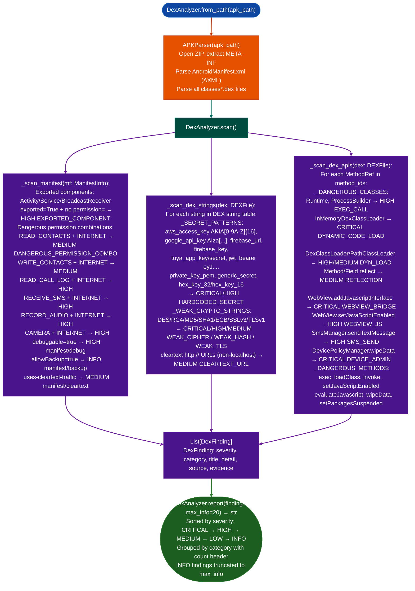

# DexAnalyzer

Scan Android APK packages for hardcoded secrets, dangerous API invocations, cryptographic misuse, cleartext network endpoints, exported attack surface, and dangerous permission combinations: without external dependencies, using ablation's native DEX and AXML parsers.

- [What is DEX, Dalvik, and ART?](#what-is-dex-dalvik-and-art)
  - [Dalvik vs. ART](#dalvik-vs-art)
  - [DEX file format](#dex-file-format)
  - [Multi-dex and APK structure](#multi-dex-and-apk-structure)
- [Why this exists](#why-this-exists)
- [How it works](#how-it-works)
  - [Finding reference](#finding-reference)
- [Module relationships](#module-relationships)
- [API reference](#api-reference)
  - [`DexAnalyzer`](#dexanalyzer-class)
  - [`DexFinding`](#dexfinding)
  - [`ManifestInfo`](#manifestinfo)
  - [`DEXFile`](#dexfile)
- [Usage](#usage)
- [Example output](#example-output)
- [False positives](#false-positives)
- [Limitations](#limitations)
- [Pipeline position](#pipeline-position)
- [See also](#see-also)

---

## What is DEX, Dalvik, and ART? <sup>[↑](#dexanalyzer)</sup>

**Dalvik** is the virtual machine that ran Android applications from Android 1.0 through Android 4.4 (KitKat). It is a register-based VM (unlike the JVM's stack machine) and executes `.dex` bytecode directly, using a just-in-time (JIT) compiler to translate hot paths to native code at runtime. The register-based design was chosen to reduce the instruction count and improve execution density on the constrained hardware of the time.

**ART** (Android Runtime) replaced Dalvik starting with Android 5.0 (Lollipop). ART introduced ahead-of-time (AOT) compilation: when an APK is installed, `dex2oat` compiles the `.dex` bytecode to native code stored in `.oat` / `.vdex` files. From Android 7.0 onward, ART uses a hybrid model — baseline JIT for first runs with background AOT promotion for frequently executed code. ART still uses `.dex` bytecode as its input format; the `.oat` file embeds the original DEX data alongside the compiled native code.

**Why this matters for RE:** The `.dex` format retains full string tables, class descriptors, method signatures, and field references in plaintext, even after ProGuard/R8 obfuscation. Native `.so` libraries inside the APK lose function names when stripped, but the Java/Kotlin layer in DEX remains readable. This makes DEX the primary target for static analysis of Android malware, IoT device management apps, and network appliance firmware that targets Android.

### Dalvik vs. ART <sup>[↑](#dexanalyzer)</sup>

| Aspect | Dalvik | ART |
|:---|:---|:---|
| Android version | 1.0–4.4 | 5.0+ |
| Compilation | JIT at runtime | AOT at install + JIT for new code |
| Bytecode format | `.dex` | `.dex` (input) → `.oat`/`.vdex` (compiled) |
| Bytecode architecture | Register-based | Register-based |
| Instruction set | Dalvik bytecode (dalvik-opcodes) | Dalvik bytecode + ART-specific |
| Package artifacts | `classes.dex` in APK | `classes.dex` in APK + system `.oat` |

Both runtimes execute the same `.dex` bytecode at the logical level. `DexAnalyzer` operates on the `.dex` files inside the APK; it does not parse `.oat`/`.vdex` ART compilation artifacts.

### DEX file format <sup>[↑](#dexanalyzer)</sup>

A `.dex` file starts with an 8-byte magic value followed by a 4-byte Adler-32 checksum and a 20-byte SHA-1 signature. The version field in the magic determines which opcode extensions are valid:

| Magic | DEX version | First Android release |
|:---|:---|:---|
| `dex\n035\0` | 035 | Android 2.2 (Froyo) |
| `dex\n036\0` | 036 | Android 7.0 (Nougat) |
| `dex\n037\0` | 037 | Android 8.0 (Oreo) |
| `dex\n038\0` | 038 | Android 9.0 (Pie) |
| `dex\n039\0` | 039 | Android 10 |

After the header, the file is organized as parallel offset tables:

- **string_ids**: Offsets into the string data section. `DEXFile.iter_strings()` walks this table.
- **type_ids**: Indices into `string_ids` for class descriptors (`Landroid/util/Log;` format).
- **proto_ids**: Method prototypes: return type + parameter list.
- **field_ids**: `(class_idx, type_idx, name_idx)` triples.
- **method_ids**: `(class_idx, proto_idx, name_idx)` triples. `DEXFile.iter_method_refs()` returns `MethodRef` objects from this table.
- **class_defs**: Per-class metadata: superclass, access flags, source file name, annotations, and the encoded method list with bytecode offsets.

The string table is the primary source of secret pattern matching. Every string constant in every class is stored in string_ids, including hardcoded URLs, API keys, error messages, and SQL queries. `_scan_dex_strings()` iterates the full string table without disassembly.

### Multi-dex and APK structure <sup>[↑](#dexanalyzer)</sup>

A single DEX file supports at most 65,536 method references (the Dalvik method-count limit from the 16-bit method index). Applications that exceed this limit split bytecode across multiple DEX files inside the APK:

- `classes.dex`: primary DEX, always present
- `classes2.dex`, `classes3.dex`, ...: continuation DEX files

`APKParser.iter_dex()` yields a `DEXFile` for each `classes*.dex` entry in the ZIP. `DexAnalyzer.scan()` calls `_scan_dex_strings()` and `_scan_dex_apis()` once per `DEXFile` so every shard is covered. The `DexFinding.source` field records which shard triggered the finding (e.g., `"dex:classes2.dex"`).

**APK structure relevant to analysis:**

```
app.apk (ZIP)
  AndroidManifest.xml   ← binary XML (AXML format, not plain XML)
  classes.dex           ← primary DEX
  classes2.dex          ← optional, if method count > 65k
  lib/
    armeabi-v7a/*.so    ← native libraries (not analyzed by DexAnalyzer)
    arm64-v8a/*.so
  assets/               ← bundled files: may contain embedded DEX, scripts
  res/                  ← resource files
  META-INF/             ← APK signature files
```

`DexAnalyzer` covers `AndroidManifest.xml` and all `classes*.dex` files. Native `.so` libraries are not analyzed.

---

## Why this exists <sup>[↑](#dexanalyzer)</sup>

1. Static analysis of Android APKs requires parsing two distinct binary formats simultaneously: Dalvik Executable (DEX) for bytecode and strings, and Android Binary XML (AXML) for manifest permissions and component declarations. Tools that use only dexdump or apktool miss cross-format findings. A `READ_CONTACTS` + `INTERNET` permission combination that feeds into a hardcoded C2 URL requires correlating manifest data with DEX string literals. `DexAnalyzer._scan_manifest()` and `_scan_dex_strings()` run together on the same `APKParser` instance so cross-format signals are always in scope.

2. Dangerous API detection must distinguish between intentional security mechanisms and misuse. `Cipher.getInstance("AES")` is not a finding by itself; `Cipher.getInstance("AES/ECB/NoPadding")` is. `_DANGEROUS_CLASSES` maps full Dalvik class descriptor strings to severity labels, preserving class-level precision. `_DANGEROUS_METHODS` covers subprocess execution (`exec`, `loadUrl`), dynamic code loading (`DexClassLoader`, `InMemoryDexClassLoader`), and WebView bridge exposure (`addJavascriptInterface`) with class-plus-method matching that is not fooled by package obfuscation that preserves method names.

3. Hardcoded secret detection without false positives requires entropy-gated pattern matching, not keyword presence alone. A string containing `api_key` is only a finding when the value portion has sufficient entropy. `_scan_dex_strings()` applies pattern matching against `_SECRET_PATTERNS` and `_WEAK_CRYPTO_STRINGS` before reporting, reducing noise from documentation strings while ensuring 32-char hex secrets, JWT tokens, and base64-encoded credentials are flagged regardless of their surrounding variable name.

---

## How it works <sup>[↑](#dexanalyzer)</sup>



### Finding reference <sup>[↑](#dexanalyzer)</sup>

| Category | Severity | Trigger condition |
|:---|:---|:---|
| `HARDCODED_SECRET` | CRITICAL | AWS key (`AKIA...`), Google API key (`AIza...`), JWT, PEM private key, generic high-entropy secret |
| `DYNAMIC_CODE_LOAD` | CRITICAL | `InMemoryDexClassLoader` ref |
| `WEBVIEW_BRIDGE` | CRITICAL | `WebView.addJavascriptInterface` ref |
| `DEVICE_ADMIN` | CRITICAL | `DevicePolicyManager.wipeData` or `setDeviceOwner` |
| `WEAK_TLS` | CRITICAL | `SSLv3` string reference |
| `EXEC_CALL` | HIGH | `Runtime.getRuntime().exec()` or `ProcessBuilder` ref |
| `DYN_LOAD` | HIGH | `DexClassLoader` or `PathClassLoader` ref |
| `WEBVIEW_JS` | HIGH | `WebView.setJavaScriptEnabled` ref |
| `WEAK_CIPHER` | HIGH | `DES`, `RC4`, `AES/ECB` string or `Cipher.getInstance` ref |
| `SMS_SEND` | HIGH | `SmsManager.sendTextMessage` ref |
| `EXPORTED_COMPONENT` | HIGH | Exported Activity/Service/BroadcastReceiver with no `permission=` |
| `REFLECTION` | MEDIUM | `Class.forName`, `Method.invoke`, `Field.set` refs |
| `WEAK_HASH` | MEDIUM | `MessageDigest.getInstance("MD5")` or `SHA-1` |
| `CLEARTEXT_URL` | MEDIUM | `http://` string literal, non-localhost |
| `DANGEROUS_PERMISSION_COMBO` | MEDIUM/HIGH | Sensitive permission + `INTERNET` combination |
| `WEAK_HASH` | LOW | SHA-1 reference |
| `SQLCIPHER_KEY` | INFO | SQLCipher passphrase or pragma key pattern |

---

## Module relationships <sup>[↑](#dexanalyzer)</sup>

```
DexAnalyzer
  └── ablation.core.apk_parser.APKParser
        ├── APKParser.parse_manifest() → ManifestInfo
        │     └── ManifestInfo.exported_components() → List[ComponentInfo]
        │     └── ManifestInfo.dangerous_permissions() → List[str]
        └── APKParser.iter_dex() → Iterator[DEXFile]
              ├── DEXFile.iter_strings() → Iterator[str]
              ├── DEXFile.iter_method_refs() → Iterator[MethodRef]
              └── DEXFile.iter_native_methods() → Iterator[NativeMethod]
```

`DexAnalyzer` depends on `ablation.core.apk_parser` and has no other ablation dependencies. It does not use `BinaryContext`, `TaintTracker`, or `SemanticSearcher` — it operates at the DEX string-table and method-reference level, not at the instruction level.

**Used by:**
- [Android](android.md) RE pipeline: `DexAnalyzer` is the first pass before JNI native library analysis
- [Android Binder Surface](android-binder-surface.md): uses `ManifestInfo.exported_components()` output

---

## API reference <sup>[↑](#dexanalyzer)</sup>

### `DexAnalyzer` class <sup>[↑](#dexanalyzer)</sup>

```python
from ablation.analyzers.dex_analyzer import DexAnalyzer
```

#### `DexAnalyzer.from_path(path)` <sup>[↑](#dexanalyzer)</sup>

```python
@classmethod
def from_path(cls, path: str | Path) -> DexAnalyzer
```

Opens the APK at `path`, constructs an `APKParser`, and returns a ready-to-scan analyzer. Raises `FileNotFoundError` if `path` does not exist. Raises `zipfile.BadZipFile` if the file is not a valid ZIP archive.

#### `DexAnalyzer.scan()` <sup>[↑](#dexanalyzer)</sup>

```python
def scan(self) -> List[DexFinding]
```

Runs all three scan passes (manifest, DEX strings, DEX APIs) and returns findings sorted by severity (`CRITICAL` first). Each DEX shard in a multi-dex APK is processed independently. The manifest is parsed once and its findings merged into the same list.

#### `DexAnalyzer.report(findings, max_info=20)` <sup>[↑](#dexanalyzer)</sup>

```python
@staticmethod
def report(findings: List[DexFinding], max_info: int = 20) -> str
```

Formats findings into a human-readable report grouped by severity. `INFO`-level findings are truncated to `max_info` to keep the report concise. Returns the full report as a string.

### `DexFinding` <sup>[↑](#dexanalyzer)</sup>

```python
@dataclass
class DexFinding:
    severity: str      # "CRITICAL" | "HIGH" | "MEDIUM" | "LOW" | "INFO"
    category: str      # e.g. "HARDCODED_SECRET", "EXPORTED_COMPONENT"
    title: str         # short label for the specific finding
    detail: str        # human-readable explanation of what was found
    source: str        # "dex:classes.dex" | "dex:classes2.dex" | "manifest"
    evidence: str      # raw string / API call / component name (may be empty)
```

`DexFinding.fmt()` returns a multi-line formatted string ready for printing.

### `ManifestInfo` <sup>[↑](#dexanalyzer)</sup>

```python
@dataclass
class ManifestInfo:
    package: str
    version_name: str
    version_code: int
    min_sdk: int
    target_sdk: int
    permissions: List[str]           # all uses-permission entries
    declared_permissions: List[str]  # permissions this app defines
    components: List[ComponentInfo]
    debuggable: bool                 # android:debuggable in <application>
    allow_backup: bool               # android:allowBackup
    uses_cleartext_traffic: bool     # android:usesCleartextTraffic
```

Key methods:
- `exported_components()` → `List[ComponentInfo]`: components with `android:exported=true` or implicit export via intent-filter
- `dangerous_permissions()` → `List[str]`: subset of `permissions` matching the known-dangerous set

### `DEXFile` <sup>[↑](#dexanalyzer)</sup>

```python
@dataclass
class DEXFile:
    filename: str         # e.g. "classes.dex"
    version: str          # DEX format version, e.g. "035"
    file_size: int
    string_count: int
    type_count: int
    method_count: int
    field_count: int
    class_count: int
```

Key methods:
- `iter_strings()` → `Iterator[str]`: all string constants in the string table
- `iter_method_refs()` → `Iterator[MethodRef]`: all method references in method_ids
- `iter_native_methods()` → `Iterator[NativeMethod]`: methods declared `native` (JNI bridge points)
- `string_at(idx)` → `str`: string at a specific string index

---

## Usage <sup>[↑](#dexanalyzer)</sup>

```python
from ablation.analyzers.dex_analyzer import DexAnalyzer

# full scan
scanner = DexAnalyzer.from_path('/path/to/app.apk')
findings = scanner.scan()
print(DexAnalyzer.report(findings))

# filter by severity
critical = [f for f in findings if f.severity == 'CRITICAL']
for f in critical:
    print(f.fmt())

# scan manifest only (no DEX pass)
from ablation.core.apk_parser import APKParser
apk = APKParser.from_path('/path/to/app.apk')
manifest = apk.parse_manifest()
scanner = DexAnalyzer(apk)
manifest_findings = scanner._scan_manifest(manifest)

# scan individual DEX shards
for dex in apk.iter_dex():
    print(f"{dex.filename}: {dex.method_count} methods, {dex.string_count} strings")
    string_findings = scanner._scan_dex_strings(dex)
    api_findings = scanner._scan_dex_apis(dex)
```

---

## Example output <sup>[↑](#dexanalyzer)</sup>

```
[CRITICAL] HARDCODED_SECRET: aws_access_key in Lcom/example/Config;
  source:   dex:classes.dex
  detail:   Pattern 'AKIA[0-9A-Z]{16}' matched in string table
  evidence: AKIA3EXAMPLE1234ABCD

[CRITICAL] WEBVIEW_BRIDGE: addJavascriptInterface in Lcom/example/WebActivity;
  source:   dex:classes.dex
  detail:   WebView.addJavascriptInterface exposes Java objects to JavaScript
  evidence: Landroid/webkit/WebView;->addJavascriptInterface

[HIGH] EXPORTED_COMPONENT: exported Activity with no android:permission
  source:   manifest
  detail:   Lcom/example/DeepLinkActivity; exported=True, permission=None
  evidence: com.example.DeepLinkActivity

[HIGH] EXEC_CALL: exec/Runtime in Lcom/example/ShellRunner;
  source:   dex:classes2.dex
  detail:   Runtime.exec() allows arbitrary command execution
  evidence: Ljava/lang/Runtime;->exec

[MEDIUM] CLEARTEXT_URL: cleartext endpoint in Lcom/example/ApiClient;
  source:   dex:classes.dex
  detail:   http:// URL in string table
  evidence: http://api.example.com/v1/
```

---

## False positives <sup>[↑](#dexanalyzer)</sup>

`HARDCODED_SECRET` fires on any string matching a secret pattern, including test fixture values and build-time-injected constants that are not real credentials. Debug builds frequently embed test API keys with real entropy. Cross-reference findings against the source class name: strings in classes containing `Test`, `Mock`, or `Fixture` are unlikely production secrets. Also check whether the string appears only in `static final` constants initialized to known-bad test values from a test library.

`EXPORTED_COMPONENT` fires on any exported component with no `permission=` attribute, but deep links and intent filters legitimately require exported components. Android deep link receivers (handling `android:scheme=` URIs) and system broadcast receivers (`ACTION_BOOT_COMPLETED`, etc.) must be exported. Confirm that the exported component handles only deep-link intents and does not expose internal data or privileged operations before escalating to HIGH.

`REFLECTION` fires on any `Class.forName` or `Method.invoke` reference, but this includes standard Java serialization, dependency injection frameworks (Dagger, Hilt), and annotation processors. Filter by class path: reflection in `com.google.inject`, `dagger`, and `javax.annotation` packages is framework boilerplate; reflection in application-layer classes warrants investigation.

---

## Limitations <sup>[↑](#dexanalyzer)</sup>

1. No bytecode decompilation. `DexAnalyzer` matches at the string-table and method-reference level. It does not disassemble Dalvik opcodes or recover control flow. A taint path from `recv()` to `Runtime.exec()` through local variables is not traceable by this module alone.

2. Runtime string decryption is invisible. Malware that XORs or AES-encrypts string literals and decrypts them at startup stores only ciphertext in the DEX string table. Hardcoded-secret patterns will not match ciphertext. `HARDCODED_SECRET` findings that lack a visible plaintext value in `evidence` may be encrypted strings.

3. ProGuard / R8 obfuscation renames class and method identifiers but cannot remove method references from `method_ids`. `_DANGEROUS_CLASSES` matches on Dalvik class descriptor strings (`Ljava/lang/Runtime;`) which survive renaming because they reference standard library classes. Application-layer class names are renamed but standard API usage is still visible.

4. Native code is not analyzed. JNI `.so` libraries inside the APK are not parsed by `DexAnalyzer`. A `System.loadLibrary("malicious")` call will appear as a method reference, but the native code executed by that library is out of scope. Use `BinaryContext` on the `.so` for native analysis.

5. Flutter and React Native applications embed most logic in native code or JavaScript bundles, not in DEX. The Java/Kotlin wrapper layer is analyzed but the bulk of application logic is not reachable from the DEX string table.

6. Multi-dex class relationships are not tracked across shards. If a secret is stored in a field in `classes.dex` and accessed from `classes2.dex`, `DexAnalyzer` sees the string in `classes.dex` as a finding but does not correlate the cross-shard field access.

---

## Pipeline position <sup>[↑](#dexanalyzer)</sup>

Before this module: unzip the APK to confirm it is a valid ZIP archive with `classes.dex` and `AndroidManifest.xml` entries. Multi-dex APKs have `classes2.dex`, `classes3.dex`, etc.: `APKParser.iter_dex()` handles all of them automatically.

After this module: for `DYNAMIC_CODE_LOAD` findings, extract the DEX path passed to `DexClassLoader` from the string constants near the call site, and re-run `DexAnalyzer` on the dynamically loaded DEX if it is accessible (common in sideloaded apps that download plugins). For `EXPORTED_COMPONENT` findings, trace intent-filter data tags to understand what URI parameters the component accepts, then test with `adb shell am start -n <component> -d <uri>` to confirm exposed functionality.

---

## See also <sup>[↑](#dexanalyzer)</sup>

- [DEX Disassembly and Lifting](dex-disassembly-and-lifting.md): bytecode-level DEX instruction disassembly and lifting to IR
- [Android](android.md): full Android RE pipeline: APK, native library (JNI), Binder surface
- [Android Binder Surface](android-binder-surface.md): Binder IPC attack surface analysis
