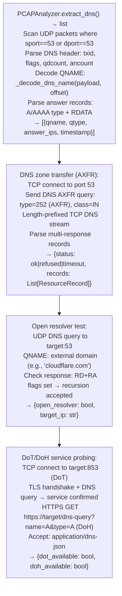

# DNS Service Posture

Extract DNS query and response records from packet captures, probe authoritative nameservers for zone transfer acceptance (AXFR), test resolver recursion for open resolver status, and detect DNS-over-TLS (DoT, TCP/853) and DNS-over-HTTPS (DoH) service exposure — providing a complete DNS infrastructure posture assessment — via `modules/network_analyze.py` `PCAPAnalyzer` and `ICMPScanner`.

---

## Why this exists

1. **`PCAPAnalyzer.extract_dns()` parses DNS query/response records from a PCAP file** — it decodes the DNS label-encoded QNAME from UDP port 53 packets, extracts A and AAAA answer records, and builds a `{domain: [ip, ...]}` resolution map. For incident response, this provides the complete DNS query history from a captured network session without requiring access to the DNS server's query log.

2. **Zone transfer (AXFR) testing** — a DNS zone transfer request (`dig AXFR @ns1.target.com target.com`) to the target's authoritative nameserver reveals every DNS record in the zone: all A/AAAA, MX, CNAME, SRV, and TXT records. Misconfigured nameservers accept AXFR from arbitrary IP addresses, exposing the complete internal DNS namespace. `network_analyze.py` raw socket DNS query construction sends a TCP AXFR request and parses the multi-message response.

3. **Open resolver and DoT/DoH probing** — an open recursive resolver (`dig +recurse @target_ip 8.8.8.8`) accepts recursive queries from any source, making it a DNS amplification vector. `ICMPScanner` confirms DNS port reachability; the DNS probe verifies recursion acceptance by sending a query for an external domain. DoT (TCP/853) and DoH (`https://host/dns-query`) service existence is tested by TCP connect and HTTPS GET respectively.

---

## How it works



---

## Usage

```python
from modules.network_analyze import PCAPAnalyzer, analyze_pcap

# Extract DNS from PCAP
analyzer = PCAPAnalyzer.from_file('capture.pcap')
dns_records = analyzer.extract_dns()
print(f"DNS queries: {len(dns_records)}")
for r in dns_records[:10]:
    print(f"  {r['qname']} → {r.get('answer_ips', [])}")

# DNS posture summary via analyze_pcap
summary = analyze_pcap('capture.pcap')
dns_map = summary.get('dns_queries', {})
print(f"Unique domains resolved: {len(dns_map)}")
```

---

## Example output

The following illustrates DNS service posture output format.

```
PCAPAnalyzer.extract_dns: capture.pcap

DNS queries: <N>

  api.internal → 10.0.1.50
  db.prod.internal → 10.0.2.100
  ldap.corp.internal → 10.0.3.10

Zone transfer (AXFR) @ns1.target.com:
  REFUSED  (properly configured — AXFR denied)

Open resolver test:
  10.0.0.1: open_resolver=False  (recursion bit not set)

DoT (TCP/853): closed
DoH (https://10.0.0.1/dns-query): 404 (not available)
```

---

## False positives

**`extract_dns()` captures recursive queries only** — in environments using DNS-over-TLS or DNS-over-HTTPS exclusively, no plaintext DNS traffic will appear in the PCAP. An empty DNS record list means either no DNS activity occurred or all DNS was encrypted; check DoT/DoH service presence before concluding DNS is absent.

**AXFR refusal interpretation** — a nameserver that returns `REFUSED` for AXFR is correctly configured, not necessarily indicative of a finding. Document the result as a positive security control, not a gap.

---

## Pipeline position

Run DNS extraction on any PCAP obtained during network capture to build the internal namespace map. AXFR testing applies to authoritative nameservers discovered from the DNS map. Open resolver testing applies to DNS service IPs observed in the ARP/routing tables.

---

## See also

- [PCAP Inspection](pcap-inspection.md) — full PCAP analysis including credential extraction and HTTP logging
- [Local Network Inventory](local-network-inventory.md) — interface and routing table discovery identifying DNS server IPs
